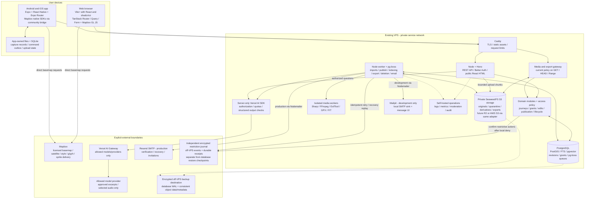
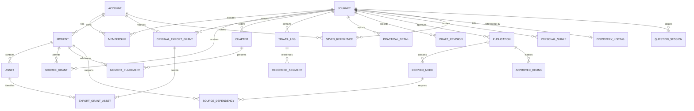
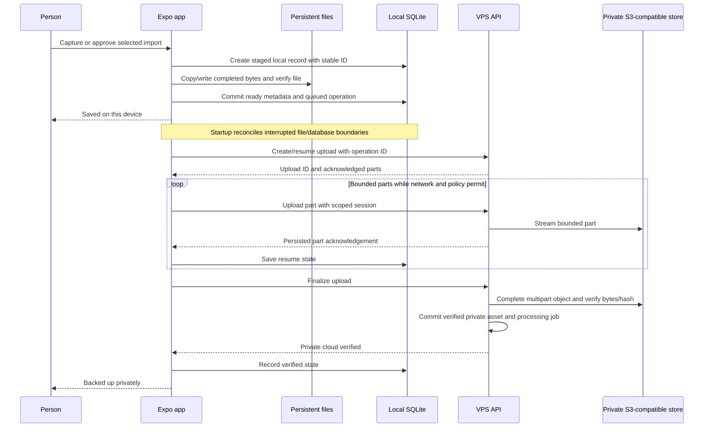
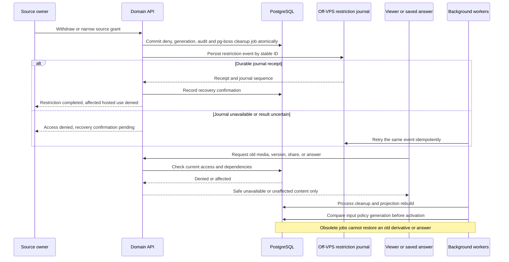
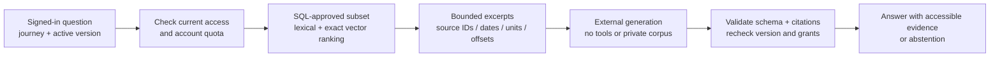

# Application architecture and technology decisions

| Field | Value |
|---|---|
| Version | 1.6 |
| Research date | 1 November 2026 |
| Status | Architecture baseline for the complete R1 product, reconciled with requirements version 2.3 and design version 1.4. No application has been implemented or load-tested. |
| Product authority | [Product requirements](product_requirements.md), [product plan](product_plan.md), and [application design](application_design.md). Requirements take precedence. |
| Confirmed platform choices | Vite+ with React and TanStack for web. Expo/React Native Android and iOS development and local testing now; Android public mobile distribution first. Apple enrollment and iOS public distribution deferred. No EAS subscription during development. |
| Confirmed styling | Tailwind/shadcn on web; React Native Unistyles v3 on Android and iOS, backed by the shared design tokens. NativeWind is excluded. |
| Confirmed email choices | Mailpit in development and Resend in production. |
| Selected maps | Mapbox GL JS on web and Mapbox native SDKs through the community React Native bridge. One provider supplies basemaps and satellite imagery. |
| Confirmed file storage | SeaweedFS with an S3-compatible application interface and S3 client, to support a future R2/AWS S3 migration. |
| Launch cost assumption | At most 10,000 people initially. Map openings per person, platform mix, and weighted tile use remain modeled inputs, not measured traffic. |
| Canonical stack location | Section 14 is the sole current technology/dependency register. Other sections explain behavior and alternatives; research files are dated evidence, not additional install lists. |
| Confirmed hosting boundary | Existing VPS hosts the application and stored application data. External AI, transcription, and map APIs are permitted. Budget is not the immediate constraint. |
| Unconfirmed infrastructure | VPS operating system, CPU, RAM, disk, region, existing workloads, launch traffic, and off-VPS backup/journal destination. |
| Decision meaning | Recommendations below guide implementation. Numerical limits and operating targets are proposed defaults until measured and adopted. |

## Contents

1. [Recommended architecture](#1-recommended-architecture)
2. [Product constraints that determine the design](#2-product-constraints-that-determine-the-design)
3. [Competitor evidence and lessons](#3-competitor-evidence-and-lessons)
4. [Overall architecture](#4-overall-architecture)
5. [Module ownership and repository structure](#5-module-ownership-and-repository-structure)
6. [Data model and invariants](#6-data-model-and-invariants)
7. [Web, mobile, and TanStack decisions](#7-web-mobile-and-tanstack-decisions)
8. [Durable capture, import, and synchronization](#8-durable-capture-import-and-synchronization)
9. [API, authentication, and shared editing](#9-api-authentication-and-shared-editing)
10. [Media, route processing, and reconstruction](#10-media-route-processing-and-reconstruction)
11. [Publication, access, and revocation](#11-publication-access-and-revocation)
12. [Maps and external processing](#12-maps-and-external-processing)
13. [Search, transcription, and grounded answers](#13-search-transcription-and-grounded-answers)
14. [Canonical stack and dependency register](#14-canonical-stack-and-dependency-register)
15. [VPS deployment and operations](#15-vps-deployment-and-operations)
16. [Implementation dependencies and release evidence](#16-implementation-dependencies-and-release-evidence)
17. [Requirement coverage](#17-requirement-coverage)
18. [Open decisions](#18-open-decisions)
19. [Research record](#19-research-record)

## 1. Recommended architecture

Build a TypeScript modular monolith with separate HTTP and background-worker processes. PostgreSQL owns canonical journeys, permissions, revisions, publication pointers, search, and durable jobs. Private SeaweedFS object storage on the VPS holds originals and generated files behind an S3-compatible interface and authenticated media gateway. Docker Compose and Caddy run and expose the application. S3 portability is an explicit requirement so file storage can later move to R2 or AWS S3 without rewriting the domain/media API.

Keep Expo and React Native. Their native camera, audio, SQLite, filesystem, and foreground-location support match the agreed product. Use locally compiled development builds for Android and iOS because native map modules and any platform transfer module require compiled native code. No EAS subscription, hosted build, update service, or cloud simulator is required during development. Apple Personal Team supports bounded local-device testing; defer Apple enrollment and iOS public distribution. A browser PWA cannot replace the required native capture durability. Kotlin is the fallback for a demonstrated Android integration problem; Flutter adds another language without solving a known requirement. [Expo build options](https://docs.expo.dev/deploy/build-project/), [mobile development plan](../implementation/mobile_development_plan.md).

Use Vite+ as the web toolchain, with React, shadcn/ui, and TanStack Router. Vite+ owns development, building, tests, linting, formatting, and task execution; it does not replace React or TanStack routing. Render approved public stories to HTML so reading and safe social metadata do not wait for the map or client JavaScript. Use TanStack Query and Form in both clients. Keep native navigation in Expo Router.

Use Mapbox for web and native maps, basemap delivery, and satellite imagery. The web uses Mapbox GL JS directly; Expo uses the community React Native bridge to Mapbox's native SDKs. Journey geometry and permissions stay on our VPS. This replaces the previous MapLibre/MapTiler selection. The modeled 10,000-person launch fits Mapbox's included map-load/native-user allowances under the assumptions in the [map cost comparison](../research/architecture/map_cost_comparison.md).

Use Vercel AI SDK on the server and Vercel AI Gateway as the actual hosted model gateway. The SDK is an open-source library; the Gateway is a separate external service that can be called from the VPS. Keep selected source files, transcripts, embeddings, question sessions, and retrieval indexes on the VPS. Send only authorized task inputs through the Gateway to explicitly allowed model providers. Use one SMTP transport with Mailpit locally and Resend in production.

All selected products, libraries, versions, service boundaries, and installation stages are consolidated in [section 14](#14-canonical-stack-and-dependency-register).

### 1.1 Architecture decisions

| ID | Decision | Why it fits this product | Alternative and reconsideration trigger |
|---|---|---|---|
| ADR-01 | Modular monolith with isolated workers | Membership, source grants, publication, and withdrawal need consistent transactions. Parsing and video conversion need separate resource limits. | Extract a service when measured isolation, scaling, or team ownership requires it. Independent domain microservices are unnecessary initially. |
| ADR-02 | PostgreSQL with PostGIS, full-text search, and pgvector | One store covers relational authority, route operations, catalog filtering, and journey-scoped retrieval. | Add a search service only when measured query volume or relevance exceeds PostgreSQL's suitable workload. |
| ADR-03 | REST with OpenAPI and generated clients | Installed mobile versions outlive web deployments. Explicit wire contracts support that release skew. | tRPC is credible for a TypeScript monorepo, but compile-time sharing does not make older installed clients compatible. GraphQL adds no demonstrated R1 need. |
| ADR-04 | SQLite plus persistent files and an application sync protocol | A completed capture must survive offline operation, process death, retries, and expired picker access. | Evaluate a sync engine only if it supports these media, grant, conflict, and revocation rules. Query caching alone is insufficient. |
| ADR-05 | Expected revisions and retained conflicts | R1 requires stale-edit detection and recovery, with character-level live coediting deferred. | Add CRDT editing only after the product adopts simultaneous text editing. |
| ADR-06 | Stable approved snapshots with current access checks | Draft edits stay private. Withdrawals and takedowns must override every old version. | Public immutable buckets or permanent asset URLs cannot satisfy this access model. |
| ADR-07 | pg-boss with direct transactional enqueue | Its shipped Drizzle adapter lets domain writes and jobs commit together. No separate generic outbox dispatcher or Redis service is needed. | Add an outbox only for a distinct destination that cannot participate in this database transaction. |
| ADR-08 | SeaweedFS plus a narrow S3-compatible storage adapter | The user explicitly prioritizes a future R2/S3 migration. Keep logical object identities and current rights checks independent of endpoints. | Migration changes the storage location/configuration and copies verified objects. Provider-specific API behavior still needs conformance tests. |
| ADR-09 | Vite+ React creator app and a narrow public renderer | Keeps the chosen toolchain and server-rendered reading. Rendering integration remains an explicit maintenance cost. | Revisit TanStack Start when its selected Vite+ Node deployment path is supported without an unaccepted prerelease. |
| ADR-10 | Mapbox SDKs and Mapbox basemaps/satellite | One provider covers the required web/native rendering and imagery. SDK pricing suits the modeled launch, and our journey overlays need no routing or hosted tileset service. | Qualify the community native bridge, actual usage, coverage, attribution, and terms during implementation. Reconsider only for a demonstrated integration, coverage, or operating problem. |
| ADR-11 | Vercel AI SDK plus hosted AI Gateway | One SDK handles bounded generation, embeddings, and transcription; one actual gateway handles provider routing. VPS deployment remains independent of Vercel hosting. | Use a self-hosted gateway if operational/privacy needs require owning that proxy. Avoid two SDKs or gateways for the same work. |
| ADR-12 | Nodemailer SMTP with Mailpit/Resend | One transport implementation supports the confirmed development and production choices. | Add a Resend HTTP SDK only if a required API-only capability appears. |

### 1.2 Whole-system alternatives considered

| Candidate | Benefits | Cost for these requirements | Decision |
|---|---|---|---|
| TypeScript modular backend, PostgreSQL, private S3 objects, workers, explicit client sync | One permission authority, portable deployment, shared contracts, independently bounded heavy work. | Own the upload/sync protocol, viewer-safe projection, and public rendering integration. | Recommended. |
| Self-hosted Supabase plus React and Expo | Packaged authentication, PostgreSQL, storage, and realtime. | More services to operate. Its packaged APIs still require custom source grants, publication snapshots, dependency invalidation, and mobile file/outbox handling. | Viable, but adds machinery without removing the difficult product rules. |
| Full local-first replication with CRDT documents and a sync service | Attractive reactive collaboration and offline documents. | Must govern replicated private material, revoked grants, media durability, schema evolution, and approved snapshots. Character-level collaboration is outside R1. | Defer until a demonstrated need outweighs the additional sync authority. |

### 1.3 Convex Cloud and self-hosted Convex

Convex is a credible whole-backend alternative. It supplies typed TypeScript queries/mutations, reactive subscriptions, optimistic updates, transactional database functions, atomic scheduling, file storage, text/vector search, and workflow components. Shared drafts and job status could update with substantially less subscription and cache-invalidation code. Its transaction retry machinery still does not replace our user-visible expected-revision conflicts. [Convex overview](https://docs.convex.dev/understanding/overview), [atomic scheduling](https://docs.convex.dev/scheduling/scheduled-functions).

| Concern | Convex Cloud | Self-hosted Convex | PostgreSQL architecture selected here |
|---|---|---|---|
| Hosting and operations | Provider operates the function/database service, moving app data off the VPS. | Respects VPS ownership, but we operate backend/dashboard, persistence, auth configuration, updates, and recovery. | We operate PostgreSQL, Node HTTP/worker, and private SeaweedFS objects. |
| Online collaboration | Reactive consistent queries, generated calls, and optimistic UI reduce client/backend plumbing. | Same programming model, subject to the chosen server build and supported feature set. | Focus refresh and a durable change feed/polling; no claim of equivalent automatic reactivity. |
| Native offline capture | Camera bytes and acknowledged work surviving process death still need durable local files/SQLite or a separately verified sync solution. | Same. | Explicit local file/outbox protocol remains required. |
| Media processing | Bounded actions suit API calls; isolated FFmpeg/parsing still need an owned worker. | A colocated worker remains a distinct execution responsibility. | The existing worker directly coordinates bounded media jobs. |
| Revocable media | Direct storage URLs are bearer access. Authenticated HTTP delivery is possible, with a documented response-size limit. | Same API design issue; local hosting does not make direct URLs recheck source grants. | Gateway checks current grants for each managed read/range without handing out a raw storage URL. |
| Geography | Point-geospatial tooling exists; route clipping, simplification, and geodesic calculations need custom processing or another service. | Same application APIs. Internal PostgreSQL persistence does not expose documents as PostGIS/Drizzle tables. | PostGIS works directly on canonical route/evidence data. |
| Search and jobs | Integrated text/vector search, scheduling, and workflow components can remove separate integrations. | Useful consolidation, with self-hosted upgrade/backup responsibility. | PostgreSQL search/vector data and pg-boss share the transactional authority. |
| Adoption result | Requires changing the confirmed app/data hosting preference. | Viable, but less infrastructure relief than Cloud and still needs the worker/gateway/native sync. | Retained for this R1 product after pruning unused services. |

Convex's file-serving guide states that anyone holding a generated URL can read it. Authenticated HTTP actions currently limit a response to 100 MiB; our proposed 150 MiB video ceiling would require bounded range/chunk delivery or the existing external media gateway. This is a design constraint to solve, not proof that Convex cannot support video. [File-serving documentation](https://docs.convex.dev/file-storage/serve-files).

Self-hosted Convex can use SQLite or PostgreSQL/MySQL internally, but that persistence database is not a normal SQL API for our application. Do not attach Drizzle/PostGIS to its internal tables. Its backend uses a fair-source FSL license, distinct from the Apache-2.0 client package, and self-hosted binary releases must be pinned independently of the client version. [Persistence guide](https://github.com/convex/convex-backend/blob/main/self-hosted/advanced/postgres_or_mysql.md), [backend license](https://github.com/convex/convex-backend/blob/main/LICENSE.md).

Do not add Convex beside PostgreSQL only for realtime. That would introduce two data authorities and another permission-revocation/recovery path. Reconsider Convex as a whole-backend choice if online reactive collaboration becomes a stronger product priority and the remaining media/runtime/hosting trade-offs are accepted. The [Convex review](../research/architecture/revision_convex_review.md) records current versions, limits, backups, auth, and the benefits that would genuinely reduce our code.

### 1.4 Challenges to the previous design

| Earlier decision | Finding | Revision |
|---|---|---|
| Standalone Vite/Vitest/Biome and possible Turbo | Vite+ already supplies the corresponding build/test/check/task tools. | Use its supported toolchain and required compatibility aliases. Remove parallel toolchains from the install plan. |
| Removing SeaweedFS/S3 for a filesystem-only store | Reduced service count, but does not satisfy the user's now-explicit storage-portability choice. | Retain SeaweedFS and the S3 client. Keep a small portable API subset and current authenticated media delivery. |
| Generic outbox plus pg-boss dispatcher | The selected pg-boss release includes a real Drizzle transaction adapter. | Enqueue directly in the same transaction. Keep audit/change records for their separate product purpose. |
| Provider-specific AI SDK only | It does not supply the desired common model interface and actual gateway service. | Select Vercel AI SDK + AI Gateway, with explicit providers, retention controls, and no silent cross-model fallback. |
| Every evaluated package in a version table | Optional choices looked like dependencies we planned to install. | Section 14 now lists selected dependencies and their stage. Historical comparisons are linked evidence only. |
| Custom public SSR | Avoiding a prerelease still creates rendering/hydration maintenance. | Retain one bounded renderer, test request isolation and the real production build, and keep the Start adapter trade-off visible. |
| Broad RLS ambition | Complex policies can duplicate business authorization or recurse. | Use one domain policy and least-privilege roles. Add tested table-level RLS where it provides clear defense in depth. |
| MapLibre/MapTiler as the initial map stack | Mapbox supplies the required rendering, basemaps, and satellite imagery with lower modeled launch charges. No measured coverage winner has been established. | Select Mapbox web/native SDKs. Remove the previous renderers and other provider integrations from the install plan. Qualify representative Indian journeys and the community native bridge. |

## 2. Product constraints that determine the design

| Requirement | Architectural consequence |
|---|---|
| One event, five participants, one canonical journey | Membership/history, public profiles, bookmarks, listings, and personal shares reference one journey ID. They do not copy it. |
| Capture survives offline use and restart | Persist a file and a recoverable SQLite record before acknowledging success. Maintain an explicit outbox and startup reconciliation. |
| A member can contribute without publishing | Keep ownership, journey-review grants, publication reuse, editing capabilities, and publishing capabilities separate. |
| Ordinary edits stay private until republishing | Draft revisions and approved versions are separate records. Readers resolve an active approved pointer. |
| Withdrawal overrides old versions and answers | Record source dependencies, commit an authoritative deny, and recheck current policy at every managed delivery point. |
| Optional GPS and truthful geography | Preserve segmented recordings, missing timestamps, participant branches, estimated geometry, and unknown gaps independently. |
| Story must load before maps and heavy media | Server-render useful public text, serve derivatives progressively, and lazy-load map/player code. |
| Historical, source-grounded learning | Store observation dates, units, source evidence, and accessible citations. Keep current-world browsing out of journey answers. |
| Complete R1 build | Search, questions, export, lifecycle controls, moderation, and operations are required workstreams. Internal build order is not a reduced public release. |

No continuous recorder, background location tracking, navigation, SOS, bookings, social feed, preparation planner, independent participant stories, or per-share answer indexes enter this architecture.

## 3. Competitor evidence and lessons

The research covers every competitor, substitute, and adjacent file ecosystem named in the product documents. Five products disclose useful technology directly. Product behavior supplies design lessons; it does not establish private schemas, service boundaries, deployed versions, or reliability.

### 3.1 Published stack evidence

| Product | First-party technology evidence | What it supports here |
|---|---|---|
| Render My Trip | Supabase database/auth/photo storage, Cloudflare hosting/scripts, several map providers, and OSRM. [Privacy statement](https://rendermytrip.com/privacy). | Distinct application, object, map, and processing responsibilities. Its service list does not identify its frontend framework. |
| RouteTale | S3-compatible storage, MapTiler, Resend, Sentry, PostHog, and Paddle. [Privacy policy](https://routetale.app/privacy/). | Object storage and external service adapters. API framework, database, renderer, and AI architecture remain unknown. |
| Polarsteps | React/TypeScript web; Python, PostgreSQL/RDS, AWS, and S3 infrastructure. [Frontend role](https://careers.polarsteps.com/vacancies/(senior)-frontend-engineer), [infrastructure role](https://careers.polarsteps.com/vacancies/senior-devops-engineer). | Separate web, mobile, and backend concerns are credible. Bonus skills in a vacancy do not confirm deployed tools. |
| TravelMap | MapLibre GL JS, PMTiles, Laravel/PHP, Vue, SolidJS, Tailwind, FilePond, and Quill. [Technical credits](https://travelmap.net/credits). | Strong direct precedent for open map rendering and independent basemap delivery. Database and service topology remain unknown. |
| Wanderlog | TypeScript, React web, React Native mobile, Node/Express; selective Redis, Elasticsearch, and Python. [Engineering role](https://wanderlog.com/blog/jobs/full-stack-engineer/). | Closest documented language/client family to our proposal. It does not establish Expo use or justify copying its infrastructure scale. |

### 3.2 Complete comparison coverage

These consequences are our design inferences. The [full competitor evidence matrix](../research/architecture/findings_competitors.md) supplies primary sources and uncertainty for each row.

| Product or substitute | Capability or constraint considered | Architecture consequence |
|---|---|---|
| Render My Trip | Map stories, photo placement, playback, revocable links. | Separate source originals from approved media and viewer delivery. |
| RouteTale | Broad imports, asynchronous processing, interactive publishing and exports. | Bound import jobs; keep heavy rendering away from readable Story. |
| Polarsteps | Shared-trip contributions and overlapping text edits. | Revision-aware writes, retained conflicts, and explicit administration transfer. |
| FindPenguins | Shared trips, departure without deleting others' work, restrictive route import. | Separate membership lifecycle from ownership; retain valid untimestamped geometry. |
| TravelMap | Multiple route segments and continued content access after paid expiry. | Preserve source geometry and define funded retention terms. |
| AllTrails | Dated reports, conditions, practical details, and reviews. | Observation dates, sources, and moderation; no invented current conditions. |
| BrightBlaze | Group preparation and advertised offline/PWA use. | Explicit persistence and sync design; preparation stays later. |
| Packalong | Local-first packing/expenses, shared trips, and copied trip data. | Distinguish shared references from copies; no packing or settlement scope. |
| Wanderlog | Shared view/edit planning and React/React Native delivery. | Share contracts and logic while keeping platform UI separate. |
| Google Photos | Shared media and independent saved copies. | Preserve ownership and explain the external-copy limit of revocation. |
| Google Docs/Drive | Role permissions and ownership transfer. | Separate capabilities and require accepted administrative transfer. |
| Group chat, including WhatsApp | Familiar media exchange; export details not verified in this pass. | Manual file selection, no promised chat ingestion or metadata restoration. |
| Blogs, including WordPress | Readable publishing, drafts, roles, and revision history. | Strong default story layout and deliberate publication, without a page builder. |
| Video, including YouTube | Media playback, captions, and time-linked source access. | Async transcripts and user-started media with readable alternatives. |
| FarOut | Guides, waypoint lists, offline maps, and recent reports. | Map-independent reading and dated source context; no navigation promise. |
| Indiahikes | Logistics references and official operational updates. | Separate participant reports from linked dated official information. |
| TrekYatra | Advertised Indian trek information and AI planning. | Ground answers in one approved journey; do not assume an empty market. |
| TrailScout | Advertised trail guides, tracking, group location, and SOS. | Keep those capabilities outside our capture-only location boundary. |
| GOTOES | File merging, conversion, repair, and timestamp tools. | Reliable imports with clear failures, without manufacturing measurements. |
| Garmin FIT ecosystem | Official format, SDK, and tools. | Use a maintained decoder with its actual license and bounded parsing. |
| Strava export/API ecosystem | Original/FIT and GPX acquisition; separate API terms. | Manual import is R1. Direct integration and API-derived data rights need a later review. |

RouteTale's import help and privacy policy conflict about direct Strava integration. Treat that capability as unresolved. No reliable first-party complete stack was found for the remaining products. Their internals are deliberately marked unknown in the supporting research.

## 4. Overall architecture



The Node service is one deployment unit containing domain modules, HTTP transport, and public rendering. The media gateway can be a separate process using the same policy implementation if traffic warrants it. Workers reuse domain policy where appropriate but run slow operations outside request handling. The operations box describes responsibilities, not a requirement to install every monitoring component on a small VPS.

Public clients never connect directly to PostgreSQL or the private object store. The upload path is a bounded authenticated gateway. Caddy exposes no raw bucket/object route that bypasses source permissions. Basemap traffic goes directly to the provider under its terms; journey geometry remains an application payload. Mailpit runs only in development, and no Vercel app hosting is required to use AI Gateway.

The restriction journal can use the off-VPS backup destination once configured, through a separate append/checkpoint interface and retention policy. It preserves restrictive events outside the database's rollback point. It is a recovery record, not another live journey database. Section 15.4 defines receipts, pending confirmation, replay, and closed recovery access.

## 5. Module ownership and repository structure

### 5.1 Domain responsibilities

| Module | Owns | Representative operations |
|---|---|---|
| Identity | Auth integration, private/public profile separation, sessions, recovery. | Register, recover account, revoke device session, select public profile fields. |
| Journeys | Canonical event, membership references, invitations, capabilities, archival. | Create, join once, change capability, accept transfer, leave. |
| Sources | Personal moments, originals, provenance, sharing/export grants, uploads, source withdrawal. | Begin/finalize upload, contribute, narrow grant, grant/revoke recipient-specific original export, compute removal impact. |
| Editorial | Chapters, moment placement, narrative blocks, revision history and conflicts. | Apply an expected-revision command, compare candidates, restore with current grants. |
| Geography | Stops, segments, participant legs, geometry provenance, statistics. | Normalize recording, associate a moment, select primary track, redact geometry. |
| Knowledge | Dated practical details, author reports, reviewable extraction. | Confirm a sourced cost, amend a report, inspect source dependency. |
| Publication | Review blockers, safe projection, approved version, visibility, source manifest. | Preview, publish, republish, unpublish, invalidate affected derivatives. |
| Sharing | Approved personal selections, hosted links, static cards. | Select eligible highlights, generate card, revoke hosted presentation. |
| Discovery | One listing per event, moderation, filters, saved references, profile eligibility. | Submit listing, review/report/remove, save private note, reference a future event. |
| Answers | Approved chunks, embeddings, question sessions, citations and abstention. | Index approved passages, retrieve within a journey, validate and serve an answer. |
| Lifecycle and operations | Export, deletion, retention, audit, quotas, notices, job support, restriction-journal receipts and recovery. | Export permitted sources, confirm journal persistence, purge eligible data, replay restrictions before enabling restored access. |

Each module hides its database queries and policy decisions. HTTP handlers call a complete domain operation instead of coordinating grants, file writes, publication updates, and audit records themselves. Workers call explicit operations such as generating a proposed derivative or finalizing a publication. They cannot directly mark arbitrary files public.

### 5.2 Monorepo layout

```text
apps/
  web/                 Vite+ React creator and public renderer/client entries
  mobile/              Expo native screens, capture, SQLite, sync engine
  server/              Hono API, auth, public HTML, upload/media gateway
  worker/              Node pg-boss consumer, media jobs, AI and email calls
packages/
  contracts/           Zod wire schemas, OpenAPI, generated client types
  backend/             Server-only domain modules, policy, Drizzle data and jobs
  shared/              Pure chronology, evidence, money, and URL-selection rules
  sync-protocol/       Versioned commands, acknowledgments, conflicts, tombstones
  design-tokens/       Existing palette, fonts, spacing, radii, motion tokens
tests/fixtures/        Consented media, GPX/FIT, permission and answer corpora
infra/
  compose/             Service definitions, health checks, resource limits
  images/              Reproducible server and sandbox worker builds
  operations/          Backup/restore, release, moderation, and incident runbooks
docs/
```

Use pnpm workspaces through Vite+'s package-management and task commands. Keep web/native UI components inside their applications until actual cross-application reuse warrants a package. Do not add a second monorepo task runner. Clients may import contracts and pure rules, never database tables, server auth configuration, secrets, or backend repositories. Shared React code must not bundle another React. Mobile and web can resolve different SDK-compatible React versions.

## 6. Data model and invariants

### 6.1 Principal relationships



This diagram shows logical relationships, not finished SQL. A segment retains its imported-file identity and can be associated with multiple chapter/leg ranges through joins. Membership capabilities, leg participants, public-profile selections, invitation/transfer records, upload sessions/parts, answer citations, jobs, audit events, and dependency edges also need explicit records.

### 6.2 Storage rules

| Concern | Required representation and constraint |
|---|---|
| Identity | Client-generated UUIDs for offline objects and operations. Unique membership by account and journey; unique listing by journey; unique saved reference by account and journey. Historical participation does not bypass current access. |
| Roles | Separate administration, coauthoring, and publishing capabilities. Review of others' contributed sources and draft reads require active coauthor or publisher membership. Editing requires coauthor capability. Administration alone grants none of these data rights. The creator initially holds all three capabilities. |
| Source scope | A moment has an owner; each journey contribution has an explicit review or publication-reuse grant and revision. Absence of a grant means no journey access. Follow the requirements capability matrix. Withdrawal has its own durable deny record. |
| Original-file export | An owner-issued grant identifies its owner, active recipient member, journey, exact asset IDs, source-grant revisions, creation time, expiry, and revocation state. Asset membership is explicit, not an unbounded future-upload grant. Owner-only sources are ineligible. Generation and every managed download recheck all grant conditions. |
| Restriction recovery | Stable restriction event ID, ordered journal sequence, affected opaque IDs, restrictive operation, policy generation, integrity digest, and durable receipt. Commit the local deny/audit/retry job together; record independent off-VPS confirmation before reporting successful completion. Store no source media, text, or coordinates in the journal. |
| Time | UTC instant when known, original local timestamp/offset, IANA timezone context when known, source, confidence, and manual corrections. A missing timezone stays unknown. Capture, upload, entry, observation, and edit times are distinct. |
| Geography | PostGIS line segments and points with evidence category, accuracy, source file, participants when known, and correction provenance. Preserve raw samples separately from display simplification and redacted output. |
| Money | Exact decimal amount and currency code, with unit, group size, inclusions, observation date, and estimate flag. Decimal amounts cross JSON as strings. |
| Editing | Entity revision and journey draft generation. Retain changed blocks, actor, server time, base revision, and a candidate for conflicts. Reordering uses stable item IDs and explicit ordered membership. |
| Publication | Immutable approved content version, policy generation, redaction configuration, source/dependency manifest, derivative states, and one active pointer on the journey. Visibility and listing state are separate. |
| Personal shares | Journey ID, approved source version, eligible moment references, cover, approved attribution, and personal caption. No copied journey, chronology, listing, or retrieval corpus. |
| Derived claims | Every generated statement, thumbnail, transcript excerpt, practical suggestion, share card, or index chunk records its source dependencies and generation. An untraceable derived claim is ineligible for publication. |
| Questions | Account-scoped session, one journey, approved version/generation, prompt/model/retrieval revisions, citation records, and disclosed retention. Stored answers recheck current access. |
| Processing | Idempotency key, input hash/version, state, attempts, next retry, timeout, cancellation generation, output references, and safe error code. |
| Storage portability | Asset ID plus logical object key, storage-location ID, byte length, checksum, content type, and transformation/policy version. Bucket/endpoint/region/credentials belong to storage configuration; never persist expiring signed URLs as asset identity. |

Use foreign keys and uniqueness constraints for identity rules. Enforce unique grant/asset membership and valid source-owner, recipient, journey, and asset relationships. Validate current membership and grant revisions transactionally at use. Index permission joins and foreign keys used in access/deletion paths. Use B-tree indexes for journey/status/date filters, GIN for full-text search, trigram indexes where useful, and GiST for spatial queries. Start with exact vector ranking inside the authorized journey subset; introduce HNSW only after measuring it. Review PostGIS and vector SQL explicitly rather than forcing every operation into ORM helpers.

Apply row-level security to private domain tables as defense in depth. Use non-owner runtime roles without `BYPASSRLS`, transaction-local verified account context, and `FORCE ROW LEVEL SECURITY` where appropriate. Application policy still decides publisher capability, source reuse, and viewer projections. Keep auth-library tables under their own least-privilege access strategy; do not assume a generic journey RLS policy fits authentication internals. Never accept account context from request JSON. [PostgreSQL row security](https://www.postgresql.org/docs/18/ddl-rowsecurity.html).

## 7. Web, mobile, and TanStack decisions

### 7.1 Vite+ and web delivery

Use Vite+ for the React application's development, client/server builds, tests, static checks, formatting, and workspace tasks. Use its supported config and test import entries, `vp dev`, `vp build`, `vp check`, `vp test`, and `vp run <task>`. Enable both type-aware and type-check options for the intended static checks. Expo Metro and native builds remain separate tasks. No application is being scaffolded by this planning update. [Vite+ guide](https://viteplus.dev/guide/), [checks](https://viteplus.dev/guide/check).

Keep the React and TanStack Router plugins. Preserve Vite+'s package-manager overrides so plugins resolve one Vite core and runner. The aliased core's package version differs from its bundled Vite version, so preserve the CLI-generated scoped Vite peer exception too. Do not ignore unrelated peer errors. The canonical register records this supported compatibility convention; it is not a claim that the raw alias satisfies every ordinary Vite semver range. [Local CLI and compatibility setup](https://viteplus.dev/guide/local-cli).

Build two entries from shared web components:

- The creator application uses TanStack Router and Query, with validated URL state for journey, view, chapter, moment, and filters. Private data loads only after verified access.
- A bounded public React renderer in the Node service resolves the approved journey and typed URL selection, then renders useful story HTML and safe Open Graph metadata. Its client entry hydrates the same component tree and progressively adds map, playback, source, and question controls.

Use one viewer-safe data contract and component family for public rendering and publisher preview. Ordinary links preserve view/chapter selection and work before client enhancement. Keep server rendering limited to this approved reader rather than building a general rendering framework. Use Vite+'s production client/server builds and manifest, request-local rendering/Query state, safe serialization, and the actual Node entry. Its development server never serves production traffic. [Vite SSR integration](https://vite.dev/guide/ssr).

Initialize a map only on an explicit map action, such as opening Explore, opening the route editor, or choosing to show a Story map. Story reading, scrolling, and idle time do not create a map instance or basemap requests. Reuse the current instance across chapter/style changes where appropriate.

This renderer is a cost the review has retained, not a free simplification. TanStack Start could remove custom routing/hydration work, but its currently documented Vite-to-Node deployment uses a prerelease Nitro adapter. Vite+ does not make that adapter stable. Revisit the maintained Start path when its compatibility/release policy is suitable. Until then, test production HTML/hydration, request isolation, lazy chunks, and unavailable metadata explicitly. [Start hosting](https://tanstack.com/start/latest/docs/framework/react/guide/hosting).

After revocation, server-render generic unavailable content and metadata. R1 uses `noindex` because external indexing is later scope. Unlisted credentials require access checks, safe logs, and a `no-referrer` policy; search-engine directives are not access control.

### 7.2 Native delivery and shared UI rules

Implement and locally qualify both native platforms during the current build. Windows/WSL owns development Compose services and containerized tooling; Windows native owns Android SDK/build/emulator/Metro; the 16 GB Mac owns Xcode/iOS build/Metro, with physical iPhone/iPad testing preferred and one simulator when needed. Production application/data hosting stays on the VPS. Accept the user's completed Mac compatibility check and record actual tool versions with the first build. The [mobile development plan](../implementation/mobile_development_plan.md) owns host networking, checkout isolation, memory management, free provisioning, T3 device setup, and deferred store verification.

Expo Router owns native screens/deep links. App-owned files and SQLite own captures, unsent edits, upload progress, and sync cursors. SecureStore owns session secrets. Query owns fetched server state with focus/connectivity integration. It never owns the only copy of a capture. [Query React Native integration](https://tanstack.com/query/latest/docs/framework/react/react-native).

Use owned shadcn components with Tailwind on web and React Native controls styled with **Unistyles v3** inside the Expo app. This is the confirmed mobile styling choice; do not introduce NativeWind. Share palette, typography, spacing, evidence language, and pure rules through the platform-neutral `design-tokens` package. Keep Unistyles configuration and styles inside `apps/mobile`; do not share DOM components or add native dependencies to the token package. Self-host the licensed Newsreader/Instrument Sans files. shadcn's primitive dependencies are selected by the components actually generated, not by installing every component. [shadcn introduction](https://ui.shadcn.com/docs), [Unistyles setup](https://www.unistyl.es/v3/start/getting-started/).

Unistyles enters the mobile foundation with its Nitro Modules dependency, the New Architecture, and a local development build. It does not run in Expo Go, so compiled builds are required before Mapbox is introduced too. Configure the supported Babel plugin with `babel-preset-expo`, a source root covering native components, and explicit processing of route files outside that root where necessary. Initialize the token-backed theme and breakpoints in a custom entry before importing `expo-router/entry` or any module creating a Unistyles stylesheet. Keep the experimental Metro integration out of the baseline and never enable both transform integrations. Import `StyleSheet` directly from `react-native-unistyles`, retain reactive styles through style arrays, and qualify themed props on Mapbox/other third-party native views. [Babel integration](https://www.unistyl.es/v3/other/babel-plugin/), [Expo Router initialization](https://www.unistyl.es/v3/guides/expo-router/).

CSS transitions cover the requested subtle web animation. Native uses built-in interaction primitives and the SDK-compatible navigation/gesture modules required by selected screens. Keep the design's reduced-motion behavior, modest transition durations, user-started playback, and map-independent reading. A separate web animation library is unnecessary initially.

### 7.3 TanStack dependencies with a current job

| Library | Product responsibility | Platform and installation stage |
|---|---|---|
| Router and its build plugin | Typed creator routes and validated view/chapter/moment URL state. | Web foundation. Expo Router handles native navigation. |
| Query | Fetched data, pagination, processing status, invalidation, account-scoped questions. | Web/native foundation; no durable-media or command-queue guarantee. |
| Form | Journey setup, practical details, permissions, and review forms using shared Zod inputs. | Add with those forms on web/native. |
| Table | Bulk-import review and moderation where sortable/selectable tables help. | Add with the web import/review workspace, not native screens. |

Versions live only in section 14. Virtualization remains a possible measured optimization, not an initial dependency. Start and AI are evaluated alternatives, not additional selected frameworks. The earlier [catalog research](../research/architecture/findings_clients.md) remains dated comparison evidence and is not a package installation list.

## 8. Durable capture, import, and synchronization

### 8.1 Local save protocol



Filesystem and SQLite writes do not form one atomic transaction. Use staged states, deterministic file paths, verification, and startup repair. A completed local save requires a durable file and committed metadata/outbox references. Clean orphaned temporary files only after reconciliation; preserve the last confirmed copy. Do not depend on picker cache files, an expiring content URI, or AsyncStorage for bulk media. [Expo SQLite](https://docs.expo.dev/versions/latest/sdk/sqlite/), [Expo FileSystem](https://docs.expo.dev/versions/latest/sdk/filesystem/).

Capture does not wait for location, upload, transcription, or AI. Bound the foreground location attempt and preserve its measurement age and accuracy. Denial, approximate access, a stale fix, or no result yields an explicit unknown/approximate state. There is no background location request or idle polling.

### 8.2 Sync protocol

Use stable client object IDs and command IDs, server revision expectations, an upload session with acknowledged parts, and a scoped incremental change cursor. The server records each accepted command result by account/device/operation identity. Retries return that result rather than repeating side effects. Deduplication lifetime must cover the supported offline-retry period; an expired command still meets unique object and revision constraints.

Persist progress after each acknowledged part. The gateway authorizes the request, streams the bounded part to the private S3-compatible store, and records its upload/part identity, length, and checksum. On restart, reconcile persisted state with the store's part listing. Finalization completes the multipart upload and verifies object size and a real whole-file checksum before committing the verified asset and processing job. Do not treat a multipart ETag or client-supplied metadata as a verified whole-file hash. If the provider cannot validate the required checksum, stream-read the completed private object for verification without buffering it in memory. Object completion and the database commit are not one atomic transaction; reconcile orphaned objects and incomplete metadata. Expired sessions explicitly abort unfinished multipart uploads. [Multipart upload behavior](https://docs.aws.amazon.com/AmazonS3/latest/userguide/mpuoverview.html).

Detect exact duplicate imports using a cryptographic content hash scoped to the owner and destination. Within that scope, reuse the verified asset/reference instead of counting a retry as another moment. Reusing an owner's asset in another journey still requires a distinct explicit grant. Never expose cross-owner hash matches or use a matching file to infer ownership, identify another person's upload, or grant access.

Sync changes include membership/grant changes, entity revisions, deletions, and access tombstones. A stale client that has fallen outside retained change history performs an authorized full resync without discarding unsent work. Revoked access stops uploads/contributions and clears cached shared data when the app reconnects. Offline devices and already downloaded files cannot be remotely erased; disclose that boundary.

Separate state axes rather than forcing them into one enum:

- Local persistence: staging, saved, missing, failed.
- Transfer: queued, uploading, paused, verified private cloud, failed, cancelled.
- Source access: owner only, journey review, publication reuse, withdrawn.
- Publication inclusion: absent, included in approved version, suppressed by current policy.

The interface uses the existing design's plain state names. Cancelling an upload preserves the local original. Explicit retry, Wi-Fi preference, quota waits, expired sign-in, and reselection of missing sources have visible states.

Foreground sync is the reliable default. Expo BackgroundTask is opportunistic, with Android scheduling controlled by the OS and a minimum periodic interval of 15 minutes. Force-stop can prevent execution until the app restarts. If required transfer behavior needs WorkManager or a foreground service, implement a bounded native Expo module inside this production application. Never promise immediate uploads after termination. [Expo BackgroundTask](https://docs.expo.dev/versions/latest/sdk/background-task/).

Apply the same durable outbox/retry contract on iOS, with its own OS scheduling and permission behavior. Android-specific transfer code does not establish iOS behavior. Test foreground retry, interruption, relaunch, and available background execution on the physical iPhone/iPad; do not promise immediate background completion on either platform.

### 8.3 Imports and web recovery

Use the Android system picker for selected photos/videos and document selection for audio/GPX/FIT. Copy approved selections into app-owned storage before queuing them. Recover Android picker activity results, including `getPendingResultAsync`, and report cloud-provider, expired-access, and individual codec failures. Date suggestions inspect permitted selected metadata locally before upload. Wider-gallery date discovery remains conditional and never silently uploads candidates. [Expo ImagePicker](https://docs.expo.dev/versions/latest/sdk/imagepicker/).

Use the corresponding iOS system media/document selection through the adopted Expo modules. Verify limited or denied access, cloud-backed selections, original metadata, and copying to persistent app-owned storage on iPhone/iPad. Native platform adapters share protocol/state rules without assuming identical permission or picker lifecycles.

For web drafts, use Dexie/IndexedDB to persist unsent text commands, base revisions, and supported selected-file state. Request persistent storage where available, show unsent edits, and provide recovery/export before destructive navigation. Browser eviction, cleared site data, and expired file handles limit guarantees. Reopening the browser may require reselecting an upload. Android and iOS are the declared durable capture platforms; Query's persisted cache is not a substitute for either client's outbox.

## 9. API, authentication, and shared editing

### 9.1 HTTP contracts

Use versioned `/api/v1` contracts, Zod validation, OpenAPI generation, and `openapi-typescript`/`openapi-fetch` clients. Keep wire schemas separate from database rows. Parse external input at the boundary and use explicit variants for evidence, missing time, access, and processing state. Authentication retains its own `/api/auth` handler.

| Operation | Contract behavior |
|---|---|
| Upload initiation/parts/finalization | Scoped session, quota reservation, acknowledged parts, checksum verification, one resulting asset. |
| Draft entity edit | Expected entity revision, command ID, validated patch, actor, and current access. |
| Publication request | Exact reviewed draft generation, source-grant/redaction generation, requested visibility, and publisher capability. |
| Incremental sync | Authorized changes/tombstones after an opaque scoped cursor, with explicit cursor-expired recovery. |
| Viewer read/source/media | Current active approved version and policy; generic unavailable result when inaccessible. |
| Question | Signed-in account, canonical journey and version, bounded question, authorized citations, rate/usage accounting. |
| Lifecycle action | Fresh session when appropriate, impact preview token tied to current state, explicit action, and auditable result. |
| Restrictive action completion | Immediate local deny. Report success only after the independent journal receipt; return a visible pending-recovery-confirmation state when persistence is incomplete. Retry by the same event ID. |

Use cursor pagination for histories, discovery, sources, and jobs. Use `ETag`/`If-Match` for entity revision checks, with `412 Precondition Failed` for a stale precondition and a retrievable conflict candidate. A semantic conflict can use `409 Conflict`. Errors follow RFC 9457 Problem Details without private fields. Return retry guidance for rate limits and processing states. [HTTP conditional requests](https://datatracker.ietf.org/doc/html/rfc9110#section-13.1.1), [Problem Details](https://www.rfc-editor.org/rfc/rfc9457).

Installed apps need compatible additive changes, explicit minimum-supported protocol versions, and versioned destructive changes. Validate old-client fixtures during server releases. A shared TypeScript build cannot test an already installed binary.

### 9.2 Authentication and permissions

Use Better Auth with PostgreSQL-backed sessions and the Expo integration. Start with verified email/password, email recovery, device-session revocation, and fresh-session checks for sensitive operations. Social login or passkeys can be added deliberately without changing journey identity. Native session secrets live in SecureStore; browser sessions use secure HttpOnly cookies. Keep CSRF and origin checks enabled, trusted origins exact, and reverse-proxy headers trusted only from Caddy. [Better Auth Expo integration](https://better-auth.com/docs/integrations/expo), [security guidance](https://better-auth.com/docs/reference/security).

Do not use an auth organization plugin as the journey authorization model. Evaluate membership capabilities, source ownership, source grants, publication visibility, active version, and takedown state server-side. Revoking a member blocks protected editing/export/share creation without claiming a public story is now secret from that person.

Use [requirements section 2.5](product_requirements.md#25-capability-and-source-access-matrix) as the authorization matrix. Active coauthors and designated publishers can review contributed sources and read the draft; only coauthors edit it. An ordinary participant has no review-pool or draft access. Source owners retain their own access and grant controls. Administration and publication never confer another contributor's raw-original export rights. Enforce the separate [original-file export contract](product_requirements.md#26-original-file-export-grants) on archive generation and managed downloads, including range requests.

Public reading and discovery stay account-free. Questions, bookmarks, private history, creation, contribution, and personal-share creation require sign-in. Unlisted links are forwardable bearer credentials, not member authentication. Generate high-entropy tokens, store their hashes, support rotation/revocation, and exclude them from analytics, logs, and referrers. Separate the discoverable public route from unlisted access resolution.

Rate-limit authentication, invitations, uploads, exports, public reads, reports, and questions. PostgreSQL-backed counters and Caddy connection/body limits are sufficient for the initial single-VPS topology. Reserve account-level usage before expensive jobs and reconcile actual usage afterward. Redis is not required just to introduce quotas.

### 9.3 Coauthor editing and notices

Use per-entity optimistic concurrency rather than one lock for the whole journey. Any accepted edit also advances the journey draft generation used by publication review. Store a revision or changed block and audit actor. On stale write, retain the attempted candidate in a separate committed conflict record, return the current value/base revision, and let the user compare, replace after rebase, or combine manually. Rejecting the update must not roll back the saved candidate too.

Autosave queues durable commands with explicit status. Network retries cannot silently replace another member's accepted changes. A restore creates a new revision and runs current source/grant checks; it never restores old permissions. Reordering, splitting/merging chapters, and changing source placement also use expected revisions.

Use a persistent in-app notice/change feed for invitations, withdrawal, conflicts, roles, publication, listing, and transfer. Poll on focus and at a modest interval. Optional SSE can improve online freshness, with authorization, reconnect, and polling fallback. A websocket service, presence system, or CRDT backend is unnecessary for R1 correctness.

## 10. Media, route processing, and reconstruction

### 10.1 Processing pipeline

After finalization, queue actual-type inspection and bounded metadata extraction. Preserve the original unchanged. Generate owner/private previews first; create public derivatives only under a valid publication job. Use deterministic keys containing source identity, input hash, transformation version, and policy generation.

Use Sharp for images, ExifTool for metadata, FFmpeg/ffprobe for media normalization, `fast-xml-parser` plus an owned GPX normalizer, and the official Garmin FIT decoder. The worker image's codec build determines accepted formats. JPEG/PNG/WebP, tested Android/iOS camera output in declared formats, supported MP4 clips, and M4A/MP3/WAV are the baseline. HEIC/HEIF, including iPhone/iPad inputs, remains disabled until the actual conversion build passes. Keep playable source media available when transcription fails.

Run untrusted decoders in non-root containers or sandbox processes with CPU, memory, wall-time, output-byte, and temporary-disk limits. Disable unnecessary network access and pass local paths through argument arrays. Reject XML DOCTYPE/entity declarations and impose depth/point limits before GPX normalization. Never pass a submitted URL to FFmpeg. The job coordinator, not an untrusted parser, receives AI credentials and external network permission.

Simple social cards use Sharp for approved photographs, bounded typography, and a safe SVG/text layer. Escape submitted text and disable arbitrary remote image/SVG references. No browser-rendering service or cinematic pipeline is required. Cards include approved attribution and a canonical journey reference. They omit basemap imagery by default because export rights differ from interactive rendering.

### 10.2 Route integrity

Retain GPX tracks and segment breaks, optional timestamps/elevation, and FIT activity provenance. Reject unsupported planned-route-only inputs clearly. A recording can span several chapters; a chapter can contain several recordings. Preserve a geometry-only track when time is missing. Do not fabricate timestamps, snap incompatible moments to a route, connect gaps, or infer that every contributor followed every leg.

Store recording distance separately from estimated transport distance. Select one primary recording for an overlapping group leg and retain alternatives without adding their distances again. Use geodesic calculations, preserve raw samples, and simplify a separate display geometry with a declared tolerance. Test antimeridian crossing, invalid coordinates, split parties, missing elevation, duplicate recordings, and large files.

Public redaction changes geometry, bounds, pins, precision, text, labels, thumbnails, and metadata before serialization. Hiding a marker in the UI is insufficient. A home location can also appear in an image or transcript; the privacy review must exclude that content when coordinate generalization alone cannot protect it.

### 10.3 Reconstruction

Implement deterministic chronology and grouping first, followed by bounded source-linked model suggestions. Retain input metadata, proposed values, evidence category, and accepted/rejected author corrections independently. Regeneration never overwrites an explicit author decision.

Represent recorded route, captured stop, author-reported travel, estimated connection, and unknown movement separately. A reported train leg need not have a line. Estimated provider geometry remains estimated. Rest days and missing recordings remain valid stages. Preserve participant-specific departure/return branches inside the same canonical journey. OCR, image-based place suggestions, and calculated routing stay conditional, with manual corrections and labelled gaps as the complete fallback.

## 11. Publication, access, and revocation

### 11.1 Publication transaction

The publisher reviews a viewer-safe preview identified by draft generation and current rights/redaction generation. A publish request verifies publisher capability, source grants, privacy blockers, and that exact reviewed generation. Generation changes return a review-required conflict instead of publishing unseen edits.

Generate a candidate approved manifest and redacted media outside a long database transaction. At activation, lock the relevant journey/publication state and recheck the draft and policy generations. Only then switch the active approved pointer atomically. Candidate artifacts stay inaccessible until activation. Failure leaves the previous approved version readable. Search/question indexing can remain explicitly pending, but may only serve ready chunks from the active version.

An ordinary draft edit does not affect readers. A grant narrowing, takedown, visibility restriction, or privacy removal immediately changes access to all affected versions. A late transcript or regenerated practical claim remains a draft/review artifact until explicitly included in an approved version.

### 11.2 Withdrawal and stale-job safety



Record source-to-derived-node dependencies across narrative, practical cards, transcripts, cover/thumbnail, geometry, shares, profile cards, catalog snippets, chunks, citations, and stored answers. On withdrawal, suppress affected nodes synchronously under the deny state. If dependency coverage is uncertain or removal leaves a misleading claim, temporarily deny the affected publication rather than serve a guessed safe fragment. Queue a repair notice and a clean rebuild.

All managed reads resolve current access, including HTML, API payloads, source details, GET/HEAD/Range media requests, old version IDs, hosted cards, export downloads, saved-reference previews, profiles, and stored answers. Stream private S3 objects only after policy checks; no public bucket or long-lived raw-object redirect bypasses the gateway. An image URL signature alone cannot override a later grant change. The same rule remains in force after an R2/S3 migration.

Begin R1 with no shared caching of rights-sensitive HTML, DTOs, or media. Use `private, no-store` where required. Static application assets can use long immutable caching. Internal derivative-byte caches may exist only behind a fresh authorization check; permission-positive cache entries cannot outlive the measured revocation target. Return generic unavailable states without a protected title, cover, dates, place, or roster.

Proposed controlled-infrastructure revocation target is at most 60 seconds, with committed denies blocking new origin requests immediately. Define and test in-flight response duration, range requests, client caches, and every later proxy/CDN rule before publishing that target. Bound media responses or reauthorize long streams. Already received bytes, external previews, screenshots, and downloaded cards cannot be recalled.

Local denial never waits for the off-VPS journal. Successful completion does require its durable receipt under section 15.4. A journal failure leaves the local restriction enforced, with visible pending recovery confirmation and an idempotent retry. This external persistence is not part of the PostgreSQL transaction; do not claim atomicity across them or hold that transaction open during network I/O.

### 11.3 Lifecycle distinctions

Leaving ends protected member authority; it does not automatically withdraw sources or delete the journey. Transfer requires the successor's acceptance. With no successor, freeze role expansion, new publication, and visibility widening, while retaining permitted reading/export under the disclosed recovery policy. Source owners can still withdraw or delete their material; authorised publishers/operators can still restrict visibility or take content down. Archive closes contribution deliberately. Unpublish denies managed publication access. A canonical deletion is a distinct privileged action that preserves other contributors' personal originals.

Export own originals and permitted structured story data without a payment gate. Raw originals from another contributor require an explicit export grant under requirements section 2.6. Generate archives as private jobs and record every included source/export-grant revision. Authorize generation and every download through the gateway. Expired or revoked grants, source changes, and recipient departure invalidate affected archives; late jobs cannot reactivate them. Account deletion, source deletion, object garbage collection, publication removal, and backup expiry each follow a disclosed retention schedule. Audit minimal necessary actions without retaining deleted private content indefinitely.

## 12. Maps and external processing

### 12.1 Selected Mapbox integration

Mapbox supplies the renderer, licensed basemaps, style resources, and satellite imagery for web and both native platforms. Use its web SDK directly in an owned React lifecycle component. On Android and iOS, the community React Native bridge embeds Mapbox's native Maps SDKs through an Expo config plugin. It requires development/native builds and does not run in Expo Go. The bridge is community-maintained, even though the underlying Maps SDKs are Mapbox's. Its broad Expo/React Native peer ranges are metadata evidence, not proof of compatibility with our complete mobile build. [Web styles](https://docs.mapbox.com/mapbox-gl-js/guides/styles/), [native bridge installation](https://rnmapbox.github.io/docs/install).

Section 14 owns package versions, native-engine defaults, and workspace constraints. Qualify Android and local iOS compilation, startup, lifecycle cleanup, gestures, style switching, attribution/telemetry controls, and memory on the selected devices as this production workstream is built. The bridge installation page describes an older package series, so the selected release's source and resolved native build take precedence over copied examples.

Mapbox does not replace our GPX/FIT parsers, PostGIS operations, capture storage, publication projection, source authorization, or timeline state. Serve authorized GeoJSON from our API and add it as local sources/layers. Do not upload journey routes or media into a provider-hosted tileset merely to display them. [Sources and layers](https://docs.mapbox.com/mapbox-gl-js/guides/styles/work-with-layers/).

### 12.2 Basemap, satellite, and journey behavior

| Capability | Selected behavior |
|---|---|
| Default map | Mapbox Standard in a restrained 2D configuration, with low visual competition from commercial POIs. No terrain/3D experience is required. |
| Satellite | User-selected Mapbox Standard Satellite in the same map instance. Retain useful labels, credits, journey overlays, stage selection, and camera context. No second imagery SDK is required. |
| Journey evidence | Solid recorded paths, dashed estimates, explicit gaps, attributed branches, and accessible moment markers. The provider's roads never become evidence of where a participant actually travelled. |
| Day selection and playback | Application-owned shared selection, user-started playback, and reduced-motion direct stage changes. Playback needs no Navigation SDK. |
| Style changes | Wait for style readiness, then restore or declaratively recreate sources, layers, marker images, and ordering. Preserve the selected stage and verify both styles on web/native. |
| Failure and accessibility | Complete ordered stage list with retry and readable Story/Learn. Basemap or satellite failure never blocks source review or publication controls. |

The styles are `mapbox://styles/mapbox/standard` and `mapbox://styles/mapbox/standard-satellite`. These are hosted style identifiers, not extra npm dependencies. Mapbox documents both styles for its SDKs. [Satellite web example](https://docs.mapbox.com/mapbox-gl-js/example/satellite-map/), [Android style selection](https://docs.mapbox.com/android/maps/guides/styles/set-a-style/).

Check consented Himalayan, Western Ghats, city, and transfer fixtures at overview/local zoom. Inspect path and contour availability, place-name language, remote coverage, imagery detail, border/worldview presentation, attribution, cold-load behavior, memory, and smoothness. Use a more suitable Mapbox style within the same integration if the default lacks required outdoor detail. No measured coverage winner or imagery-freshness guarantee has been established. An outage falls back to the stage list; there is no automatic second-provider integration.

The earlier Esri/open-renderer evaluation remains [historical research](../research/architecture/revision_maps.md). The [cost comparison](../research/architecture/map_cost_comparison.md) preserves alternative tariffs for future reassessment. Neither is an active dependency list.

### 12.3 Licensing, credentials, and privacy

Use separate restricted web/native public access tokens and the selected Mapbox account terms. Public rendering credentials grant no access to our journeys. Keep any secret SDK-download credential in the build environment, outside client bundles. Verify token/resource access for styles, tiles, glyphs, and sprites. Keep Mapbox branding, attribution, imagery credits, and required telemetry information/opt-out controls visible and accessible. The native bottom sheet must not obscure them. [Attribution requirements](https://docs.mapbox.com/help/getting-started/attribution/).

Keep source routes and permissions on our VPS. Direct map requests still reveal network metadata and requested map area to Mapbox, including in private views. Disclose that boundary. Send viewer-safe geometry to public clients and no private titles, source URLs, or unlisted tokens in provider referrers. Viewing historical routes does not require location permission or continuous tracking.

Vendor map tiles have separate caching, redistribution, and output rights. Do not mirror them into our S3 store or treat a screenshot as an unrestricted export. Photo/text share cards use our own approved media. Static map imagery and offline basemap packs are outside the current implementation. [Mapbox terms](https://www.mapbox.com/legal/tos).

### 12.4 External data boundaries

| Destination | Authorized input | Data we retain and control |
|---|---|---|
| Mapbox | SDK/style/basemap/satellite requests for the requested viewport. Separate lookup/routing inputs only if those conditional features are adopted. | Source recordings, journey geometry, corrections, and redaction settings. Rendering our overlays does not require a hosted route dataset. |
| Vercel AI Gateway and allowed model provider | Owner-authorized or permitted contributed audio/text for draft transcription and suggestions. Publication-approved excerpts only for public questions and retrieval embeddings. | Original media, transcripts, vectors, source manifests, retrieval indexes, questions, and validated answers. Gateway/provider processing retention is a separate policy. |
| Resend | Necessary recipient/address, message, and invitation/recovery credential. | Account/invitation state, mail-event identity, send result, and minimal audit. Development uses Mailpit instead. |

Credentials stay server-side except deliberately public restricted renderer keys. Processing permission is purpose-specific; it is not permission for unrelated model training. Manual authoring, source playback, Story, Learn, and keyword search remain useful if an external service fails.

### 12.5 Mapbox launch costs and controls

The user expects at most 10,000 people initially. The [cost comparison](../research/architecture/map_cost_comparison.md) models all of them as monthly map-active, including guests, with 80% web-only and 20% Android-only. Four map openings per person give 32,000 web map loads and 2,000 native map users. Modeled Mapbox SDK map charges are $0 within the published 50,000-load and 25,000-native-MAU allowances. At ten opens per person, 80,000 web loads give $150/month while native map use remains within its allowance. These are map-only scenarios, not a total operating estimate or a promise of free usage. [Mapbox pricing](https://www.mapbox.com/pricing).

That remains an Android-first public-launch illustration, not an exclusion of local iOS work. Local iOS map usage still needs account metering. Recalculate the platform mix and cross-platform billable users before iOS public distribution; do not assume an iOS install adds no usage or shares an Android MAU identity.

Ordinary basemap/satellite rendering through the SDK uses its map-load/MAU billing route. Direct tile APIs have different meters. The community native bridge falls under Mapbox's hybrid-framework billing classification; verify the actual account line item. Separate APIs, offline resources, or additional data products are excluded from this baseline. [Web SDK billing](https://docs.mapbox.com/mapbox-gl-js/guides/pricing/), [native SDK billing](https://docs.mapbox.com/android/maps/guides/pricing/), [hybrid framework billing](https://docs.mapbox.com/accounts/guides/pricing/#hybrid-frameworks).

Initialize maps only on an explicit map action, and keep the current instance across chapter/style changes where appropriate. Story reading and idle time do not initialize maps. Do not create a map on every story card. Track map loads/native users separately, count public viewers and author previews, set billing alerts, and inspect actual usage for both styles. Alerts are not automatically hard spending caps. Conditional geocoding or estimated routing requires explicit product adoption, storage/use rights, and its own usage limits; manual labels and honest route gaps remain the complete baseline.

## 13. Search, transcription, and grounded answers

### 13.1 AI SDK and actual gateway

Use server-only Vercel AI SDK with the hosted Vercel AI Gateway. The SDK supplies model calls, structured results, embeddings, and recorded-audio transcription. The Gateway supplies network routing, authentication, provider policy, usage controls, and failover configuration. Neither supplies our source authorization, retrieval eligibility, citation checks, or revocation. The gateway is callable from the VPS with a server credential and does not require Vercel app hosting. [SDK introduction](https://ai-sdk.dev/docs/introduction), [Gateway provider](https://ai-sdk.dev/providers/ai-sdk-providers/ai-gateway).

| Option | What it solves | Decision |
|---|---|---|
| Vercel AI SDK | Common typed interface for the required server model tasks. | Select one core SDK. Its bundled Gateway provider avoids separate direct provider modules for the selected routes. |
| TanStack AI | Credible typed open-source alternative with provider/media support. | Not selected alongside Vercel AI SDK; no current task requires both. |
| Vercel AI Gateway | Actual hosted gateway for allowed model/provider routes. | Select under the confirmed allowance for external AI APIs. |
| LiteLLM | Actual self-hosted proxy with routing and operational controls. | Reconsider if owning the proxy becomes necessary. Do not add another Python service now. |

Selected model IDs and versions are recorded in section 14. Their presence in the current public gateway catalog is evidence of catalog support, not proof of this account's regional access or latency. Do not invent immutable snapshot suffixes. Record actual returned model identity, prompt version, and evaluation date; re-evaluate after documented changes. [Gateway model catalog](https://ai-gateway.vercel.sh/v1/models), [model/gateway research](../research/architecture/revision_toolchain_ai_email.md).

Use an explicit model allowlist and serving-provider restrictions. Start without cross-model fallback; any permitted retry/fallback must use an evaluated route with the same privacy and structured-output constraints. Coordinate one end-to-end deadline/attempt budget across pg-boss, SDK retries, and the gateway so nested retries cannot multiply work unnoticed. If no approved route is available, return pending/unavailable rather than bypassing the gateway or widening providers.

Verify request content retention, region, training, and logging at both gateway and provider. The gateway's no-training restriction is opt-in and has BYOK-specific behavior; it is not zero retention. Request-level ZDR currently depends on the selected paid plan and provider agreements. Disable unnecessary content telemetry, keep ordinary logs metadata-only, and fail closed if a required policy cannot be enforced. An upstream storage flag alone does not establish gateway/provider ZDR. [Training controls](https://vercel.com/docs/ai-gateway/security-and-compliance/disallow-prompt-training), [ZDR controls](https://vercel.com/docs/ai-gateway/security-and-compliance/zdr).

Do not add client chat hooks or an agent framework. Query requests and owned answer/citation components handle the buffered question interface. A direct provider adapter is added only if a real selected gateway capability fails qualification and a replacement route is chosen deliberately.

### 13.2 Transcription and source approval

Extract supported video speech with FFmpeg and submit only its audio through the selected Gateway transcription route. Enforce our limits plus the current gateway and upstream request caps. The Gateway recorded-audio transport uses base64 JSON rather than the direct provider's multipart protocol, so include encoding overhead in body/memory limits. Split accepted audio into bounded deterministic chunks with real source offsets, retain the segment-to-original mapping, and account for overlap. Do not infer word timings from transcript character positions. Use the stable recorded-audio API, not experimental live streaming. [Gateway speech-to-text](https://vercel.com/docs/ai-gateway/modalities/speech-to-text).

The current default transcript workflow does not establish precise word/segment alignment. Cite a real extracted chunk start/range where available and label its granularity. If precise alignment becomes necessary, select and verify an alignment-capable workflow rather than adopting a deprecated API. Word timestamps are not an unconditional R1 promise. Keep unknown timing explicit.

Declare languages only after English, relevant Indian languages, code switching, wind/noise, names, and local place terms pass consented sample tests. Preserve original language. Transcription creates reviewable text; an owner can correct it with provenance. A public question corpus contains only the transcript passages included in the approved source set. A transcript completed after publication does not silently become a new public source.

### 13.3 Retrieval and generation flow



Public keyword search and Discover filters use approved fields in PostgreSQL full-text search and optional trigram matching. Questions combine lexical and semantic relevance inside one authorized canonical journey/version. Use a language-appropriate or simple text configuration for original-language content instead of stemming everything as English.

Filter current eligibility in SQL before context construction and ranking. Do not retrieve global nearest neighbors and rely on client filtering. For small journey corpora, exact vector distance over authorized rows is adequate until measurements show otherwise. Use a separate index generation for each embedding model/dimension; never compare vectors from different models.

The selected 3072-dimensional embeddings fit exact `vector` storage/search. pgvector's current HNSW/IVFFlat `vector` indexes support at most 2000 dimensions. Before adding an approximate index, evaluate half-precision indexing, which supports 4000 dimensions, or a quality-tested reduced embedding dimension. Do not create an incompatible 3072-dimensional `vector` ANN index. [pgvector index limits](https://github.com/pgvector/pgvector/blob/v0.8.7/README.md).

Each chunk carries publication ID, policy generation, source/dependency IDs, text range or real audio offset, observation date, contributor identity permitted for that audience, and structured cost context. Personal shares reference this canonical corpus. Their private sharing captions do not enter it.

Ask for structured factual claims with citations drawn only from supplied IDs. Validate schema, citation membership, current access, and that the referenced excerpt supports each claim. Software can check IDs and permissions deterministically; factual entailment still needs evaluation and conservative abstention. Missing evidence, a current-price request, or unresolved conflicting reports must not produce a fabricated answer.

Buffer the answer until access/citation checks complete. Capture active publication and policy generation at request start and recheck under the same locking/version discipline before committing and serving. A withdrawal during generation discards the stale result. Uploaded text and transcripts are untrusted content, not instructions. Treat conversation history as untrusted too, and revalidate old turns and citations after policy changes. Do not reintroduce withdrawn facts through a prior answer in the next model prompt.

Cache only validated results, scoped by journey, approved version, rights generation, source manifest, model/prompt/retrieval version, and relevant account/session context. Stored answer reads recheck current access. Avoid cross-account caching of question text in R1. Log request IDs, latency, tokens, and safe failure codes rather than transcripts or full questions by default.

### 13.4 Failure and quality behavior

Use per-task deadlines, bounded retry/backoff, job idempotency, provider concurrency limits, and circuit breakers. A provider timeout cannot mark a transcript ready or invent an answer. Search, source playback, practical cards, Story, and Learn stay available during AI failure. Grounded questions remain required for complete R1 release, even though an outage has a graceful fallback.

Maintain an evaluation corpus covering missing evidence, old prices, group versus per-person amounts, mixed languages, conflicting reports, prompt injection, private departures, review-only media, withdrawn sources, republication, and citation access. Record factual support and abstention separately from answer fluency. Do not choose a model on a general leaderboard alone.

## 14. Canonical stack and dependency register

This is the sole current stack/dependency register. Other sections explain decisions; research files record alternatives and observations. They must not be merged into an install list. A library is added when its listed production workstream starts, not because it appeared in a comparison. [Repository setup progress](../implementation/repository_setup_progress.md) records installed foundation dependencies and executed compatibility checks; installation is not native/runtime qualification.

### 14.1 Consolidated stack

| Area | Selected stack | Where it runs and what it owns |
|---|---|---|
| Web toolchain | Vite+, React plugin, pnpm, TypeScript. | Development/CI: builds, tests, checks, formatting, workspace tasks. Vite+ is not a production server. |
| Web application | React, TanStack Router/Query/Form, shadcn source, Tailwind, Lucide; Table for bulk review. | Browser plus a narrow server-rendered approved reader. CSS supplies subtle motion. |
| Mobile | Expo, React Native, Expo Router, Unistyles v3/Nitro Modules, Query/Form, SDK-supported capture/files/SQLite modules. | Android/iOS local development now, Android public distribution first. Shared tokens feed native styles. Metro/native toolchains remain separate from Vite+. |
| HTTP/backend | Node, Hono, Zod/OpenAPI, Better Auth, Drizzle/node-postgres. | VPS API, public HTML, access policy, authenticated upload/media/export delivery. |
| Database | PostgreSQL + PostGIS + pgvector + built-in FTS. | Canonical state, grants/revisions, spatial data, approved search and embeddings. |
| Background jobs | pg-boss in a separate Node worker using the same PostgreSQL. | Durable scheduling/retries, media/AI/email/publication/export/deletion jobs. No generic dispatch outbox. |
| File storage | SeaweedFS S3-compatible storage plus the AWS SDK S3 client and DB object manifest. | Private originals, quarantine, derivatives and exports; explicit future R2/S3 portability. |
| Media/import processing | Sharp, ExifTool wrapper, FFmpeg/ffprobe, bounded GPX parser/normalizer, Garmin FIT SDK. | Resource-limited worker execution. |
| Maps | Mapbox GL JS on web; Mapbox native SDKs through the community React Native bridge. | Mapbox supplies basemaps and satellite. Our API supplies authorized journey overlays. No additional map renderer/provider SDK. |
| AI SDK/gateway | Vercel AI SDK core + hosted Vercel AI Gateway. | Server-only task calls and explicit approved model/provider routes. |
| Email | Nodemailer SMTP; Mailpit development, Resend production. | Durable email jobs, one message/transport interface. |
| Deployment/recovery | Caddy, Docker Compose, PostgreSQL backup/WAL, encrypted file backups, and an independent restriction-journal interface. | Existing VPS plus an off-VPS failure domain. Restriction receipts/history are separate from database checkpoints. |
| Operations | Pino, health/readiness checks, job/usage diagnostics, host/disk/backup alerts. | Self-hosted operational data. Reuse existing VPS monitoring before adding a dashboard stack. |

### 14.2 Web, backend, and worker package pins

Observed on 1 November 2026. Exact direct pins and the resolved lockfile are required at installation. These are metadata-compatible candidates; the actual application has not been built. The [revision metadata](../research/architecture/revision_versions.json) records registry peers/engines and current gateway model support.

| Owner | Package/component | Current pin | Install when / reason |
|---|---|---|---|
| Shared runtime | Node.js | `26.13.0` LTS | Foundation. [Dated release](https://github.com/nodejs/node/releases/tag/v26.13.0). |
| Workspace | `pnpm` | `12.16.1` | Foundation, managed through the chosen Vite+ workflow. |
| Web/server types | `typescript` | `7.0.2` | Foundation; mobile SDK exception below. |
| Web tooling | `vite-plus` | `1.4.0` | Foundation; one supported toolchain. |
| Vite compatibility | `vite` alias to `@voidzero-dev/vite-plus-core` | `1.4.0` alias target | Required plugin compatibility, not a second independently selected Vite. |
| React tooling | `@vitejs/plugin-react` | `6.1.2` | Foundation, with Vite+'s scoped peer rule. |
| Web React | `react`, `react-dom` | `19.3.1` | Matching render/hydration pair. |
| Web routes | `@tanstack/react-router`, `@tanstack/router-plugin` | `1.170.46`, `1.168.48` | Foundation; compatible release pair, not necessarily equal numbers. |
| Web/native server state | `@tanstack/react-query` | `5.105.1` | Foundation and processing-status UI. |
| Web/native forms | `@tanstack/react-form` | `1.33.5` | Journey, details, rights, and publication forms. |
| Web batch review | `@tanstack/react-table` | `9.3.1` | Import/moderation workspace; no native table adapter. |
| Web component generation | `shadcn` CLI | `4.23.0` | Generate only selected components; owned source, not a runtime umbrella library. |
| Owned web primitive support | `cn`, `class-variance-authority` | `0.5.2`, `0.7.1` | B01 selected shadcn source utilities; no component-explorer or second styling framework. |
| Web primitive base | `@radix-ui/react-slot`, `@radix-ui/react-label`, `@radix-ui/react-separator` | `1.5.0`, `2.1.17`, `1.2.0` | B01 generated button/field support, narrowed to the three used primitives instead of the full `radix-ui` entry. |
| Web styles | `tailwindcss`, `@tailwindcss/vite` | `4.3.3` | Design foundation. |
| Icons | `lucide-react`, `lucide-react-native` | `1.66.0` | Design foundation with the native SVG peer below. |
| Web recovery | `dexie` | `4.4.7` | Unsent web edits/outbox; distinct from Query caching. |
| HTTP | `hono`, `@hono/node-server` | `4.13.16`, `2.1.5` | API, auth, renderer and protected gateways. |
| Contracts | `zod`, `@hono/zod-openapi` | `4.6.7`, `1.6.3` | Wire validation and OpenAPI. |
| API clients | `openapi-typescript`, `openapi-fetch` | `7.13.0`, `0.17.0` | Generated versioned client contracts. |
| Generator compiler | `typescript` in `tools/api-generation` | `6.0.3` exact | Development-only compiler API exception for `openapi-typescript@7.13.0`; its declared `^5.x` peer is extended only for this exact tested pair. Root/shared remain on TypeScript 7; contracts never depend on this tool. |
| Database access | `drizzle-orm`, `drizzle-kit`, `pg` | `0.45.4`, `0.31.11`, `8.23.1` | Reviewed data schema/migrations, raw spatial/retrieval SQL where needed. |
| Authentication | `better-auth`, `@better-auth/expo` | `1.7.15` | Accounts, sessions, recovery, native integration. |
| Auth schema generation | `auth` CLI | `1.7.15` | Development-only in `tools/identity-generation`, matched to Better Auth; no runtime CLI. |
| Auth generator peers | `@better-fetch/fetch`, `better-call`, `jose`, `kysely`, `nanostores`, `@types/bun` | `1.3.3`, `1.4.4`, `6.2.15`, `0.29.8`, `1.5.5`, `1.4.4` | Explicit strict peer/declaration graph in the isolated auth generator. No Bun runtime or second backend is selected. |
| Drizzle declaration peers | `gel`, `mysql2` | `2.2.1`, `3.24.6` | Development-only published dialect declaration dependencies; PostgreSQL remains the runtime database. |
| Durable worker | `pg-boss` | `12.38.0` | First asynchronous domain work; direct `fromDrizzle` transaction adapter. |
| Queue peer | `@opentelemetry/api` | `1.10.0` | Required pg-boss peer at foundation; no tracing backend is introduced. |
| PostgreSQL declarations | `@types/pg` | `8.23.1` | Backend development types for the selected driver. |
| Portable object storage | `@aws-sdk/client-s3` | `3.1161.0` | Foundation storage acceptance and the B03 server-only private identity-media adapter; later source uploads use the same boundary. Future R2/AWS S3 endpoint configuration stays behind that adapter. |
| AI tasks | `ai` | `7.0.159` | Transcription/embedding/generation workstream. Gateway provider is exported from this package. |
| SMTP | `nodemailer` | `10.3.1` | Account email/invitations; same transport for both environments. |
| Logs | `pino` | `10.4.0` | Server/worker foundation, with redaction. |
| Image/card worker | `sharp` | `0.35.5` | Photo derivatives, safe bounded static cards. |
| Metadata worker | `exiftool-vendored` | `39.1.0` | Private source metadata extraction. |
| GPX worker | `fast-xml-parser` | `5.11.2` | Bounded XML plus owned domain normalization. |
| FIT worker | `@garmin/fitsdk` | `21.218.0` | FIT import; inspect its FIT Protocol License. |
| Web maps | `mapbox-gl` | `3.34.1` | Explore/route workstream. Direct React integration with an owned lifecycle component; no extra map wrapper. |
| Native maps | `@rnmapbox/maps` | `10.3.16` | Community bridge with Expo config plugin. Separate native workspace and development builds; actual Android and local iOS qualification required. |
| Web behavior tests | `@testing-library/react` | `16.3.3` | Add with meaningful component behavior. |
| Web acceptance | `@playwright/test`, `@axe-core/playwright` | `1.64.1`, `4.14.0` | Integrated web/accessibility qualification; no separate browser app service. |
| Accessibility test peer | `playwright-core` | `1.64.1` | Explicit `@axe-core/playwright` peer; matches the existing Playwright browser/test version. Development-only. |

Vite+ bundles Vite `8.3.5`, Rolldown `1.2.15`, Vitest `5.0.5`, Oxlint `1.89.0`, Oxfmt `0.74.0`, and tsdown `0.23.1`. Those are bundled observations, not additional direct selections. Preserve the supported pnpm overrides for `vite@*` to the single Vite+ core and `vitest@*` to the bundled runner version. Use `vite-plus` config APIs and `vite-plus/test` test APIs. No standalone Biome, ESLint, Prettier, Vitest, or Turbo stack is added. [Vite+ local setup](https://viteplus.dev/guide/local-cli), [shipped-tool evidence](../research/architecture/revision_toolchain_ai_email.md).

The Vite+ alias target's semver does not literally match the React plugin's upstream Vite-major peer. Keep the current CLI-generated scoped compatibility rule and test the real resolved graph instead of claiming every raw peer range passes. Node meets the reviewed engine floors; Better Auth accepts the selected Drizzle/pg family; AI SDK accepts the selected Zod family. Confirm all together in the actual production build.

Setup step 1 uses exact-parent Vite peer-range overrides for the React plugin, bundled Vitest, and bundled mocker. The pinned pnpm 12.16.1 rejects the newer `:peer` selector documented on the live site; supported plain parent/dependency overrides apply to these peer-only entries. Strict checks remain enabled for other peers. `pnpm verify:toolchain` proves the installed alias graph with browser/SSR builds and a React render, and verifies isolated generator CLI/API output with TypeScript 6/7 positive and negative consumers. A version-specific Redocly declaration dependency extension is recorded in the [setup evidence](../research/repository-setup/repository_setup_progress_2026-11-02.md#compatibility-decisions); no first-party declaration errors are hidden. Actual project schemas were qualified in step 2; rerun the affected gates when toolchain or schema inputs change.

Setup step 2 qualifies the actual status schema, offline OpenAPI 3.1 generation, and generated fetch client against both compilers. The lockfile includes declaration-only patches for `react-native@0.88.1`, `openapi-fetch@0.17.0`, and Pino's transitive `thread-stream@4.2.0` to address strict native/Node 26 declaration defects. The selected runtime versions and code remain unchanged, and `skipLibCheck` remains false. [Patch details and acceptance evidence](../research/repository-setup/repository_setup_progress_2026-11-02.md#step-2-declaration-compatibility-patches) govern their retention and requalification. Shared rules/tokens consume no ambient platform types; Zod schemas use the standard URL declarations provided by browser/native runtimes. The separate contracts schema-generation export is forbidden in clients.

Setup step 3 qualifies the composed Hono/Vite development server and deployed production dependency closure, including reader SSR/hydration, request isolation, lazy assets, and the typed status endpoint. Router/Tailwind plugins receive exact-parent Vite peer adjustments; Babel React Compiler's declarations receive a version-specific missing-type dependency extension. Development packing keeps dependencies external so the aliased Vite core resolves its native bindings correctly. The final runtime excludes development tooling. [Step 3 acceptance evidence](../research/repository-setup/repository_setup_progress_2026-11-02.md#step-3-verification) records the executed gates; data services and native foundation acceptance were qualified in subsequent setup steps; public deployment remains later work.

Setup step 4 adds the selected PostgreSQL, SeaweedFS, Mailpit, and pg-boss foundation. The lockfile retains a declaration-only `pg-boss@12.38.0` patch restoring two interfaces present in its tagged source but omitted by its declaration build; runtime code is unchanged and declaration checking remains enabled. Schema-owner credentials are reserved for bootstrap and acceptance tooling, outside both application processes. Three focused data integration scenarios and the required startup/readiness gates are recorded in [step 4 evidence](../research/repository-setup/repository_setup_progress_2026-11-02.md#step-4-verification), following the [testing scope guidance](../../AGENTS.md#testing-scope). Domain transaction/Drizzle integration, uploads, and account email remain their later workstreams.

The first account B02 slice adds strict declaration-only repairs for Drizzle/Gel and isolates auth generation from runtime. Its [identity boundary guide](../implementation/identity_database.md) records roles, the pool budget and the version-specific frozen legacy deployment workaround for pnpm's patched development-peer pruning. The normal frozen source install and final dependency-closure probes remain mandatory. [Account implementation progress](../implementation/accounts_journeys_access_progress.md) owns the current evidence; foundation acceptance above does not qualify these changed inputs.

AI SDK currently depends on Gateway provider `4.0.132`. Using its exported `gateway`/`createGateway` does not require a second direct package. Install a provider subpackage only if code actually imports a capability not exported by the selected core.

Mapbox package versions were rechecked against the [web registry metadata](https://registry.npmjs.org/mapbox-gl/latest) and [native bridge metadata](https://registry.npmjs.org/@rnmapbox/maps/latest). The bridge declares an optional web-only `mapbox-gl` peer of `^2.9.0`, which does not match our current web package. Use direct GL JS in the web workspace and the bridge only in the native workspace. Do not use its web shim, auto-install that optional peer, downgrade web GL JS, or suppress all peer checks. The [selection metadata](../research/architecture/mapbox_selection_versions.json) records these constraints.

### 14.3 Expo-supported direct modules and peers

Use `expo install` and `expo-doctor` against the adopted SDK. The [shipped SDK matrix](https://unpkg.com/expo@58.0.23/bundledNativeModules.json), [template metadata](https://registry.npmjs.org/expo-template-default/58.0.31), and native builds govern mobile compatibility. The lockfile records actual resolutions; do not independently maximize every SDK peer. The locked Unistyles/Nitro foundation pins passed Android and iOS build/runtime qualification with the adopted SDK. Requalify the affected combination when those native inputs change. The [SDK 58 patch refresh](../implementation/expo_sdk_refresh_progress.md) records the current dependency update and its new verification; the earlier foundation build does not qualify the refreshed graph.

| Package/group | SDK-supported selection | Reason / stage |
|---|---|---|
| `expo`, `react-native` | `58.0.23`, `0.88.1` | Mobile foundation. |
| Mobile `react` | `19.3.0` | SDK/template pin; intentionally differs from web. |
| Mobile transitive navigation peers | `react-dom@19.3.0`, `@expo/metro-runtime@58.0.17` | Required by the installed Router/Radix graph during foundation; this does not select a mobile web application. |
| Mobile `typescript` | `~6.0.3` template baseline | Keep until current mobile tools pass with the latest compiler. This is an explicit SDK exception. |
| Mobile development tooling | `@babel/core@7.29.7`, `babel-preset-expo@58.0.24`, `react-refresh@0.14.2`, `@react-native/metro-config@0.88.1`, `expo-doctor@1.21.5` | SDK-matched Babel preset and its explicit refresh peer; matching Metro config supplies Worklets' required peer. Keep Expo Metro defaults. |
| `expo-dev-client` | `58.0.18`, selected through `expo install` | Local Android/iOS development builds without an EAS requirement. |
| Foundation display/type peers | `expo-font@58.0.11`, `expo-symbols@58.0.4`, `expo-system-ui@58.0.7` | Router's published native-tab declarations require Symbols and its font peer; System UI applies the selected light native appearance. No additional UI framework or icon system is introduced. |
| `expo-router` | `~58.0.30` | Navigation/deep links. |
| `react-native-unistyles` | `3.7.0` | Mobile foundation; confirmed native styling layer, themes, variants, and responsive styles. Requires New Architecture and the Babel integration. |
| `react-native-nitro-modules` | `0.37.1` exact | Mobile foundation; meets Unistyles 3.4+ minimum. Pin explicitly; do not float independently of Unistyles. |
| `@react-native/normalize-colors` | Exact installed React Native version (`0.88.1` baseline) | Required Unistyles peer; explicitly declare in mobile and verify against the actual SDK graph. |
| `react-native-screens`, `react-native-safe-area-context` | `~4.30.1`, `~5.11.1` | Navigation/display peers selected with the Expo router. |
| `expo-sqlite`, `expo-file-system` | `~58.0.15`, `~58.0.13` | Durable moments, unsent commands, uploads, files. |
| `expo-camera` | `~58.0.14` | Photo and bounded video capture. |
| `expo-audio`, `expo-video` | `~58.0.11`, `~58.0.13` | Voice capture and user-started playback. |
| `expo-image-picker`, `expo-document-picker` | `~58.0.10`, `~58.0.4` | Explicit media/audio/GPX/FIT selection. |
| `expo-location` | `~58.0.20` | Bounded foreground capture location. |
| `expo-secure-store` | `~58.0.2` | Native session material. |
| `expo-network`, `expo-web-browser`, `expo-constants` | `~58.0.4`, `~58.0.7`, `~58.0.15` | Required Expo/auth integration peers, not an extra authentication system. |
| `expo-sharing`, `expo-linking` | `~58.0.21`, `~58.0.16` | Native sharing/deep-link behavior. |
| `expo-haptics` | `~58.0.7` | Capture-stage feedback after the completed durable local save, as specified by the application design. |
| `expo-background-task` | `~58.0.12` | Opportunistic deferred sync; no immediate-after-force-stop promise. |
| `expo-image` | `~58.0.18` | Image presentation/cache controls. |
| `react-native-svg` | `15.16.0` | Native icon peer. |
| `@react-native-community/netinfo` | `12.0.1` | Query connectivity and upload Wi-Fi policy; `expo-network` above is an auth peer. |
| Reanimated / Worklets / Gesture Handler | `4.7.1` / `0.13.0` / `~3.3.0` | Add with the designed draggable native map/stage sheet, or earlier when required by selected navigation peers. Keep this SDK pair together. |

Unistyles/Nitro pins and peer observations are recorded in the [Unistyles compatibility evidence](../research/repository-setup/unistyles_compatibility.json). Unistyles requires React Native 0.81+, React 19+, Expo SDK 54+ when using Expo, and Xcode 16.4+ for Nitro; the actual adopted SDK may impose higher toolchain floors. Reanimated and `react-native-edge-to-edge` are optional peers in Unistyles 3.7.0. Keep Reanimated at its existing feature-driven stage unless navigation needs it earlier. Expo already enables Android edge-to-edge; do not add the deprecated edge-to-edge package just to satisfy an optional peer. [Upstream compatibility table](https://github.com/jpudysz/react-native-unistyles#installation).

The actual foundation graph requires Reanimated and Gesture Handler through `expo-router@58.0.29` → `react-native-drawer-layout@4.2.12`, so the selected Reanimated/Worklets/Gesture Handler set enters in setup step 1 under that navigation exception. Native build/runtime qualification passed for the foundation and remains required when its inputs change.

The styled shell initializes Unistyles before Router and uses the generated status client with TanStack Query. Its native-only TypeScript environment uses ES libraries, real React Native globals, and RN 0.88's `react-native-legacy-deep-imports` declaration condition for existing Router/Safe Area type imports. Strict declaration checking and exact optional properties remain enabled. Version-specific declaration-only patches for Router 58.0.29, Unistyles 3.7.0, and Expo Server 58.0.6 correct published declaration defects without changing runtime code or fabricating DOM globals. SDK 58 requires New Architecture by default; its app schema rejects the older `newArchEnabled` configuration field. See the [mobile setup evidence](../implementation/repository_setup_progress.md#current-checkpoint) for actual native qualification status.

NativeWind is excluded from this project. Wider media-library scanning, an additional UI framework, FlashList, and push services still require a selected requirement/integration before becoming application dependencies. Agent skills for future workstreams are installed now under `.agents/skills`; having that guidance available does not install its example libraries or change this dependency register. System capture durability still requires actual files/device tests; metadata compatibility is not runtime evidence.

### 14.4 Services, binaries, and external model routes

| Area | Selection / version observed | Purpose and stage |
|---|---|---|
| Database | PostgreSQL `18.6` | Canonical transactional data. [Release](https://www.postgresql.org/docs/release/18.6/). |
| Private object store | SeaweedFS `4.51` | Self-hosted S3-compatible file storage. [Release](https://github.com/seaweedfs/seaweedfs/releases/tag/4.51); Apache-2.0. |
| Native map engine | Mapbox Android `11.33.0`; bridge iOS constraint `~> 11.33.0` | Defaults declared by the selected native bridge. Resolve and record the exact native artifacts in Android and local iOS build evidence now. iOS public distribution is deferred. |
| Spatial extension | PostGIS `3.7.0` | Canonical line/point operations. [Project news](https://postgis.net/news/). |
| Retrieval extension | pgvector `0.8.7` | Approved embedding storage/exact search. [Changelog](https://github.com/pgvector/pgvector/blob/master/CHANGELOG.md). |
| Lexical search | PostgreSQL FTS; `pg_trgm` only when its fuzzy-search query is introduced. | No separate search engine. |
| Media binaries | FFmpeg/ffprobe `9.0.2` | Decode/transcode/inspect; freeze exact codec build and signatures. [Official tag](https://github.com/FFmpeg/FFmpeg/tree/n9.0.2). |
| TLS/ingress | Caddy `2.11.7` | Public TLS, request limits, private upstream routing. [Release](https://github.com/caddyserver/caddy/releases/tag/v2.11.7). |
| Service management | Docker Compose `5.6.1` | VPS service profiles/health/resource limits. Engine/host pins follow inventory. [Release](https://github.com/docker/compose/releases/tag/v5.6.1). |
| Database recovery | pgBackRest `2.60.0` | Base backups and WAL/PITR. [Release](https://github.com/pgbackrest/pgbackrest/releases/tag/release/2.60.0). |
| Object-data recovery | restic `0.19.1` | Encrypt/copy verified consistent object-store snapshot/export output off the VPS. [Release](https://github.com/restic/restic/releases/tag/v0.19.1). |
| Development email | Mailpit `1.33.0` | Development-only SMTP sink/UI, not a production MTA. [Release](https://github.com/axllent/mailpit/releases/tag/v1.33.0). |
| iOS development toolchain | Xcode `26.5` (`17F42`), iOS/Simulator SDK `26.5`, CocoaPods `1.16.2` | Observed on the user's Intel Mac after reinstall. Native Pod resolution is owned in `apps/mobile/native-locks/ios/Podfile.lock`; normal builds enforce it with deployment mode. Runtime/device results remain in setup progress. |
| Native device video utility | Windows Gyan.FFmpeg `9.0.2`, with `libx264` | Installed for T3 Android emulator video; executable SHA-256 `589e50b766d251afdf181dd664d40bd94407e200b019989fd7468c7d118a28d0`. Host setup/acceptance evidence is in `docs/implementation/repository_setup_progress.md`. This host installation does not qualify the media worker codec build. |
| Windows native build utility | Ninja `1.13.2`, used by SDK CMake `3.22.1` | The bundled Ninja 1.10.2 misreads long pnpm-generated paths. The Windows host uses the checksum-verified replacement and enabled OS long-path policy, with the original binary and registry value backed up; doctor/build guard both prerequisites. Linux builds do not require this host repair. [Release](https://github.com/ninja-build/ninja/releases/tag/v1.13.2), [Windows path fix](https://github.com/ninja-build/ninja/issues/1900). |
| Production email | Resend SMTP | Verified sender, TLS, stable mail-event idempotency key. No Resend SDK needed. [SMTP](https://resend.com/docs/send-with-smtp). |
| Basemap and satellite | Mapbox Styles/Maps services | External licensed delivery through the selected SDKs. Standard in 2D by default, Standard Satellite on user selection. No separately installed imagery library. |
| AI gateway | Vercel AI Gateway | External network gateway, called from the VPS with restricted server credentials. |
| Answers / reviewed extraction | Gateway route `openai/gpt-6.1-sol` | Bounded source-grounded structured output; provider identity must be allowlisted. |
| Recorded transcription | Gateway route `openai/gpt-transcribe` | Selected audio chunks; validate current gateway/account availability. |
| Embeddings | Gateway route `openai/text-embedding-3-large`, initially `3072` dimensions | Approved text only; record model/dimension generation. |

The three model routes appear in the current public gateway catalog. They are current aliases, not fabricated immutable snapshots. Models/maps/Resend are hosted services rather than deployable npm versions. Freeze our SDK/configuration, record returned model identity, and recheck account-specific capabilities and policies. Fonts, generated shadcn primitives, native/host toolchains, and transitive packages enter the reproducible release manifest when their actual components/builds are selected.

### 14.5 Dependencies explicitly outside the initial install plan

SeaweedFS and the S3 client are selected dependencies because storage portability is an explicit requirement. The plan excludes MapLibre web/native, MapTiler SDK/services, Esri/ArcGIS integrations, PMTiles hosting, and an additional React map wrapper. Mapbox Navigation/Search SDKs, Directions, Matrix, Optimization, Map Matching, hosted journey tilesets, offline map packs, and 3D terrain are outside the initial install plan. Conditional place lookup or estimated routing does not add an SDK before that capability is adopted.

Also excluded: a duplicate dispatch outbox, standalone toolchains, web motion library, direct OpenAI/Resend SDKs, TanStack AI alongside Vercel AI SDK, client AI chat hooks, a second database, Redis, self-hosted LLM proxy/model servers, and an observability dashboard/trace stack. Comparisons above do not authorize installing them.

Potential additions have specific triggers: virtualization after a measured list bottleneck; a maintained SSR framework when its supported adapter reduces our renderer cost; a self-hosted gateway when owning the proxy becomes an actual policy/operating need. A presigned-upload package is unnecessary while uploads go through the existing gateway. The product's required monitoring, accessibility, native qualification, and backup outcomes remain release obligations even when no extra library is chosen.

## 15. VPS deployment and operations

### 15.1 Deployment units and portable object storage

| Unit | Exposure/state | Initial responsibility |
|---|---|---|
| Caddy | Public 80/443, TLS state and immutable application assets. | TLS, bounded requests, private Node routing; no raw object-store bypass. |
| Node HTTP | Private service network, bounded ephemeral caches. | API/auth, approved public HTML, upload/media/export gateway, bounded restriction-journal confirmation. |
| Node worker | Private service network, PostgreSQL-backed pg-boss state. | Durable job claims, provider/email calls, eligible output activation, processing status. |
| Media execution | Non-root isolated process/container profile, bounded scratch storage. | Sharp/ExifTool/FFmpeg/GPX/FIT work with CPU/memory/time/output limits. Local scratch is not the permanent media store. |
| PostgreSQL | Private only, persistent volume. | Domain data, search, revisions, object manifest and queue state; separate runtime/migration/backup privileges. |
| SeaweedFS | Private authenticated S3 API, persistent object data and metadata. | Private originals, quarantine, derivatives and exports. Application uses the selected portable S3 subset. |
| Mailpit | Development profile only, private/local SMTP/UI. | Catch development email; no forwarding to real recipients by default. |
| Backup/operations runner | No public inbound port. | WAL/base backups, consistent object-store backup/export, encrypted off-VPS copies, restriction-journal verification/replay, health/disk/job/backup checks. |

Use the documented single-node SeaweedFS deployment with persistent volumes, credentials, private networking, resource limits, and verified backup/restart behavior. Application code accesses stored media through an owned adapter using the S3 SDK, not SeaweedFS internals or host paths. Parser inputs and conversion scratch files remain local and bounded; opaque server-controlled names prevent traversal/symlink abuse. The gateway authorizes range reads before streaming bytes from the private bucket.

The adapter needs only object put/head/get-range/delete and multipart initiate/upload/list/complete/abort, plus the listing needed for maintenance/migration. Keep immutable keys, application checksums, policy generation, and upload state in our manifest. Do not make AWS bucket policies, event notifications, special storage classes, ACLs, or provider-specific lifecycle features prerequisites for correctness.

R2 implements an S3-compatible subset rather than every AWS operation. Endpoint, credentials, region/signing, path style, checksum headers, multipart behavior, range semantics, CORS if later needed, retries, and metadata preservation need conformance tests for each destination. A single SDK makes migration easier; it does not make a provider change a zero-test configuration edit. [R2 S3 compatibility](https://developers.cloudflare.com/r2/api/s3/api/).

For a later R2/AWS S3 migration:

1. Create private destination buckets/credentials and pass the storage contract tests.
2. Copy immutable objects while recording source/destination location, key, size, and independent checksum. Do not compare multipart ETags as whole-file hashes.
3. Reconcile concurrent writes or use a brief controlled upload cutover window. Keep one authoritative write destination and make each asset's verified storage location explicit.
4. Change location references/configuration while retaining stable asset IDs and authenticated public URLs. Test old versions, revoked objects, media ranges, exports, and deletion on the new backend.
5. Keep a verified rollback/backup period, reconcile objects written after cutover before rollback, and retire the old store only after integrity and restore checks pass.

The current store stays on the VPS. A future cloud-object migration changes where media bytes live, not the database, publication policy, app identity, or source grants. Do not publish buckets or long-lived download links merely to make the migration easier.

Inventory the VPS before allocating memory, disk, worker slots, or backup bandwidth. Preserve API/database headroom and conversion scratch space. One VPS is a single failure domain; container separation and S3 compatibility do not create high availability. No GPU, local model server, tile pipeline, Redis, second database, or Kubernetes cluster is required.

### 15.2 The background job worker

Use `apps/worker`, a long-running Node process running pg-boss against the same PostgreSQL server. It is separate from HTTP serving and survives a web request ending. It is not a browser Web Worker, a Vite task, a Vercel Function, or an in-memory timer. Version and libraries are in section 14.

| Queue/work | Execution | Reliability and policy |
|---|---|---|
| Source inspect and import | Bounded metadata/GPX/FIT sandbox jobs. | Immutable input ID/hash, clear per-file failures, original preservation. |
| Image/video/card derivatives | Bounded media execution. | Deterministic output identity, codec/resource limits, one heavy conversion initially. |
| Transcription and embedding | Worker calls through AI SDK/Gateway. | Authorized input, chunk mapping, task deadline/usage budget, approved-index generation. |
| Candidate publication and repair | Worker builds safe manifest/derivatives; short DB activation transaction. | Compare draft and policy generations; stale jobs cannot restore withdrawn material. |
| Export and deletion | Worker prepares permitted archives or removes eligible files/data. | Recheck current grants on generation/download, retention/deletion ledger. |
| Restriction-journal confirmation | Trusted coordinator appends minimal restriction events to the independent off-VPS destination. | Stable event IDs, durable receipts, bounded retries, visible pending states, and no rollback of a local deny. |
| Email | Worker uses Nodemailer to the environment-selected SMTP service. | Stable message event/idempotency key, expiry/current-state checks, visible delivery failure. |
| Scheduled cleanup/maintenance | pg-boss schedules bounded recurring jobs. | Expired chunks/exports, safe garbage collection, quota reconciliation, no continuous location work. |

For application-owned transactions, commit the domain change, audit/change-feed entry, and pg-boss job together using its shipped `fromDrizzle(tx, sql)` adapter. Rollback must remove both the domain write and job; test this with the actual selected `pg`/Drizzle connection. No separate generic outbox table/dispatcher is needed. Domain audit and sync change records remain because they support product history and synchronization. Auth-library callbacks do not automatically share this transaction; await durable enqueue there and verify the library's actual commit/error behavior. [pg-boss ORM adapters](https://pgboss.io/api/adapters).

Use at-least-once assumptions for external effects. A worker can write a file or send a request and crash before job acknowledgment. Deterministic result identities, idempotency records, retry/expiry policy, stale-generation checks, and visible terminal failures handle replay. Never hold an open database transaction while running FFmpeg or an external API call. Use separate queue concurrency/deadlines within one worker application before splitting processes by measured load.

Keep API and worker DB pools bounded and queue privileges separate. Reserve account/global usage before expensive work. Notification hints or optional SSE may prompt refresh, but durable state and the product change feed remain authoritative. A deletion/withdrawal generation wins over old queued work.

### 15.3 Email, security, and observability

Use one Nodemailer message interface for Better Auth verification/recovery, journey invitations, and operational notices. In development it connects to Mailpit's private SMTP sink and local message UI. In production it uses Resend SMTP with TLS and a verified sender domain; the VPS does not run a public mail server. Persist/await queued work before reporting queued status. Plain text and HTML templates are sufficient initially. [Mailpit sending](https://mailpit.axllent.org/docs/usage/sending-messages/), [Resend SMTP](https://resend.com/docs/send-with-smtp).

Verify outbound SMTP/TLS from the actual VPS during integration. If its network policy blocks that route, use Resend's HTTP API through native server `fetch` behind the same message interface; add a provider SDK only if a required capability warrants it. This does not change Mailpit/Resend or add a second production email service.

Set the documented `Resend-Idempotency-Key` header from a stable mail-event identity, retain the send result, and check token expiry/relevant state when delayed jobs run. Provider idempotency has its own scope/retention; it is not a promise of exactly-once email forever. Do not log bodies, recovery secrets, or bearer invitation links. Test the actual callback/queue failure path and Resend delivery/account limits. A Resend Node SDK and React Email package are unnecessary for the selected transport/templates.

Keep production/staging/dev data, volumes, secrets, provider keys, domains, and SMTP configuration separate. Use non-root runtimes and private database/admin ports. Untrusted decoder execution has no external network access; only the trusted coordinator receives the necessary model/email credentials. Keep backup keys recoverable under controlled access.

Pino logs contain safe request/job identities, timings, action types, and error codes. Exclude precise private coordinates, source text/media, unlisted tokens, full questions, signed credentials, and email contents. Exceptional support access requires a scoped recorded justification. Product analytics count canonical journeys independently from members/shares/bookmarks and do not collect private content.

Required monitoring covers HTTP readiness, host/disk/scratch capacity, database health, queue age/failures, provider error/usage, upload verification, withdrawal latency, and backup freshness. Reuse the VPS's existing monitoring/alerting if available; otherwise select the smallest health/host alert arrangement during infrastructure configuration. An off-VPS uptime check is necessary to detect total VPS loss. A dashboard/trace stack is not an initial dependency just because it was researched.

Alert on failed or delayed restriction-journal confirmations and failed journal-integrity checks. Report locally enforced restrictions separately from recovery-confirmed completions.

Listing moderation needs a named operator, pending/listed/removed queue, reporting, and takedown controls. A restricted operations tool is sufficient. Catalog removal is distinct from a content/rights takedown, and takedowns use the same authoritative policy generation as withdrawal.

### 15.4 Backup, restore, and release

Use pgBackRest base backups and archived WAL for database PITR. Back up SeaweedFS object data and metadata through a verified consistent snapshot/export procedure, then use encrypted off-VPS copies such as restic over that consistent output. A live walk of an object-store volume or copying only one metadata directory is not proof of a restorable store. Coordinate the DB manifest with the object checkpoint and prevent garbage collection from removing referenced data during the backup. Include configuration, schema/image versions, independent checksums, key recovery, and job recovery behavior.

A restore must not expose a database pointer to missing objects or undo a previously acknowledged access restriction. Database backups and WAL alone cannot preserve restrictions committed after their recoverable point. Use an encrypted append-only restriction journal on the independent off-VPS destination, with credentials and retention separate from database restore operations. It can share backup infrastructure, but restoring a database must never roll back the journal. It is not a second live database or a generic job-dispatch outbox.

For source withdrawal, grant narrowing, membership/capability removal, export-grant revocation, link revocation, privacy removal, takedown, and deletion:

1. Commit the authoritative local deny, policy generation, minimal restriction event, audit entry, and pg-boss retry/cleanup jobs in one transaction. New origin reads obey that deny immediately.
2. Append the minimal event to the off-VPS journal outside the transaction, using its stable event ID for idempotency. Retain the destination's durable receipt and ordered sequence/checkpoint with integrity verification.
3. Report successful completion only after local denial and independent persistence are confirmed. On timeout or uncertain append, return a pending-recovery-confirmation result such as HTTP 202 and keep the local deny. The API or worker retries the same event and reconciles an existing receipt rather than issuing a second event.

The journal records opaque affected IDs, restrictive operations, generations, ordering/integrity data, and receipts. It does not contain source files, captions, questions, coordinates, or bearer secrets. Its application credential can append and verify but cannot delete history. Retain events for every backup that could restore the superseded permissions, plus the declared recovery window. Privileged retention cleanup expires journal history only after those backup generations are retired. Disclose residual retention of these minimal records.

Recovery starts with publication, protected-source, answer, and export delivery disabled. Fence any earlier writer before capturing the current journal head. Load that head independently of the restored database and verify the ordered history and durable receipts. Replay restrictions idempotently, invalidate affected grants, tokens, archives, projections, and stale jobs, then verify object/manifest integrity and rebuild safe projections. A stale backup or job cannot grant access again. Replay can conservatively keep an item denied pending fresh owner/publisher review.

Enable affected reads only after journal completeness, current restrictions, and restored-object integrity are verified. A missing, corrupt, unavailable, or uncertain journal tail keeps all potentially affected access denied. If the affected set is unknown, keep all protected and published delivery disabled until reconciliation or fresh rights review establishes safe access. Never infer current authorization solely from an older database checkpoint. Only independently confirmed restrictions receive the recovery-completion guarantee; the interface keeps unconfirmed requests visibly pending.

Verify crashes before/after local commit, append, receipt persistence, and response; idempotent retries; journal outage; an unknown tail; and a restore predating acknowledged withdrawals, member removals, link revocations, and deletions. Test that no old URL, stored answer, export, or resumed job re-exposes the restricted content. Backup expiry and residual deleted-byte retention are disclosed. Future R2/S3 durability or versioning is not a replacement for this recovery plan.

Proposed targets remain RPO at most 15 minutes for transactional state and RTO at most 4 hours. Verified-media RPO also depends on object backup frequency; database WAL alone cannot recover lost video bytes. Record separate measured media/state recovery guarantees before advertising them. Another directory or bucket on the same VPS is not an independent backup.

Build pinned OCI/native artifacts through controlled CI/local builds. Use Vite+ checks/tests and production web client/server builds, real PostgreSQL/extension integration, actual media fixtures, and native device qualification. Deploy reviewed expand/contract migrations with known compatible rollback images. Test old installed-client contracts. Freeze binary/codec/toolchain settings and a resolved dependency manifest. Do not infer successful native capture, gateway access, or safe public payloads from a compiler pass.

### 15.5 Proposed numerical starting limits

These are testable recommendations, not approved product promises. Adjust them after the VPS inventory and real device/file measurements. Reject over-limit input before expensive processing and show limits before capture/upload.

| Area | Proposed initial limit | Required check |
|---|---|---|
| Image | 30 MiB and 60 megapixels per source. | Decode-memory ceiling and derivative generation at the maximum. |
| Short video | 60 seconds and 150 MiB, both enforced. | Android/iOS output, supported MP4 conversion, user-started browser playback. |
| Voice/audio | 15 minutes and 40 MiB. | Split/transcode to the provider's smaller request cap while preserving source offsets. |
| Route file | 50 MiB and 500,000 accepted points. | Bounded parse/normalization, preservation of segments, simplified display performance. |
| Journey media | 500 items initially. | Import review, pagination, publication, export, and storage-cost measurement. |
| Upload transport | 8 MiB parts, at most two concurrent parts per device. | Resume/restart/cancel, bounded memory, reverse-proxy limits, final hash. |
| Heavy conversion | One job per VPS initially. | Keep API responsive and scratch space available under the actual hardware. |
| Questions | Ten per minute/account, at most two active per account, bounded context/output. | Account and global provider limits, abuse, usage reservation, graceful rejection. |
| Storage | Explicit account and server quotas derived from available disk. | Reject before reserved capacity plus scratch/backups exhaust the filesystem. |
| Revocation | At most 60 seconds across infrastructure we control. | Old HTML/media/ranges, shares, profiles, citations, stored answers, and managed caches. |

Retention durations, total account quota, global AI concurrency, and public-read admission rates remain release decisions. They cannot be derived from an unspecified VPS. Budget flexibility does not remove disk, CPU, rate-limit, or moderation constraints.

## 16. Implementation dependencies and release evidence

Build all workstreams in the same production application. This order follows dependencies and does not introduce an MVP, separate trial service, or preliminary proof-of-concept gate.

| Order | Production capability | Evidence required before complete R1 release |
|---|---|---|
| 1 | Contracts, accounts, canonical identity, membership, capabilities, source/export grants, and audit. | The requirements capability matrix governs review, editing, publication, and export. Repeated joins retain one history reference. Account recovery and independent restriction-journal confirmation work. |
| 2 | Android/iOS capture, persistent files/SQLite, durable sync and upload sessions. | Saved captures survive offline process kill/restart and retry without duplication on both platforms, including physical iPhone/iPad checks. |
| 3 | Selected imports, metadata, bounded image/audio/video/GPX/FIT processing. | Real fixtures preserve originals, missing metadata, segments, and individual failure states. |
| 4 | Contributions, revision-aware shared editing, conflicts, transfer, and departure. | Five coauthors preserve stale candidates and recover without stale permissions. Source withdrawal, recipient departure, and role changes enforce the current matrix. |
| 5 | Supported transcription and transcript review. | Owner-authorized or permitted contributed audio is processed privately. Declared languages, corrections, and real offsets pass; unsupported/failed/pending media remains playable and labelled. Public source approval comes later. |
| 6 | Reconstruction, geography, canonical story editing, and practical details. | Notes, metadata, and reviewed transcripts support truthful rest days, branches, gaps, costs, and corrections. Map/Satellite switching preserves overlays and selection. Native builds, attribution, performance, and billable usage pass. |
| 7 | Viewer-safe projection, public renderer, exact preview, publication and revocation. | Public bytes reveal no hidden coordinates/EXIF/transcripts. Old URLs and in-flight jobs obey rights changes. |
| 8 | Personal highlights/static cards and optional public profiles. | Empty personal selection, attribution, full-journey link, and withdrawal rules pass. |
| 9 | Discover, manual moderation, saved research, new-event references. | One listing per journey; private/unlisted data absent; bookmarks are not completed events. |
| 10 | Journey search, grounded questions, citations, quotas, stored-answer invalidation. | Evidence/abstention, privacy attacks, old prices, provider failure, and generation races pass. |
| Throughout | Withdrawal, archival, permitted export, deletion, retention, security, limits, monitoring, support, backups, and restore. | Add each control and its impact preview with its data/action. Verify raw-export grants, journal receipts/replay, actual payloads, restore behavior, and documented limits. |

The ten steps map directly to [requirements section 18.2](product_requirements.md#182-dependency-aware-implementation-sequence), which owns delivery order. [Design section 18](application_design.md#18-handoff-package) supplies the same staged handoffs. Transcription precedes transcript-based reconstruction and extraction. No lifecycle control is deferred to a final cleanup stage.

Run the complete five-person scenario in [requirements section 20](product_requirements.md#20-acceptance-scenarios-and-definition-of-done). Also test an account being deleted with no accepted successor, revoked membership while offline, a rights change during publication/answer generation, restored backups, cloud-only picker media, interrupted chunk finalization, malicious media, expired sync cursors, codec failures, and provider outages. Verify domain-write/job rollback together, Vite+ plugin resolution and production SSR, Mailpit capture/Resend retries, and gateway model/privacy/failure behavior.

After internal security/privacy verification, representative community participants run the complete release candidate's acceptance tasks before release approval. Broader post-release adoption evaluation follows that approval. This tests the full implementation and does not create an MVP or an adoption gate.

Web acceptance targets p75 LCP at or below 2.5 seconds on the agreed mobile 4G profile, with useful text independent of map delivery. Accessibility targets WCAG 2.2 AA, including keyboard reordering, Android TalkBack/iOS VoiceOver paths, reduced motion, captions, and a complete map-list alternative. Battery overhead and supported Android/iOS versions require actual target-device measurements. iOS local qualification is required now; store-distribution checks follow later Apple enrollment. No architectural diagram proves those outcomes.

## 17. Requirement coverage

This map includes all 117 functional IDs. Coverage means an architecture responsibility and verification path exist; it does not mark a requirement implemented. Conditional capabilities keep their complete baseline fallback.

| Requirement IDs | Primary architecture responsibility | Critical evidence |
|---|---|---|
| TRP-01, TRP-02, TRP-03, TRP-04, TRP-05, TRP-06 | Journeys, membership uniqueness, invitations, archive and history references. Sections 5, 6, 9, 11. | One event across five histories; join/revoke/archive never copies sources or invents rights. |
| PRO-01, PRO-02, PRO-03, PRO-04, PRO-05, PRO-06 | Private profile/history, eligible public selections, saved research. Sections 6, 9, 11. | Private fields and counts do not leak; public cards recheck current access. |
| CAP-01, CAP-02, CAP-03, CAP-04, CAP-05, CAP-06, CAP-07, CAP-08 | Expo capture, persistent files/SQLite, explicit destination, bounded foreground location. Sections 7, 8. | Process-death durability, permission denial, low storage, interrupted recording, no idle tracking. |
| SYN-01, SYN-02, SYN-03, SYN-04, SYN-05, SYN-06 | Durable client outbox, idempotent chunk uploads, cursors/tombstones, revisions. Sections 8, 9. | One logical upload across retries; expired auth/files and stale edits preserve work. |
| IMP-01, IMP-02, IMP-03, IMP-04, IMP-05, IMP-06, IMP-07, IMP-08, IMP-09 | Picker/file import, local date review, owner-scoped dedupe, bounded parsers. Sections 8, 10. | Missing time/GPS and individual failures remain explicit; wider-gallery scan conditional. |
| COL-01, COL-02, COL-03, COL-04, COL-05, COL-06, COL-07, COL-08, COL-09, COL-10 | Independent capabilities/grants, canonical sharing, conflicts, withdrawal, transfer. Sections 6, 9, 11. | Review-only exclusion; separate departures; both stale candidates; accepted successor. |
| REC-01, REC-02, REC-03, REC-04, REC-05, REC-06, REC-07, REC-08 | Evidence-aware suggestions and author overrides. Sections 6, 10, 13. | No fabricated chronology or overwritten correction; OCR/place analysis conditional. |
| GEO-01, GEO-02, GEO-03, GEO-04, GEO-05, GEO-06 | PostGIS, source/display/public geometry, Mapbox, list fallback. Sections 10, 11, 12. | Gaps/branches/antimeridian, deduped distance, payload redaction; calculated routes conditional. |
| STO-01, STO-02, STO-03, STO-04, STO-05, STO-06, STO-07 | Editorial blocks, autosave/history, exact publication preview. Sections 7, 9, 11. | One common story with rest stages; draft edits stay private until deliberate republish. |
| LRN-01, LRN-02, LRN-03, LRN-04, LRN-05, LRN-06 | Dated source-linked details, exact money context, contact/redaction rules. Sections 5, 6, 10, 13. | Group/per-person costs remain distinct; corrected text does not refresh the observation date. |
| PUB-01, PUB-02, PUB-03, PUB-04, PUB-05, PUB-06, PUB-07, PUB-08 | Safe snapshots, policy generations, dependencies, gateway, access invalidation. Section 11. | Inspect actual HTML, EXIF, media, old versions, cards, catalog, and answers after withdrawal. |
| VWR-01, VWR-02, VWR-03, VWR-04, VWR-05, VWR-06, VWR-07, VWR-08 | Public HTML, shared view selection, lazy maps, accessible list/player. Sections 7, 10, 12, 16. | Account-free reading, context retention, map failure, no autoplay, generic unavailable content. |
| SHR-01, SHR-02, SHR-03, SHR-04, SHR-05, SHR-06, SHR-07, SHR-08 | Canonical personal selections, Sharp cards, native share sheet, policy checks. Sections 6, 10, 11. | Own eligible sources default; explicit group fallback; no visibility widening or new index. |
| DIS-01, DIS-02, DIS-03, DIS-04, DIS-05, DIS-06, DIS-07 | Public projection, unique listing, moderation, bookmarks/new-event references. Sections 5, 6, 11, 15. | One catalog result; immediate access denial despite stale previews; reporting/removal work. |
| ASK-01, ASK-02, ASK-03, ASK-04, ASK-05, ASK-06, ASK-07, ASK-08, ASK-09 | Approved text search, transcripts, SQL-filtered retrieval, validated citations, quotas. Section 13. | Account-limited questions, accessible evidence, historical units, abstention, rights races. |
| OWN-01, OWN-02, OWN-03, OWN-04, OWN-05 | Auth/recovery, permitted exports, deletion/retention, quotas, audit. Sections 9, 11, 15. | Data export without payment, shared continuity, usage visibility, justified support access. |

The 25 inherited product decisions remain in [requirements section 21.2](product_requirements.md#212-inherited-decision-baseline). ADRs in this document select technical mechanisms; they do not replace product decision IDs or move later/conditional scope into R1.

## 18. Open decisions

Resolved choices are the existing VPS for app/data, external AI/maps allowed, Vite+ React/TanStack with Tailwind/shadcn for web, Expo/React Native with Unistyles v3 for mobile, Mapbox web/native maps with basemaps and satellite, Mailpit development email, Resend production email, and SeaweedFS/S3 for future storage portability. Launch planning uses a ceiling of 10,000 people. PostgreSQL/pg-boss and AI SDK/Gateway remain selected. A VPS hosting budget estimate is not required to continue.

| Priority | Open decision | Proposed direction or required information |
|---|---|---|
| Before infrastructure configuration | Existing VPS inventory, region, and independent backup/journal destination. | Record OS, CPU, RAM, usable disk, network limits, existing services, backup access, and durable append/checkpoint/retention support. Verify the journal's independent failure domain and access credentials before shared data and restrictive actions are enabled. |
| Before domain/app registration | Product name, domain, package identifiers, and ownership. | Keep existing descriptive naming until selected; do not invent a brand. |
| Before provider integration | Gateway/provider access and region/retention, Mapbox account credentials/policies, Resend sender setup. | Qualify Gateway policies, Mapbox native builds/style behavior and account billing, and verified Resend domain. Map provider, email, and S3 storage choices are settled. |
| During native implementation | Supported Android/iOS versions and target devices. | Start from SDK-supported floors; validate representative Android hardware and the user's iPhone/iPad. Prior Mac compatibility is confirmed by the user. Implement/test iOS now; defer public distribution. |
| During processing implementation | Supported media profiles, exact FFmpeg build, route limits, language set. | Use the candidate register and consented fixture corpus. Disable conditional codecs/analysis until verified. |
| Before community release | Journey volume, repeat map openings, public/guest traffic, concurrency, support capacity. | User supplied at most 10,000 launch people. Measure the map-active share, platform mix, opens and billable units; account count alone does not cap public map traffic. |
| Before community release | Retention, deletion, sync-history horizon, question-log retention, account storage quota, export-grant lifetime, and journal/backup retention. | Publish durations and limits backed by capacity and provider behavior. Retain restriction history while any backup can restore superseded rights. |
| Before community release | Revocation maximum, in-flight delivery behavior, RPO/RTO. | Measure the proposed 60-second revocation and 15-minute/4-hour recovery targets; disclose the actual adopted result. |
| Before public discovery | Moderation/takedown owner and response process. | Founder-operated queue is sufficient if responsibilities and escalation are explicit. |
| Before an adapter change | Whether to adopt TanStack Start with its selected hosting adapter. | Keep Vite+/Router creator + React public renderer now. Revisit the supported adapter when it can reduce rendering maintenance. |

The most useful next infrastructure input is the VPS specification and region. The most useful product input is the first transcription language set. Neither uncertainty prevents recording the recommended overall architecture.

## 19. Research record

| Artifact | Contents |
|---|---|
| [Research plan](../research/architecture/research_plan.md) | Questions, evidence rules, research assignments, and synthesis scope. |
| [Competitor evidence](../research/architecture/findings_competitors.md) | All 21 named competitors/substitutes/ecosystems, direct stack disclosures, unknowns, and product lessons. |
| [Initial client research](../research/architecture/findings_clients.md) | Historical full catalog and native evidence. Earlier install recommendations may be superseded. |
| [Initial service research](../research/architecture/findings_selfhost.md) | Historical storage/model/operations alternatives; not the current selected service list. |
| [Initial npm observations](../research/architecture/npm_versions.json) | Historical registry/SDK evidence, including unselected packages. |
| [Vite+, AI, and email revision](../research/architecture/revision_toolchain_ai_email.md) | Current compatibility evidence, SDK/gateway comparison, model routes, Mailpit and Resend. |
| [Earlier map comparison](../research/architecture/revision_maps.md) | Historical ArcGIS/MapLibre/MapTiler comparison, superseded by the Mapbox selection. |
| [Convex and architecture review](../research/architecture/revision_convex_review.md) | Cloud/self-hosted comparison and concrete challenges to the earlier design. |
| [Revision metadata](../research/architecture/revision_versions.json) | Current observed candidate package pins, SDK matrix, and selected gateway catalog entries. Section 14 owns installation stages. |
| [Map cost comparison](../research/architecture/map_cost_comparison.md) | Current feature/rate comparison and explicit 10,000-person launch assumptions. |
| [Mapbox pricing research](../research/architecture/mapbox_pricing_research.md) and [MapTiler pricing research](../research/architecture/maptiler_pricing_research.md) | First-party rate/meter definitions, integration choices, optional API scope, and limitations. |
| [Map cost model](../research/architecture/map_cost_model.json) | Inputs, progressive pricing brackets, scenario/sensitivity outputs and sources. |
| [Mapbox selection metadata](../research/architecture/mapbox_selection_versions.json) | Rechecked selected web/native package versions, native-engine defaults, and peer constraints. |
| [Storage portability versions](../research/architecture/storage_portability_versions.json) | Rechecked selected SeaweedFS release and S3 client metadata. |
| [Unistyles compatibility evidence](../research/repository-setup/unistyles_compatibility.json) | Selected mobile styling pins, required/optional peers, published native/toolchain floors, and remaining runtime checks. |

Source authority is explicit. HTTP standards are Tier 1; platform specifications and official API/SDK documentation govern their own interfaces. Maintainer repositories, release pages, and registries provide first-party implementation/version evidence. Competitor credits, privacy policies, and careers pages confirm only the technologies or behaviors they name. Architectural consequences and recommendations are our synthesis, not claims about private competitor implementations.

Research did not include authenticated competitor sessions, production deployments, application builds, VPS inspection, device capture tests, authenticated provider calls, or a legal compliance determination. Public metadata/catalog retrieval and shipped-package inspection establish research observations only. The product plan, requirements, design, and cost report now reference the same selected stack. All functional IDs and inherited product decisions are retained. Implementation and full-product release verification establish behavior; this document establishes the proposed design and the evidence behind its choices.
