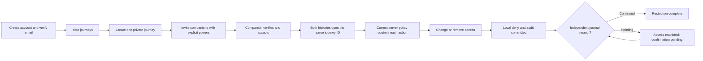

# Accounts, journeys and access: implementation plan

| Field | Value |
| --- | --- |
| Date / version | 3 November 2026 / 1.2 — implementation baseline selected |
| Status | B00 reconciled; B01 contracts/web specimens implemented and still in progress. B02 S01–S06 schema/migration/privilege foundation is complete with real PostgreSQL G03/core isolation evidence. Integrated account/journey acceptance remains pending. See the [execution record](accounts_journeys_access_progress.md). |
| Scope | Delivery step 1 of the complete R1 product: contracts, accounts, canonical journey identity, memberships, capabilities, source/export-grant foundations, audit and restriction recovery. |
| Baseline inspected | `84d339e734dfe85e9ea12e356f650d59991ab32e`; completed setup/native foundation, product status shells. |
| Governing sources | [Requirements](../core/product_requirements.md), [architecture](../core/architecture.md), [application design](../core/application_design.md). |
| Supporting deliverables | [Selected decisions](accounts_journeys_access_decisions.md), [implementation starting guide](accounts_journeys_access_start.md), [research and gap analysis](../research/accounts-journey-access/analysis_2026-11-03.md), [detailed experience handoff](accounts_journeys_access_design.md). |

[OpenCode / DeepSeek V4.1 Flash review and parent assessment](../research/accounts-journey-access/review_2026-11-03.md) records the original findings and version-1.1 corrections. Version 1.2 selects the remaining behavior in the decision document and supplies a starting guide. The plan is ready for implementation, not a claim that any implementation or deployment test passed. The user requested finalization; selected defaults are recorded transparently rather than presented as previously approved choices.

Reading path: start with [outcomes](#1-what-this-work-achieves), the [starting guide](accounts_journeys_access_start.md), [selected decisions](accounts_journeys_access_decisions.md), [user workflows](#6-user-workflows-and-api-integration), [design delivery](#7-design-and-consumer-experience-delivery) and [ordered batches](#10-ordered-implementation-batches). Engineering detail lives in the [module inventory](#3-functional-modules-and-service-boundaries), [data model](#4-proposed-relational-model-and-invariants), [migrations](#8-migration-and-deployment-specification) and [acceptance gates](#9-acceptance-gates-and-focused-verification).

## 1. What this work achieves

A person can create and recover an account, manage a private profile and sessions, create a private journey, invite companions, and open that same journey from each accepted account's history. The organiser assigns administration, coauthoring and publishing independently. Removing access denies protected use, produces an audit record, and honestly reports whether independent recovery confirmation is complete.

The database becomes a reliable foundation for later capture, contributions and publishing: source ownership is explicit, review/publication reuse is separate from original-file export, retries do not duplicate objects, and an old backup cannot silently restore acknowledged permissions. The consumer experience is part of delivery: clear forms, recognizable journey identity, appealing compositions, responsive layouts, purposeful feedback and complete error/access states.

This is a dependency batch within the complete product, not an MVP or a public release. A database-only result does not complete the account/journey experience; a polished prototype does not prove access enforcement. The full R1 obligations in [requirements section 18](../core/product_requirements.md#18-implementation-order-and-complete-release) remain intact.

### 1.1 Scope and completion boundaries

| Deliver now | Establish now, finish against later real resources | Remains in later R1 delivery steps |
| --- | --- | --- |
| Verified email/password, recovery, secure sessions, private profile/history and profile-data export. | Source/asset identity contract, owner/journey relationships and current source-grant revisions. | Camera/audio/video capture, app-owned files/SQLite, resumable upload and offline command durability. |
| Private create/join, date corrections, invitations, capabilities, safe People views and notices. | Exact-asset original-export grant model, policy operations and approval/revocation component specifications. | Full source/import review, bulk contribution and actual original-archive generation/download. |
| Leave/remove, accepted administrative transfer, archive and deletion for the resources introduced here, with impacts. | Current-access hooks, policy generations, scoped change/tombstone contract and restrictive-operation replay. | Editorial revisions/conflict UI, reconstruction, maps, transcription, Story/Explore/Learn, approved publication and sharing. |
| Reviewed schema/migrations, RLS, idempotency, atomic audit/jobs and recovery coordinator. | Grant selectors exercised with labeled development fixtures, without fake production sources or success states. | Public profiles, discovery, saved research behavior, search and questions. |

Grant foundations have their own acceptance gate. Their full user acceptance requires actual sources and file delivery in the later batches; do not mark COL-01/02/03/07 or OWN-02 completely satisfied from this milestone alone. Basic membership lifecycle runs now because it is unsafe to introduce active membership or account deletion without it. Rich source/editorial impact and repair extend the same operations in delivery step 4.

### 1.2 Three distinct sign-offs

1. **Data/access foundation:** reviewed migrations and real-database constraints/policies/transactions pass, including grant foundations. This permits dependent implementation; it is not a finished UI.
2. **Usable account/journey slice:** actual APIs and web/Android/iOS screens pass the workflows, role variants, accessibility and failure recovery below. Source/export screens awaiting later resources remain explicitly unaccepted.
3. **Independent recovery and operational qualification:** the actual off-host journal and replay drill pass; production origins/mail/retention/backup prerequisites are qualified before corresponding deployment or shared-data activation. Local doubles or a second local directory do not satisfy this sign-off.

The plan is complete as a planning artifact. None of these implementation sign-offs is completed by writing it. Record execution later in a dedicated progress document with commit/schema/device/image inputs; keep setup progress focused on the completed setup work.

## 2. Requirements and decisions already settled

- One group event has one canonical journey. Membership/history, personal shares and bookmarks never copy it or inflate its count.
- Better Auth owns verified email/password, recovery and sessions. Keep `/api/auth` separate from versioned domain `/api/v1` contracts.
- Administration, coauthoring and publishing are independent journey capabilities. Source ownership is separate. An ordinary participant gains no gallery, draft, review-source or raw-original access.
- Only me is the absence of active journey permission. Review and publication/sharing reuse are explicit source grants for that journey. Another person's originals always need a separate owner-issued exact-asset grant.
- PostgreSQL is authoritative; Drizzle/node-postgres, pg-boss, Hono, generated OpenAPI clients, TanStack Query/Form and the selected SMTP/storage interfaces remain the stack.
- Private domain tables use RLS as defense in depth. Application policy still controls every action and serialized field.
- Restrictive actions commit local denial immediately. Successful recovery completion needs an independent durable journal receipt; uncertain confirmation remains pending.
- The existing light-first field-journal visual system, Unistyles native styling, Tailwind/shadcn web components and Lucide icons remain selected.
- Continue local Android/iOS development builds on their owning OS. No EAS subscription, paid Apple membership, NativeWind, @expo/ui, new monorepo framework or second formatter/test stack is introduced.

The [research record](../research/accounts-journey-access/analysis_2026-11-03.md#4-integration-research) contains version-matched integration findings and primary sources. In particular, Better Auth 1.7 native `getCookie()` must be awaited. Documentation guidance is not a compatibility test of the eventual installed graph.

## 3. Functional modules and service boundaries

Names below describe proposed interfaces, not existing exported functions. A service receives verified actor context and typed input, checks current policy, executes its full operation and returns an explicit result. HTTP handlers validate/map requests; they do not coordinate SQL, grants, audit and jobs themselves. Avoid a generic table CRUD API or a universal policy-edit endpoint.

### M01 Identity, authentication and recovery

**Owner:** backend identity integration, Hono auth mount, native/web auth clients.

- Configure the pinned Better Auth PostgreSQL/Drizzle adapter and generated auth schema for verified email/password, email verification, reset and device-session revocation. Keep CSRF/origin protections; sensitive actions require a fresh server-validated session.
- `resolveActor(session)` maps the verified auth user to a stable domain account. `ensureAccountForSession` is idempotent and provides a usable account even if a post-registration hook failed. Never map a new auth user into old membership merely because email matches.
- First-account provisioning uses the narrow pre-domain identity entry described in section 4.4; it cannot require a domain context that does not exist yet, disable RLS or use owner credentials.
- Provisioning/session eligibility also checks the retired-auth-subject deny record. Detaching a live auth FK during purge must never make a previously deleted auth user appear to be a first-time account if the library-row purge then fails.
- Keep auth-owned provider credential accounts distinct from domain accounts; no organization plugin becomes the journey model.
- Await durable email enqueue in verification/reset callbacks. Qualify auth-row commit/enqueue failures; a successful callback is not assumed to share a domain transaction.
- If auth creation committed but mail enqueue failed, retain the recoverable account and offer a rate-limited verification resend before verification, with an enumeration-safe response. Expired or unavailable sealed mail payloads require a fresh library token rather than reconstruction from a hash. Never advise creating another account to escape an enqueue failure.
- Gate session hydration before native redirects/private rendering. Support cold/warm verification/reset/invitation intent and safe web fallback.
- Block or route generic auth account-deletion paths through M08 so library cascades cannot erase shared resources or bypass recovery restrictions.

**UI/API:** E01–E04/E11, Better Auth handler and domain `/me` projection. **Acceptance:** G01/G02/G11 below.

### M02 Private profile, identity media and sessions

**Owner:** identity domain, profile UI, bounded identity-media adapter.

- `getMyProfile`, `updateMyProfile` and `exportMyAccountData` expose the account's permitted fields. Display name and optional bio/avatar do not automatically become public profile fields. Email is private.
- Define the authoritative source for display name: the domain profile. Any Better Auth `name` mirror is integration data, not an independent public identity or permission source.
- Optional avatar selection is a bounded, authenticated identity-media flow: validate actual type/size, sanitize/strip metadata, store a private logical object reference, and render only the permitted representation. Remove/replace through a safe lifecycle operation. Profile avatars are not eligible journey sources.
- Retain initials fallback and failed-upload/retry/remove states. No arbitrary remote avatar URL or whole-gallery permission.
- Expose session descriptions safely, current-session indication, revoke-one/revoke-others and sign-out. Do not expose session tokens.
- Include own profile data and any avatar introduced here in the no-payment account-data export and deletion impact. This is not yet the structured story/original export implementation.
- B03 must supply the bounded identity-media adapter before B04 activates avatars: private storage, actual-type/size/pixel checks, sanitized re-encoding, managed reads and deletion. A small account/profile export is an immediate authenticated JSON document with a current managed-avatar manifest, not an assumed ZIP/archive job. The dependency checklist is in section 8.4.

**UI/API:** E10/E11/E13; `/me`, profile-asset and account-export endpoints. **Acceptance:** G02/G10/G12.

### M03 Canonical journeys and private history

**Owner:** journeys domain and account-scoped history projection.

- `createJourney` commits one client-identified journey, creator membership, initial administration/coauthor/publisher capabilities, audit/change records and required jobs atomically.
- `listMyJourneys` derives one reference from the unique account/journey membership, with role/status/year/category filters and stable cursor pagination. Do not store a copied journey per account or rely on client deduplication.
- `getJourneySummary` serializes a role-appropriate projection. `updateJourneyDetails` requires active coauthor or administrator authority while collaboration is open, a current revision and validated date/time context. An administrator does not gain draft/source access through this metadata permission. Shared narrative editing remains a later coauthor operation.
- Preserve the intended local time, known UTC instant/offset and IANA zone. Reject invalid local time combinations; dates remain correctable without replacing IDs or removing sources.
- Model archival/deletion/administrative freeze separately from publication/draft state. Do not mark a journey published, complete or active merely because of its intended date.
- Former-member history may retain only the minimal permitted reference; it never authorizes protected workspace reads. Canonical deletion produces a generic unavailable reference rather than resurrecting details from cached history.
- `GET /journeys/{id}` returns generic unavailable to a former member lacking another current right. Any minimal participation row is returned only by the private history projection under D08; it contains no protected cover, roster or location. Deleted-journey tombstones retain opaque identity, not those fields.
- Suspected duplicates are never automatically merged. Offer the existing-journey invite path; explicit resolution may select that journey and separately archive an authorized empty duplicate. Combining already populated histories/sources needs a later consented resolution flow and is not a completed TRP-02 claim here.

**UI/API:** E05/E06/E08, A01/A06/W01/W09. **Acceptance:** G03/G04/G12.

### M04 Invitations and acceptance

**Owner:** journeys invitation service plus durable email/notice integration.

- Use recipient-addressed invitations bound to verified identity, with explicit coauthor/publisher offers, a seven-day expiry, a random secret stored as a hash, and a stable invitation ID. Ordinary participant is the default; administration moves only by the separate accepted-transfer flow.
- `createInvitation`, `resolveInvitation`, `acceptInvitation`, `declineInvitation`, `revokeInvitation` and `resendInvitation` each validate the relevant current state. Invitation resolution grants no membership.
- Accept under lock: verify target, expiry, inviter authority/current offer, journey state and current membership; consume once and upsert the one membership without copying the journey. Do not silently widen an existing member's powers through an ambiguous duplicate invite; require the explicit capability workflow.
- A replay may return the original safe outcome only if still permitted. It cannot reactivate a later removed/left membership. A new invitation is required for intentional rejoining.
- Rejoining advances a membership epoch and installs only the newly accepted power set. Old capability rows, offers and recipient export rights cannot become active merely because the unique membership row is active again.
- Revoke/resend/expiry and delayed-worker execution are race-safe. An admin losing invitation authority invalidates their outstanding expansive offers; reissue requires the current administrator's new action.
- Resend only retransmits the same still-pending offer, without extending expiry, changing powers or reviving a terminal state. It needs the valid short-lived sealed mail payload. Expired/missing payload, expired offer or changed powers require explicit reissue: new ID/secret, current authority and supersession of the old offer. Revoked/consumed offers never return to pending.
- Add a locked journey/recipient admission guard, unique current pending offer and captured admission epoch. Leave/removal/account deletion invalidates outstanding offers and advances the epoch; acceptance must match the current guard and be newer than the relevant membership end. This blocks a second pre-removal invitation from bypassing removal. Bind an already-known recipient account immutably; email reuse never rebinds it.
- Do not accept on GET, email scanner preview or verification callback. Never expose target email, roster or private metadata through an invalid/wrong-recipient response.

**UI/API:** E07/E09/E16; invitation resolve and journey invitation endpoints. **Acceptance:** G04/G05/G08.

### M05 Membership and independent capabilities

**Owner:** journeys membership/policy service.

- `getMyJourneyAccess` returns safe available actions and reasons appropriate to the known resource. `listPeople` returns only the caller's permitted roster projection.
- `setMemberCapabilities` changes coauthor/publisher powers independently using a current membership revision, explicit impact and audit. Administration is displayed independently but moves only by accepted transfer; reject generic attempts to add a second admin or clear the last one. Participant is membership state; contributor is an owner/source relationship, not a global checkbox conferring ownership.
- `removeMember` and `leaveJourney` revoke protected use, advance generations and create the restriction flow. Deny edit/export/new member-share creation without pretending a public journey is hidden from a public visitor.
- New coauthors/publishers can expand the review audience; require an explicit admin action and explanation. Last-administrator changes follow transfer/freeze policy, not accidental lockout or silent succession.
- Keep owner withdrawal/own-data operations available under their own policy even after membership ends. Source ownership never depends on being an active coauthor.

**UI/API:** E08/E09/E12/E14; membership, capability and access projections. **Acceptance:** G05/G06/G09.

### M06 Source-sharing grant foundation

**Owner:** sources/access domain; capture/import registers actual sources later.

- Establish `registerSourceIdentity`/`registerSourceAssetIdentity` as internal trusted boundaries with stable UUID, owner, purpose, provenance/status and asset relationship. Do not add an arbitrary public “claim this source ID” endpoint or create fake production sources for this slice.
- `setSourceScope` and `withdrawSourceGrant` enforce owner/journey/source relationships. Expanding contribution requires a permitted current membership/journey state; narrowing/withdrawal keeps the owner's restrictive path.
- Represent a current grant and monotonic revision; absence or a withdrawn tombstone grants no journey access. Review and publication reuse are distinct from actual publication and from original export.
- Review readers are the owner, or active coauthors/publishers within the current grant. Ordinary participants and administration alone receive no other person's review content.
- Narrowing/withdrawal records local denial, policy generation, audit and journal retry atomically. Expose an explicit result contract for downstream dependency invalidation; later derivatives must register their dependency edges before use.

**UI/API:** source-scope component/contract now; production source screens with capture/contribution. **Acceptance:** G06/G07/G09 against real SQL identities/fixtures; later source delivery acceptance remains open.

### M07 Original-file export-grant foundation

**Owner:** sources/export-access domain.

- Define request/approve/decline/revoke operations. Approval is owner-issued for a named active member, this journey, exact eligible source assets, per-source grant revisions and expiry. Only-me/profile-avatar assets cannot enter it.
- For a batch spanning several sources, pin each asset's applicable source grant/revision; one scalar revision on the whole batch is insufficient.
- `authorizeOriginalExport` checks owner/recipient/journey/asset binding, current membership and its granted epoch, grant state/revision, source state and expiry. It is the common boundary for archive generation and every managed GET/HEAD/Range download when those exist. Departure permanently invalidates the old recipient grant; a later rejoin needs a new owner approval.
- Withdrawal, grant narrowing, recipient departure, expiry and explicit revocation deny further use. A stale worker or old download URL cannot restore it. Owner export remains independent and has no payment gate.
- Keep request/approval UI distinct from publication-scope choices. Explain the metadata implications and inability to recall already downloaded copies.

**UI/API:** contracts, relational model, service policy and component specification now; actual request screens/archive delivery with real sources. **Acceptance:** G07/G09 now, later archive/range/link gates required for OWN-02 completion.

### M08 Lifecycle, impacts and accepted transfer

**Owner:** lifecycle coordinator calling explicit identity/journey/source operations.

- `previewLifecycleImpact` returns a safe affected-resource summary and short-lived opaque/signed preview token bound to actor, action, resource versions, policy generation and chosen options. Never let the client supply an authoritative impact list.
- Separate `offerAdministrationTransfer`, `acceptAdministrationTransfer`, `leaveJourney`, `archiveJourney`, `deleteJourney` and `deleteAccount`. Accepting rechecks target eligibility and current administrative state; offering a transfer does not complete it.
- An accepted administration transfer moves that power explicitly. Other editorial/publisher capabilities do not change silently. A departed/deleted last administrator causes the documented freeze on role expansion/new publication/visibility widening; preserve permitted reads/exports and restrictive safety operations.
- Archival closes contribution, not source ownership or necessarily public reading. Canonical deletion affects all references but does not delete other people's private originals. Account deletion does not cascade through all shared journey data.
- Recheck preview versions and fresh session at commit. Broad destructive actions require the second confirmation specified in the design. A stale preview fails safely with refreshed impact.
- Large account operations use a persisted operation/saga: deny the account/session first, process affected journeys in bounded ordered units, retain resumable status and restrictions. Do not promise one transaction or immediate byte purge across external systems.
- Account deletion also needs safe status after session revocation. Issue a separately scoped, high-entropy read-only operation receipt, with server-side hash, bounded retention and protected client storage. It reveals only this operation's minimal status, cannot restore account/journey access, and never appears in logs or ordinary URL parameters. Freeze its exact carrier in B01; do not leave a deleted account signed in just to poll status.
- Record retention/purge separately from logical denial and journal confirmation. A new account using the same email cannot revive the deleted account's rights.
- Sections 5.3–5.4 implement the selected archive/action and account-deletion matrices. Canonical deletion requires the current administrator, fresh authentication, current impact and two explicit requester confirmations. This baseline requires no independent-person countersignature and does not represent those confirmations as group consent.

**UI/API:** E04/E12/E13/E14, lifecycle impact/command/status endpoints. **Acceptance:** G08/G09/G10.

### M09 Audit, notices and scoped change records

**Owner:** backend audit/notice integration, recipient views and worker delivery.

- Accepted domain operations append audit and scoped change records in the same transaction. Record event ID, actor/service identity, action, object IDs, server time, revisions/generations and a safe before/after policy summary.
- Audit is append-only to ordinary runtime code; controlled retention/purge is separate. Do not record passwords, session/invitation/reset secrets, media, precise coordinates or arbitrary request JSON.
- Create recipient-specific notices for invitations, capabilities, transfer and lifecycle changes. Role changes must not expose hidden sources through notification text or counts.
- Paginate notices/history with a scoped cursor. Recheck target access at read; events can remain investigable without returning inaccessible object details.
- Reserve compatible change/tombstone semantics for later sync. Delivery step 1 does not claim a complete offline sync engine or old-client capture replay.
- Add an operator-only, purpose-scoped audit query/runbook and job/confirmation diagnostics. Log operator identity, justification and accessed scope. Ordinary support investigation sees safe event metadata, not unrestricted source content or credential payloads; no new public administration dashboard is implied.

**UI/API:** E05/E16, notices and safe change projections. **Acceptance:** G05/G08/G11.

### M10 Restriction journal and recovery

**Owner:** lifecycle/operations coordinator, independent append adapter and replay tooling.

- `applyRestriction` commits the local deny, policy generation, stable event, audit/change records and pg-boss retry/cleanup jobs together.
- Outside that transaction, `confirmRestriction` appends the minimal event to the actual off-VPS destination. The adapter must supply idempotent append by event ID, durable receipt, ordered head/sequence and integrity/completeness checks. An ordinary object PUT or another directory on the VPS is not sufficient proof.
- Confirmed append plus receipt persistence yields completed status. Timeout/unknown outcome yields HTTP 202 pending recovery confirmation, while denial remains enforced. Retry reconciles the same event and receipt.
- Journal data contains opaque IDs/operations/generations/integrity metadata, not source text/media/locations or bearer secrets. Application credentials cannot delete journal history. Retention exceeds every backup generation that can restore superseded rights.
- Restore starts fenced: disable protected/published/export delivery, fence earlier writers, obtain the current independent journal head, replay/reconcile idempotently, verify object/state integrity and only then release affected reads. Unknown affected scope keeps all potentially affected delivery closed.
- Initially exercise membership/capability/deletion restrictions and source/export fixture restrictions. Extend the same replay/invalidation boundary as actual publications, media and answers arrive; their old-link/answer gates cannot be claimed now.
- Classify every introduced transition by whether reversing it could restore protected access or an outstanding authority offer. The closed initial restriction set includes invitation revocation/supersession/decline when relied on for denial, transfer cancellation/decline and invalidation, archival, last-admin freeze, membership/capability removal, account/journey deletion, and source/export restrictions. Accepted transfer also journals removal of the prior authority. Derived freeze is re-established from replayed authority plus its deny generation. Natural expiry is always checked from server time; marking a row expired is not the only expiry barrier.
- Use the same event/receipt/pending-result contract for these restrictive commands. A restore must not make an old offer usable or an archived/frozen journey expansive again. This is a restriction journal, not a journal of every ordinary business edit. The concrete restore fence is specified in section 8.3.

**UI/API:** E14 and typed restrictive results. **Acceptance:** G09, using both controlled failures and the actual independent failure domain before shared-data activation.

### M11 HTTP/contracts, clients and authenticated routing

**Owner:** contracts, Hono adapters and platform-specific data layers.

- Domain contracts remain independent Zod/OpenAPI schemas, with generated types/fetch client. Neither browser nor native imports Drizzle tables, backend auth configuration or the schema-generation/server-only entry.
- Keep the injected fetch seam: same-origin browser cookies/explicit credential mode as configured; native awaits the Better Auth Expo cookie and attaches it through the documented transport. Do not replace it with a second token system or leak server types into the app.
- Replace the setup-only origin/preflight assumptions with separate reviewed auth/domain policies. Allow only necessary exact origins, methods and request/response headers. Missing Origin on native is not itself authentication; preserve Better Auth's own checks.
- Extend the Hono creator-shell routing for actual account/journey deep links: the current server serves only `/` and `/setup/status`. Keep API/auth/health/assets and public-reader handling ahead of the explicit creator route fallback; unknown API paths must not receive an HTML shell.
- Query keys include the domain account/session epoch and relevant journey/filter/cursor. On sign-out/account change, cancel queries, clear protected route/query/form state and reject late responses by epoch. Confirmed revocation removes protected content; invalidation alone retains it.
- Distinguish a client auth epoch from server policy generations: the client increments an in-memory UUID/counter on hydration identity change, sign-out, session invalidation or account switch. `/me` supplies the stable domain account ID and safe account lifecycle revision; no session token is exposed to make a cache key. Async results must match the captured client epoch and account. Section 4.4 defines the separate post-deletion receipt store/route exception, which is not retained account data.
- Use AbortSignal, bounded timeouts and explicit error mapping. Do not retry authorization/validation errors as network errors. Preserve safe non-secret form drafts after a failed save, using the same command identity for uncertain outcomes.
- The slice uses online authoritative permission mutations. No background offline capability expansion or persisted sensitive Query cache. Later durable capture commands have a different protocol and acceptance.
- Auth guards handle pending/hydrated/verified/signed-out/expired states and preserve allowlisted intent. Server policy remains authoritative, including direct URL/API access.
- Freeze per-IP/account/recipient-target operation budgets for auth resend, invite create/resolve/accept, grants, exports and status polling in D04. Use the selected PostgreSQL-backed counters and trusted-proxy address rules; count atomically, bound retention, return non-enumerating 429/retry guidance, and test repeated/concurrent abuse separately from valid retry idempotency.

**UI/API:** all E flows. **Acceptance:** G01/G04/G11/G12.

## 4. Proposed relational model and invariants

This inventory defines schema responsibilities. B02 now supplies the reviewed [models, migrations, policy graph and evidence](identity_database.md#complete-s02s06-database-boundary); its source names/types/constraints are frozen at that checkpoint. Keep SQL/auth schemas private; wire types are projections. Use UUIDs for domain/offline identities and operation IDs, timezone-aware server timestamps and explicit local-time context. The auth generator owns its actual identifier types.

### 4.1 Tables and key relationships

| Record / owner | Important fields and relationships | Required invariant |
| --- | --- | --- |
| Auth user/session/provider-account/verification and configured rate-limit records / Better Auth | Exact generated fields, indexes and FKs for pinned configuration. | Preserve library semantics; its provider `account` is not a domain membership/account. No generic domain RLS copied onto auth internals. |
| Domain account / identity | UUID, nullable unique mapped auth-user identifier of the generated type, lifecycle state, created/deleted times, revision and account policy generation. | Active accounts require an auth mapping. Coordinated deletion detaches it before auth purge; FK is restrictive, not cascading. A minimal opaque domain tombstone retains history/audit references. Email reuse never remaps history. |
| Retired auth subject / identity | Unique opaque auth-subject ID, domain tombstone reference, deny generation and retirement time; no FK requiring the live auth user to remain. | Provisioning/session eligibility rejects retired subjects even during partial auth purge. Retain the barrier while the old auth row or a restorable backup can reintroduce it; no email-based remapping. |
| Private profile / identity | Account FK/PK, display name, optional bio/avatar reference, revision. | No automatically public email/profile projection. Own-profile updates only; bounded validated values. |
| Profile avatar / identity media | Owner, logical storage location/key, content type, sanitized representation, size/checksum, processing/deletion state. | Separate from journey-source assets; no foreign-key path makes an avatar eligible for source export. Own lifecycle/retention enforced. |
| Journey / journeys | UUID, title, intended time/zone context, optional end/category, lifecycle, administrative freeze, revision, policy generation, creator attribution. | One canonical identity; creator attribution is not permanent authority. No inferred publication or completion. |
| Membership / journeys | UUID, journey/account FKs, state active/left/removed, joined/ended timestamps, revision and membership epoch. | Unique `(journey_id, account_id)` across states. Rejoin advances epoch and installs explicit rights; historical reference grants no access. |
| Member capability / journeys | Membership FK/epoch, journey binding, bounded capability code, active/revoked state, actor/times, revision. | Unique current membership/capability and unique active administrator per journey; composite FK binds membership/journey. Current checks require active membership/epoch. Zero admin requires freeze/terminal lifecycle. |
| Invitation recipient guard / journeys | Journey, opaque recipient key with restricted verified email/account binding, admission epoch, last-ended membership barrier. | Lock/unique target serializes offers even before an account exists; ending participation invalidates prior offers. No public recipient lookup. |
| Invitation + proposed capabilities / journeys | UUID, journey, inviter, recipient guard/admission epoch, token hash, expiry, state, consumed account/time, revision and offered powers. | Secret unique; one current pending offer per guarded target; one acceptance transition. Reissue and existing-member power changes are explicit; no silent escalation. |
| Administration transfer / journeys | Journey, offering administrator/membership, target coauthor/membership, expected generation, expiry, state and acceptance. | One pending offer per sole administrator/journey; eligible target accepts current state within 72 hours. Move admin atomically; no silent successor or other-power change. |
| Source identity / sources | UUID, owner account, provenance/type, current identity/deletion revision. | Immutable ownership association; registering a UUID does not claim another person's source or prove uploaded bytes. |
| Source asset identity / sources | UUID, source FK, owner binding, purpose/type, verified availability metadata when actual upload exists. | Asset belongs to the stated source/owner. Exact identity is independent of an expiring storage URL. |
| Current source grant / sources | Source, journey, owner binding, review/publication-reuse scope, active/withdrawn state, revision, actor/time. | Unique source/journey; no active grant means private. Revision monotonically advances; current relational ownership is enforced. |
| Original-export request and request-asset binding / sources | Requester, owner, journey, normalized exact requested assets, state/expiry. | Request is not authority. Requested assets must already be eligible; later approval rechecks all conditions. |
| Original-export grant / sources | UUID, owner, named recipient/membership epoch, journey, issued/expires/revoked times, state/revision. | Expiry after creation; live expiry/membership/epoch is checked at use. Departure invalidation survives rejoin. |
| Export-grant asset / sources | Grant, exact source asset, applicable source-grant identity/revision, ownership/journey binding. | Unique grant/asset; composite FKs or equally strong relational design reject mismatched owner/source/journey combinations. |
| Command receipt / operations | Actor, operation UUID/type, normalized payload digest, safe result/resource reference, retention state. | A key reused for a different payload fails. Replay rechecks current access and never grants rights revoked later. |
| Audit event / audit | Stable ID, scoped opaque targets, actor, action, server time, revisions/generations, safe payload. | Append-only ordinary runtime privileges, no arbitrary sensitive snapshots or cascade erasure. |
| Account notice / notices | Recipient, event reference, safe summary template, read state, cursor key. | Recipient-scoped and current-access-safe. Do not expose private actor/account fields. |
| Domain change / sync boundary | Journey/account scope, monotonic cursor key, opaque target/type/revision/tombstone. | Authorized cursor and filtering; permission loss cannot be bypassed by an old cursor. |
| Lifecycle operation / lifecycle | Actor, named action, target, impact digest/versions, state, progress/restriction references, optional scoped status-receipt hash. | Bounded resumable work; status receipt discloses no account/journey data; denial, recovery confirmation and purge remain distinct. |
| Restriction event/receipt / operations | Stable event UUID, target IDs, operation, policy generation, integrity data, retry state, receipt/sequence/checkpoint. | Local denial is committed with event/jobs; receipt is independent and reconciled idempotently. A local cached head is not recovery authority. |
| Email delivery / email | Stable mail-event identity, protected recipient/template/short-lived sealed token payload or secure reference, expiry, current-state binding and delivery result. | Jobs/logs contain safe references, not bearer URLs/bodies; at-least-once delivery with expiry/current-state checks. |

Do not create future editorial/publication/map/search tables merely to fill an ERD. Source/asset identities here are the minimum typed boundary needed to enforce grants; actual storage completeness and capture durability arrive with their own workstreams.

### 4.2 Database constraints and queries

- Use real FKs/unique constraints for account/journey membership, grant/source and exact asset membership. Cross-owner/journey associations must fail at the database boundary as well as in API validation.
- Pin an export asset's source-grant revision as an immutable issued snapshot and compare it with the current grant at use. Do not FK that snapshot to the mutable current revision, which would prevent a withdrawal/update. An optional immutable revision-history relation can provide a historical FK; the current grant identity/owner/journey relationships remain constrained either way.
- Restrict destructive cascades across accounts, journeys, sources, audit and restriction records. Deliberate lifecycle operations decide what is retained, anonymized or purged. Auth-generated cascades require review in that context.
- Use finite state/capability/scope checks and monotonic revision rules. Expiry-at-use, authority, state transitions and source-grant revision comparison require transactional logic; a static CHECK cannot prove all of them.
- Index account/history date+ID pagination, journey/state membership, current capability lookup, invitation secret/target/current state, source-owner/journey joins, grant-recipient/asset access, recipient notices and pending restriction/email work. Reuse indexes backing useful unique constraints.
- Add foreign-key indexes for actual access/deletion paths. Review EXPLAIN on representative multi-account fixtures and paginated histories; avoid speculative GIN/GiST/vector indexes in this slice.
- Cursor order has an immutable tie-breaker and is bound to actor/scope/filter. History totals count distinct canonical journey membership, never joined capability rows.
- Use a shared deterministic lock order: journey IDs, then relevant membership/source/grant IDs in stable order. Account-wide work iterates bounded ordered units after an account-level deny. Document the exact order with the first transactions and test opposing operations.

### 4.3 RLS and database privilege design

`runAsAccount(actor, operation)` obtains one connection/transaction, sets transaction-local verified domain account context and executes policy/data work on that connection. Missing context denies. The pooled connection cannot retain the prior account after success, exception or cancellation. [PostgreSQL row security](https://www.postgresql.org/docs/18/ddl-rowsecurity.html) and [transaction-local settings](https://www.postgresql.org/docs/18/functions-admin.html#FUNCTIONS-ADMIN-SET) inform this boundary.

| Principal | Intended scope |
| --- | --- |
| Migration/schema owner | Controlled bootstrap/migration only; never injected into API/worker runtime. |
| Auth runtime | Only the library-required auth tables/functions and identity integration boundary; not ownership of domain tables. |
| Domain API runtime | Non-owner, no BYPASSRLS; table-specific grants and private-domain RLS with FORCE where applicable. |
| Worker | Named trusted operations with current target/generation validation; no generic impersonation from job JSON or unrestricted owner credentials. |
| Journal coordinator/recovery | Minimum append/verify or controlled recovery privileges; no application permission to delete independent history. |

Membership/capability RLS can recurse if it reads its own protected table. B02 must include a policy dependency graph. Prefer nonrecursive policies; any narrow SECURITY DEFINER helper needs a non-login owner, fixed search_path, explicit schema qualification, restricted EXECUTE and a documented visibility boundary. Do not solve recursion by disabling RLS or giving runtime BYPASSRLS. Auth tables use their reviewed library-specific privilege strategy.

The starting bootstrap gave `kairn_server` only queue-version SELECT, while the worker had queue DML/EXECUTE. The [B02/S06 producer foundation](identity_database.md#enqueue-only-product-queue-boundary) now qualifies the enqueue-only API/auth path on its actual transaction against pinned pg-boss. Do not guess that a table INSERT alone is sufficient, copy all worker privileges, or switch to a separate connection that loses atomicity. Qualify any restricted producer function/adapter against `fromDrizzle` and approved queue names. Producer initialization must not attempt worker registration, supervision, scheduling, migrations or queue maintenance. G08 runs as the actual producer and worker roles, with fetch/complete/delete/queue administration denied to the producer. The remaining integrated command/audit/event boundary must roll back those records together on denied enqueue, not leave a committed change without its job.

Review USING and WITH CHECK for reads and writes. RLS alone does not prevent returning private fields in an otherwise visible row or authorize publishing/raw-original export. Maintain explicit safe projections and service checks. Recalculate the total connection budget when separate auth/domain/queue pools are introduced; the current pool cap is not permission to multiply unbounded pools.

### 4.4 Provisioning, tombstones and post-deletion status

- Provide an insert/idempotent-lookup identity function callable only by the trusted auth integration principal before domain context exists. It accepts the already server-verified auth identity, checks its live eligible auth record, and creates at most one account/profile under a unique auth mapping. Any SECURITY DEFINER implementation follows the helper restrictions above and cannot edit journeys/roles or provision arbitrary request-body identities. Concurrent first sign-ins return one mapping; absent/unverified/deleted identities fail.
- Define the corresponding narrow provisioning INSERT/lookup RLS policies using the trusted verified-auth identity boundary. SECURITY DEFINER alone does not bypass FORCE RLS; the function must pass its reviewed policy instead of relying on implicit owner exemption.
- All ordinary domain work then uses transaction-local domain-account context. Neither provisioning nor account deletion grants runtime table ownership or BYPASSRLS.
- On deletion, deny the account/sessions and retire the opaque auth subject with its restriction event, preserve the domain UUID tombstone, reconcile restrictions, then detach the nullable live auth FK only through the coordinated purge. The retired-subject barrier is independent of that FK and prevents re-provisioning if purge fails. Keep detach/auth purge atomic when the selected boundary supports it; otherwise retain the barrier throughout retries. Shared references point to the domain tombstone, not a cascading auth-user FK. Do not retain a plaintext email as tombstone identity. Replay restores the deny/retired-subject barrier before authentication/domain delivery reopens.
- Canonical journey deletion is a terminal tombstone preserving opaque journey/member/audit/restriction identity, followed by policy-eligible detail purge. It never cascades through other owners' sources. All normal journey projections exclude the tombstone; only a permitted minimal private-history reference can survive. Tests must prove both FK safety and field redaction.
- Keep a deletion-operation receipt outside auth cookies and account-scoped Query/form caches. Native uses a separate SecureStore namespace; web uses a dedicated Secure/HttpOnly, path-scoped status cookie and a server-authorized no-store status route. Its URL contains no bearer receipt. Account sign-out clears auth/private data but preserves this receipt until terminal status is dismissed or its declared retention ends; account switching cannot load deleted-account data through it.
- The status route is explicitly outside signed-in account route guards and yields only minimal operation/confirmation/cleanup state. The receipt never authorizes retry or other writes. Server-side storage holds its hash and supports bounded rotation/overlap. D08 selects a 45-day hard receipt window and seven-day terminal grace within it, covering the 30-day cleanup target and relaunch; expiry leads to a generic safe support path, never restored account access. Receipt/cookie semantics require real cold-start/cross-account acceptance.

### 4.5 Generation and epoch model

| Guard | Advances on | Carried/rechecked by |
| --- | --- | --- |
| Account policy generation | Account deny/deletion and security state that closes domain access. | Verified actor context, account lifecycle jobs and impact tokens; every protected operation also checks current account state. |
| Journey policy generation | Membership end/rejoin, capability changes, source grant changes, archive/freeze/delete, invitation/transfer issue/invalidation and other access-policy transitions. | Impact tokens and authority-dependent jobs; compare under the relevant locks before effects. Restriction event records committed generation. |
| Membership epoch | Each explicit new admission after an ended membership. | Capability assignments and recipient export grants; a prior epoch never becomes current again. |
| Invitation admission epoch | Removal/leave/deletion and explicit invalidation/reissue for its journey/recipient guard. | Offer acceptance and delayed mail; evaluate alongside inviter authority and target binding. |
| Source-grant revision / asset identity revision | Any grant-scope/state change and relevant source/asset invalidation. | Each issued export-asset snapshot and source-dependent job/use. Snapshots never FK to a mutable current revision. |
| Client auth epoch | Session hydration identity change, logout/switch/invalidation. | Local queries/routes/in-flight results only; it is neither a server permission nor the persisted policy counter. |

Increment and persist the applicable counters with the accepted policy transition/audit/jobs in the same transaction. Every new job type declares its input account/journey/target generations and rechecks live authority. A changed broad generation means recompute current policy or stop safely; it is not permission to restore old state. Original-export grants bind specific membership/source revisions, not a broad journey counter that would unnecessarily revoke them for an unrelated invitation. Record this dependency contract with each job rather than accepting an unspecified “current generation.”

## 5. Permission and state contracts

### 5.1 Authorization matrix to encode once

| Action | Required current authority | Additional checks |
| --- | --- | --- |
| Read/update private profile; own account-data export | Same account, valid session. | Fresh session for sensitive account/security actions; avatar/export delivery stays scoped. |
| Open a protected journey summary | Active membership with the permitted summary projection. | Historical reference/public readership does not grant workspace access. |
| Manage invites/capabilities | Active administrator. | Journey lifecycle/freeze, expected revision, proposed review-audience impact. |
| Correct journey title/intended dates | Active coauthor or administrator while collaboration is open. | Current revision, time validation and no implied source/draft/publication permission. |
| Read another person's contributed review source/draft | Active coauthor or designated publisher. | Current source grant and permitted fields; administration alone is insufficient. |
| Edit common draft | Active coauthor. | Later editorial revision/grant rules; publisher alone cannot edit. |
| Set/expand contribution scope | Source owner with permitted current journey participation/state. | No impersonated owner; active source/asset and relationship checks. |
| Narrow/withdraw own grant | Source owner under the restrictive path. | Deny immediately, generation/audit/journal; membership departure cannot erase owner control. |
| Approve publication/visibility | Active designated publisher. | Later exact reviewed publication/source/privacy generation; frozen journeys cannot expand publication. |
| Approve original-file export | Source owner. | Exact eligible assets, named active recipient, journey, each source revision, expiry. |
| Use another person's original-export grant | Named active recipient. | Every grant/asset/source/current revision/expiry check at generation and every managed read. |
| Leave/remove/transfer/archive/delete | The action-specific owner/member/admin policy. | Fresh session/impact where required, acceptance for transfer, no-successor rules, current restrictions. |

Do not ship draft/publish/export-download routes before those resources exist merely because the matrix lists them. Server-derived available actions help render controls; they are not a reusable authorization token for later writes.

### 5.2 State transitions and races

| State machine | Required transition rules |
| --- | --- |
| Invitation | pending → accepted/declined/revoked/expired; consumed/revoked offers cannot become pending through retry. Reissue is explicit. |
| Membership | absent → active on create/accept; active → left/removed; reactivation needs a new authorized acceptance, never old command replay. |
| Capability | active → revoked is restrictive; revoked/absent → active is explicit expansion under current admin/freeze policy. |
| Source grant | absent/withdrawn means Only me; active review/publication-reuse advances revision; narrowing/withdrawal is restrictive. |
| Export grant | requested is not granted; active approval → revoked/expired/invalidated-by-source-or-membership. Old archives do not retain permission. |
| Transfer | offered → accepted/declined/cancelled/expired; acceptance rechecks both parties and administrative generation. |
| Restriction | local deny committed → confirmation pending → recovery confirmed; errors retry without undoing deny. |
| Deletion | requested/impact confirmed → access denied → recovery confirmed and cleanup pending → policy-eligible purge; do not collapse these into one success boolean. |

For role/owner/grant changes, lock the relevant authority and resource rows and recheck after locking. A concurrent removal must prevent a stale expansive transaction from granting access on old membership. Any operation that creates new rights compares the current generation; jobs recheck before effects. Journal replay may conservatively keep an object denied until fresh authorized review; an old “active” row or job is never sufficient to reopen it.

### 5.3 Archived-journey action matrix

This is the selected D10 behavior, detailed in the decision document. Archival closes collaboration and is not a change of publication visibility. Source ownership, existing permits and safety restrictions remain separate.

| Action while archived | Selected rule |
| --- | --- |
| Private history / summary | Retain current permitted projection and archive label; former members still receive only their allowed history reference. |
| Existing draft / review-source reads | Existing active coauthors/publishers may read only current permitted fields/grants. Ordinary participants/admin-only gain no new access. |
| New contribution, draft edit, metadata correction, grant expansion | Closed for this slice; no implied unarchive control. An eventual reopen action needs a separately reviewed contract. |
| Invitation create/reissue/accept and capability expansion | Denied. Invalidate prior outstanding admission/expansion offers and advance/journal the deny generation. |
| Administrative continuity | Permit a fresh explicit transfer to an existing eligible coauthor, with current archive-aware impact and acceptance. Prior stale offers cannot bypass the archive generation. No automatic successor. |
| Source-owner withdrawal/narrowing/deletion | Remains available through the owner's restrictive path, including after membership ends. |
| Own export / currently granted exact-original export | Remains subject to current owner/recipient/source/revision/expiry checks. Permit new exact-original owner approval for already contributed assets; it grants no editing or public reuse. |
| New publication / republish / visibility widening | Blocked by archive policy; implement the actual publication assertions when that module exists. |
| Unpublish / visibility narrowing / takedown | Retain appropriately authorized restrictive actions once publication exists; do not build fake unpublish behavior now. |
| Canonical deletion | Current sole administrator, fresh authentication/impact and two named confirmations; never inferred from archive status or publisher rights. |

The impact preview states these rules and treatment of outstanding offers. G10 tests the real state/actions introduced now; later publication/unpublish evidence remains a step-7 gate.

### 5.4 Account-deletion relation matrix

The selected default is immediate conservative denial and withdrawal of the deleting owner's journey reuse. No “keep sharing after deletion” exception is implemented here. D08 in the decision document supplies retention targets; actual deployment behavior must qualify them before activation. Populate actual source/export fixtures in the lifecycle integration test even while source UI remains deferred.

| Relation | Immediate deny / coordinated result | Retention and continuity |
| --- | --- | --- |
| Auth sessions / domain account | Deny domain access and revoke sessions; reject old recovery/verification authorization. | Detach/purge auth mapping only through the coordinated order; keep opaque domain tombstone. |
| Memberships / capabilities | End active participation and invalidate prior epochs/rights. | Preserve only permitted minimal references; other members keep the canonical journey. |
| Last administration responsibility | Complete an eligible accepted transfer or apply the no-successor freeze. | No invented successor, new publication or role expansion. Fresh valid recovery follows the explicit policy. |
| Outgoing/incoming invitations and transfers | Invalidate offers tied to the account or its verified recipient bindings; advance admission/authority guards. | Cancel delayed mail/effects, retain minimal audit and journal restrictions. Reused email/new auth identity cannot consume the old offer. |
| Owned sources / journey source grants | Owner-account deny dominates reads/jobs immediately while per-source withdrawal/invalidation is processed. Withdraw journey reuse; no continuing-sharing checkbox. | Other owners' originals are untouched. Own bytes and dependencies follow the disclosed deletion/backup policy, not immediate-purge claims. |
| Issued / received original-export grants | Invalidate both received and issued grants; block archive generation and every managed read. | Prior membership/source epochs never revive after re-registration. Already downloaded copies cannot be recalled. |
| Profile / avatar / account-export delivery | Remove normal profile/avatar availability and deny existing managed export/asset reads. | Purge eligible PII/objects according to D08; status receipt never grants access to them. |
| Notices / audit / job payloads | Redact inaccessible targets, stop stale jobs and erase expired sealed secrets. | Keep minimal justified actor/event records and recipient-safe notices for their declared retention; no cascade through group history. |
| Lifecycle status | Keep only the narrowly scoped receipt path outside account auth guards. | Finite recovery/status window, automatic coordinator retry and safe expiry/support behavior from section 4.4. |

Canonical deletion uses current administration plus a fresh session, named impact and two requester confirmations, never publisher/participant status alone. No independent countersignature is required; do not label the requester's confirmations group consent. The operation terminates journey grants/links while preserving other owners' private originals and opaque history/audit references.

## 6. User workflows and API integration

The [experience handoff](accounts_journeys_access_design.md#3-screen-and-route-inventory) specifies compositions, selected routes, field behavior, state variants and device adaptation. The following flows bind it to service operations.

| Flow | User sequence | API/domain result | Required failure recovery |
| --- | --- | --- | --- |
| F01 Register/recover | Enter account details → verify email → sign in, or request/reset password. | Auth session → stable domain account → `/me`. | Generic recovery response, expiry/resend, durable enqueue failure, safe intended-destination recovery. |
| F02 Return/switch account | Hydrate session → load history → sign out or switch. | Current actor-scoped queries. | No prior-account flash, late-response leak or stale protected route. |
| F03 Create/correct journey | Short form → authoritative save → open overview → optionally correct dates. | One journey/membership/capability set, revision/audit. | Same command on timeout retry; stale update preserves entered values. |
| F04 Invite/join | Admin chooses recipient/powers → sends → recipient resolves/verifies → explicitly accepts. | One current invitation acceptance into the existing journey. | Wrong account/expired/revoked offer; replay cannot restore later revoked rights. |
| F05 Manage People | Open scoped People → inspect powers → preview and save change. | Current capability revision and audience effect. | Compare/reload on conflict; denial clears protected views; pending receipt shown. |
| F06 Profile/security | Edit name/bio/avatar → save; inspect/revoke sessions. | Own profile revision/asset status and session revocation. | Retain draft on failure, initials fallback, safe expired-session route. |
| F07 Transfer/leave | Inspect impact → offer transfer → recipient accepts → depart or keep other roles explicitly. | Transfer state and membership restriction. | No automatic successor; last-admin freeze and pending confirmation visible. |
| F08 Archive/delete | Inspect named impact → reauthenticate if required → confirm → track status. | Current-state lifecycle operation. | Stale preview reissued; other originals retained; purge and confirmation statuses separate. |
| F09 Grant source scope | Owner selects exact sources and scope → reads audience → confirms. | Owner/journey grant revision. | Cross-owner input rejected; narrow/withdraw deny persists through outage. Actual source UI activates later. |
| F10 Approve/revoke original export | Recipient requests files → owner approves exact set/expiry → recipient exports if still permitted. | Exact-asset grant and current policy result. | Expiry/narrowing/departure/revoke block managed reads. Archive/download steps arrive later. |
| F11 Read notices | Open relevant invitation/change → follow permitted action. | Recipient-scoped sanitized event and current target access. | Inaccessible targets show no protected title/source/account fields. |
| F12 Restore/reconcile | Operator fences delivery → obtains independent head → replays → verifies → releases safe access. | Restrictive state survives a pre-removal database restore. | Uncertain/missing journal tail fails closed; stale worker stays blocked. |

### 6.1 Endpoint inventory to freeze in B01

Paths below are the selected operation patterns. Generate and validate their exact wire schemas before clients consume them in B01. Keep Better Auth endpoints/client calls aligned to the pinned library rather than duplicating them into custom authentication endpoints. Only foundation source/grant endpoints whose real service boundary exists should be mounted; deferred file/publication endpoints are explicitly not implemented here.

All domain paths are under `/api/v1`; subsequent paths abbreviated within a table row inherit that prefix. They are not unversioned routes. Action suffixes in the same row inherit the stated method and full resource prefix.

| Endpoint group | Proposed domain operations | Access and response contract |
| --- | --- | --- |
| `/api/auth/*` | Library sign-up/sign-in/verify/reset/session/revoke/sign-out. | Library-owned security/error semantics; reviewed callbacks and deletion restrictions. |
| `GET /api/v1/me` | Current domain profile, verification/account state, safe capabilities/limits relevant now. | Current verified session; no credential/provider tokens. |
| `PATCH /api/v1/me/profile` | Name/bio update with If-Match and command ID. | Same account, field-safe profile projection and new ETag. |
| `POST /api/v1/me/avatar/uploads`, `POST /me/avatar/uploads/{uploadId}/complete`, `GET/DELETE /me/avatar` | Begin/finalize bounded own avatar; read/remove permitted representation. | Own-account bounds/checksum/current-state checks, async sanitization status and managed reads; expose no raw/public object URL. |
| `GET /api/v1/me/export` | Immediate bounded account/profile JSON and current permitted avatar manifest. | Same account; credential/token payloads excluded; avatar uses current managed read. No archive job/polling endpoint unless later justified. Not OWN-02 completion. |
| `GET /api/v1/me/journeys` | Cursor history and role/status/year/category filters. | Own one-reference projection and safe totals. |
| `POST /api/v1/journeys` | Create canonical journey. | Verified account, command/resource UUID; 201 or safe idempotent replay. |
| `GET /api/v1/journeys/{id}`, `PATCH /journeys/{id}` | Role-safe summary; authorized event-detail correction. | Current access and adopted metadata-edit rule, safe fields; If-Match/revision for writes. |
| `GET /api/v1/journeys/{id}/access` | Available actions and known-resource reasons. | Current actor projection, never an authorization credential. |
| `GET/POST /api/v1/journeys/{id}/invitations`, `POST /journeys/{id}/invitations/{inviteId}/resend`, `/revoke` | Create/list scoped invites, resend or revoke. | Administrator, current invite revision and safe delivery state. Reissue is a new POST offer; terminal offers do not revive. |
| `POST /api/v1/invitations/resolve` | Resolve invitation secret supplied in a redacted body. | Rate-limited; no unauthorized metadata; explicit pre-auth/recipient projection contract. |
| `POST /api/v1/invitations/{id}/accept`, `/decline` | Consume verified-target invitation explicitly. | Command ID/current offer; accept returns canonical ID, not a new journey. |
| `GET /api/v1/journeys/{id}/people` | Permitted member/invite projection. | Admin management or narrower actor view; no automatically public roster/emails. |
| `PUT /api/v1/journeys/{id}/members/{memberId}/capabilities` | Replace explicit coauthor/publisher set; administration uses transfer only. | Active admin, expected membership revision/impact; restrictive result if any power removed; reject extra-admin/direct-admin-clear attempts. |
| `POST /api/v1/journeys/{id}/members/{memberId}/remove` | Remove member. | Action-specific authority/current impact; 200 completed or 202 confirmation pending. |
| `GET/POST /api/v1/journeys/{id}/transfers`, `POST /journeys/{id}/transfers/{transferId}/accept`, `/decline`, `/cancel` | Offer/resolve accepted administration transfer. | Current sole admin/eligible target as appropriate; authority/expiry/generation recheck. |
| `POST /api/v1/journeys/{id}/lifecycle/impact` | Preview leave/archive/delete/transfer effects. | Action-specific scope and fresh current state; safe preview token. |
| `POST /api/v1/journeys/{id}/leave`, `/archive`, `/deletion` | Execute the named lifecycle command. | Required actor, preview/version/freshness checks; truthful operation result. |
| `POST /api/v1/me/deletion/impact`, `/me/deletion` | Account-deletion impact and command. | Fresh session, explicit confirmation, transfer/freeze and bounded lifecycle coordinator. |
| `GET /api/v1/operations/{id}`, `POST /operations/{id}/retry` | Status and idempotent confirmation retry. | Initiator/authorized actor, or minimal read-only status through a scoped deletion receipt; stable event. A status receipt cannot authorize retry or other writes. |
| `GET /api/v1/me/notices`, `POST /me/notices/{id}/read` | Relevant durable attention feed. | Same recipient; cursor and access-safe target resolution. |
| `GET /api/v1/me/contributions` | Later owner-only contribution list with a minimal journey reference and restrictive actions. | Add with actual sources; retained owner control must not require opening a former journey workspace. Not mounted as a placeholder now. |
| `GET/PUT /api/v1/sources/{id}/journeys/{journeyId}/grant` | Current source scope and owner-controlled change. | Real registered source and current owner/member policy; monotonic revision. |
| `POST /api/v1/sources/{id}/journeys/{journeyId}/withdrawal` | Explicit restrictive source command. | Owner and current impact; journal-backed typed result. |
| `POST /api/v1/journeys/{id}/original-export-requests`, `GET /me/original-export-requests`, `POST /original-export-requests/{requestId}/approve`, `/decline` | Request, owner approval or decline for exact assets/expiry. | Foundation contract/service; owner/requester-scoped lists. Mount full user routes with actual sources. No archive/download endpoint implied. |
| `GET /api/v1/journeys/{id}/original-export-grants`, `POST /original-export-grants/{grantId}/revocation` | Scoped issued/received grants and owner revocation. | Current explicit source/recipient/revision binding; owner-only restriction and journal-backed status, never a general member grant directory. |

### 6.2 Common wire behavior

- Additive `/api/v1` schemas use explicit state variants: invitation, membership, grant, lifecycle operation and `restricted_pending_confirmation` versus `restriction_complete`. Include safe operation ID/status location/retry guidance for HTTP 202.
- Use RFC 9457 Problem Details for new domain failures: type/title/status, safe stable code, field errors when appropriate and request/operation ID. Preserve existing status-client compatibility; do not silently change the foundation error/status contract.
- Use 401 for missing/expired session; 403 for a known safely disclosed resource/action without authority; generic 404/unavailable for hidden resources or invalid invitations; 409 for semantic/idempotency conflict; 412 for failed If-Match; 429 with retry guidance; safe 503 for unavailable dependencies. Auth-library errors remain mapped separately.
- Every create/command accepts a stable operation UUID. Store actor/type/payload digest and a safe result reference. Reuse with changed input fails. Expired reconciliation state cannot blindly rerun a destructive command or create a duplicate; the client uses resource/operation status recovery.
- Require current ETag/expected revision for mutable membership, capability, profile and journey metadata. A server impact token is bound to current versions and cannot outlive a role/target change.
- Return each mutable entity's server-issued strong `etag` in its JSON projection, including nested profile/member/invitation/transfer/grant items. Clients send the target item's tag as If-Match; a collection response's header tag cannot stand in for a member's tag, and clients never construct opaque tags from numeric revisions.
- Invitation secrets must not enter logs, analytics, referrers or Query keys. Select the concrete email/web/native token carrier in B01; prefer fragment-to-redacted-body resolution with manual-code fallback where compatible. Retain only short-lived protected intent through authentication, never an arbitrary redirect URL.
- Responses for private account/journey data are no-store and field-filtered before serialization. No private data is embedded in a globally cached SSR shell. Preserve per-request state isolation if private rendering is introduced.
- Source/export operations and clients retain actual contract/protocol compatibility fixtures. Do not increment sync protocol just for adding account routes; a later incompatible command/tombstone change needs its own version decision.

## 7. Design and consumer experience delivery

Design is on the critical path. B01 produces the [experience handoff](accounts_journeys_access_design.md), then B04–B07 implement it alongside the corresponding data/API paths. Do not append a generic “polish UI” task after backend completion.

Required outputs before a screen is ready to build:

1. Its primary task, actor variants, route/entry/back behavior and canonical journey identity.
2. Field/control specification, exact audience/impact copy and action-to-API mapping.
3. Phone, iPad/tablet and desktop composition; keyboard/safe-area/larger-text behavior.
4. Initial loading, empty/filtered-empty, validation, pending, failed-save/retry, offline, expired session and denied/unavailable states.
5. Shared semantic tokens/component variants, actual fonts/assets/licenses and interaction timing/reduced-motion behavior.
6. Acceptance task including one failure/recovery, accessibility method and required evidence.

Start the real component set with buttons, labeled fields/password controls, form errors, explicit permissions, person/invite rows, journey card/no-cover variant, impact confirmation and restriction status. Share plain token values, not DOM components or native styling libraries. Extend the existing Unistyles theme and web token mapping; do not create a competing theme or apply a generated dashboard preset.

Use the chosen field-journal identity deliberately: quiet Paper layouts and precise type for forms, one clear Forest action, restrained Clay review/confirmation states, real journey identity/media when available, a meaningful journey line, and no fabricated travel imagery. Routine management lists use alignment and separators. Interaction quality includes pressed/focus feedback, stable pending labels, preserved forms, clear navigation and persistent results, not just animation.

Visual acceptance uses actual screen/device captures, primary tasks, keyboard/screen-reader checks, target sizes, contrast and long-content fixtures. A token contrast calculation or static design comp does not prove rendered accessibility. Do not ship dead navigation/actions for later capture/editorial features.

## 8. Migration and deployment specification

### 8.1 Controlled migration sequence

The numbers below are logical batches, not final generated filenames or hashes.

| Order | Reviewed migration responsibility | Prerequisite / review focus |
| --- | --- | --- |
| S01 | Auth schema generated from pinned configuration; least-privilege auth access. | Review actual user/session/credential/verification/rate-limit models and deletion hooks. |
| S02 | Domain account/profile/avatar, canonical journey, membership/capability and command identity. | Pre-domain provisioning, nullable restrictive auth mapping, terminal domain/journey tombstones, generations and unique identity; no dangerous cascades. |
| S03 | Invitations/recipient admission guards/proposed powers, transfers and lifecycle state. | State/expiry/recipient/admin-cardinality constraints; pending-offer uniqueness, terminal resend/reissue and pre-removal-offer invalidation. |
| S04 | Minimum source/asset identity, source grants, exact export request/grant asset bindings. | Composite relationship integrity, owner-only scope, per-source revision binding. |
| S05 | Audit, notices, scoped changes, lifecycle operations, restriction/receipt and email delivery state. | Safe payloads, append privileges, durable retry identity and retention. |
| S06 | Domain runtime roles, RLS/provisioning policies/helpers, indexes and explicit grants. | Policy graph/no recursion; actual non-owner access; enqueue-only API/auth producer versus worker authority; auth/domain separation and total pool budget. |

Keep any deployment initially closed to domain traffic until the corresponding tables, policies and grants are fully applied. On an empty database S01–S06 may be one controlled release, but review each concern separately. Preserve pg-boss's controlled bootstrap; runtime must never auto-create/migrate either queue or domain schemas.

### 8.2 Runner, compatibility and rollback

- Put schema definitions and committed reviewed SQL/snapshots under the backend's database boundary; keep the pinned generator/migrator tooling development-only. Final paths and script names are created in B02, not assumed to exist now.
- Use the version-matched Better Auth generator to produce auth schema, then the selected Drizzle migration workflow. Review any additional CLI package/version through architecture; generic `@latest` skill commands do not override exact pins.
- Migration execution uses schema-owner credentials only in the one-shot migration unit. Obtain a database advisory lock; verify expected starting version/checksums; apply in order; fail on changed applied SQL, unsupported schema, incomplete state or missing policies. Re-running the ledger-driven runner applies no duplicate work.
- Prefer transactional first-release DDL. Future nontransactional/concurrent-index work needs an explicit resumable release phase; it cannot be disguised as atomic rollback.
- Readiness checks require the supported domain/auth/queue schema versions and required privileges. The API/worker cannot serve newer features against an old or partially applied schema. Runtime credentials must fail DDL attempts.
- Use expand/backfill/contract for later changes, retain old installed-client compatibility and record the compatible application image range. Roll back the application only while schema-compatible; correct schema forward rather than casually dropping domain data.
- Before destructive changes, take verified recoverable checkpoints and run the independent restriction replay procedure. Restoring a backup without the journal fence is not a valid rollback.
- Prove empty-database application, upgrade from the previous supported migration, repeat execution, tamper/failure handling and previous-compatible application startup. Check the actual final image contains the intended migrations and no owner secret.

### 8.3 Concrete single-VPS restore fence and drill

The operations runbook must implement this sequence against the actual deployment before recovery sign-off. These are requirements for later controlled execution, not commands run during planning.

1. Put the front door in maintenance mode for protected/domain/publication/export delivery. Stop API, worker, schedulers and other writers; disable their automatic restart/redeploy. Keep this control outside the database being restored.
2. Using controlled operator/migration access, fence the known writer roles by preventing new logins/connections and terminate their existing sessions, including pooled clients. Preserve the distinct migration/replay principal. Record the fenced role/connection set and block old deployment credentials from being reintroduced during restore.
3. Prove an already-running old API/worker connection can no longer commit and reconnect attempts are refused. A UI maintenance flag alone is insufficient. If any writer or journal appender cannot be fenced, stop the drill and keep delivery closed.
4. Obtain and verify the independent current journal head after fencing all relevant writers/appenders. Reconcile outstanding append uncertainty without inventing a complete tail. Restore the chosen DB/object checkpoint with the writer fence still in place; reapply/verify external role/connectivity controls even if restored role metadata differs.
5. Replay restrictions in order, preserve conservative denial for uncertain generations, invalidate offers/grants/stale jobs, and validate object/manifest/current-state integrity. Test a pre-invitation-revoke, pre-archive, pre-transfer-cancel and pre-member-removal checkpoint as well as deletion/source/export fixtures.
6. Admit only the current compatible application/worker generation after the replay/completeness checks pass. Release role/connectivity and front-door gates deliberately, verify fresh reads/writes, and prove the old process/credential generation remains fenced. Failed or unknown checks keep delivery closed.

Choose the concrete Docker/process, PostgreSQL role/network and credential-generation controls when inventory is known under D01/D11. Capture evidence for each fence, not just an application log saying maintenance started. Do not restore writer access merely because the database accepts connections.

### 8.4 Dependency and native-input checklist

The [canonical dependency register](../core/architecture.md#14-canonical-stack-and-dependency-register) owns exact versions. This is the work allocation, not a competing version list or an instruction to install every optional package.

| Batch / boundary | Packages and infrastructure to qualify |
| --- | --- |
| B02 database/auth schema | Selected `drizzle-orm`, development-only `drizzle-kit`, `better-auth` and the matched schema generator; existing `pg`/pg-boss remain. Review any separate generator package before adding it. |
| B03 email/producer/operations | Selected `nodemailer`; real API/auth producer grants, approved queues, sealed email payload/key handling, operator diagnostics and independent journal adapter. No generic outbox stack. |
| B03 identity media, before B04 avatar | Runtime private S3-compatible adapter using selected `@aws-sdk/client-s3`, storage manifest/managed gateway, bounded image re-encoding using selected `sharp` in the controlled worker, limits and delete/cleanup jobs. No ExifTool/FFmpeg/full import pipeline just to make an avatar. Reject unsupported types and qualify native picker output rather than assuming HEIC support. |
| B04 native auth | `better-auth`, `@better-auth/expo`, SDK-selected `expo-secure-store` and `expo-network`; retain existing Linking/Constants. Add `expo-web-browser` only when selected callback behavior or the actual plugin graph needs it; social login is not introduced. |
| B04 profile/design/forms | Selected TanStack Form, owned shadcn primitives and required generated peers, Lucide web/native and native SVG peer, reviewed font assets and `expo-image-picker` if avatar selection activates. Existing Expo font and Unistyles setup remain. |

The Better Auth 1.7.15 guide is version-matched to the auth library, but its examples describe Expo SDK 55. Kairn is SDK 58: package-graph/Metro declarations, SecureStore/network integration, callback behavior and Android/iOS rebuilt runtime must qualify the actual selected combination in G01/G11/G12. SDK 55 example success is not SDK 58 evidence. Use the SDK matrix and owning-OS host guide; preserve native output/signing, rebuild for changed native inputs, and record exact installed pins.

### 8.5 Selected producer implementation contract

Read-only inspection of the actually installed `pg-boss@12.38.0` implementation established that `send` reads cached queue metadata, then inserts through `plans.insertJobs` into that queue's selected table. The statement reads `pgboss.queue`, calls `pgboss.job_now()` and returns the inserted ID. `fromDrizzle` executes it through the provided transaction. The [execution record](accounts_journeys_access_progress.md#next-b02-activity-enqueue-only-producers) now qualifies this producer foundation against real PostgreSQL and actual API/auth/worker roles; integrated command/audit/event/mail acceptance remains open.

- Bootstrap pre-creates fixed `kairn.email.v1`, `kairn.restriction.confirm.v1`, `kairn.lifecycle.cleanup.v1` and `kairn.identity.avatar.v1` queues using standard policy, dedicated queue partitions (`partition: true`) and polling (`notify: false`). No user-supplied queue name or runtime queue creation.
- Resolve each actual partition/table name from the bootstrap queue metadata and quote identifiers safely; do not hardcode a guessed hash name. The API producer can enqueue only the queues it needs; the auth producer only email. Keep new-queue grants explicit when future workstreams arrive.
- Grant schema usage, queue/version metadata SELECT, EXECUTE on the actual required `job_now()` helper, INSERT on approved partition tables and only the ID SELECT needed for RETURNING. Review any further function/type/default requirement found in the pinned SQL. Do not grant the producer worker-wide DML/function rights or access to shared/unapproved job tables.
- Producer startup disables migrations/schema creation, supervisor/scheduler, instance registration, persisted warnings/stats and reindex/maintenance behavior; it may read the metadata cache through a bounded read pool. Worker configuration remains separate. Supported queue sends use stable event/job IDs and `fromDrizzle(tx, sql)` on the domain/auth-owned enqueue transaction; no flow/upsert/update/consume API is exposed.
- Initial connection allocation: API domain pool four, auth pool two, producer metadata pool one; worker domain two and pg-boss four. Bootstrap uses at most two and is one-shot. Verify the actual combined budget and reserve operator capacity; do not silently add a pool per request/module.
- G08 must prove startup and commit as the real restricted roles, exact rollback on enqueue failure, no job payload enumeration, and denied fetch/complete/delete/schedule/create-queue/unapproved-partition insert. If a pinned SQL privilege differs, correct the minimal reviewed grant under this same design and rerun the gate; do not substitute owner credentials or a second dispatch connection.

## 9. Acceptance gates and focused verification

These are outcomes, not a demand for a separate test file per row. Use a small number of real-boundary integration suites, parameterized policy fixtures and targeted browser/native acceptance. Vite+ owns test/format/lint work. Record tests executed, actual inputs, failures and unresolved gates in the implementation progress record; do not write routine tests that mirror configuration values.

| Gate | Evidence required | Why this boundary matters |
| --- | --- | --- |
| G01 Auth transport/recovery | Real Mailpit verification/reset, expired/reused token, denied unverified access, committed-account/enqueue-failure then safe pre-verification resend, actual SDK 58 auth/SecureStore/network/awaited-cookie integration and browser secure-cookie flow, cold/warm links. | Auth SDK configuration or an SDK 55 example alone does not prove usable SDK 58 account recovery. |
| G02 Account/session isolation | Two accounts/devices; revoke session, sign out/switch, client auth epoch/cancel/late response, secure-storage failure, private fields absent from other-account responses; isolated receipt namespace survives deletion/logout without restoring account data. | Prevents cross-account leaks and stale private UI. |
| G03 Migrations/privileges | Fresh DB, supported upgrade/repeat, partial/tampered SQL rejection, no runtime DDL/owner/BYPASSRLS, readiness rejection of old schema. | Proves deployable schema rather than bootstrap-only success. |
| G04 Canonical identity/idempotency | Five accounts accept into one ID; several capabilities still one history entry; concurrent/repeated create/join, changed-payload key rejection and old replay after removal. | Protects canonical identity and retry semantics. |
| G05 Permission matrix/RLS | Real non-owner SQL/API for participant, admin-only, coauthor, publisher-only, source owner and outsider; first/concurrent verified-account provisioning; missing/pooled context; roster/audit/notice redaction; direct API bypass attempts. | UI hiding is insufficient; broad membership must not expose sources. |
| G06 Concurrency/access loss | Removal versus both primary/second pre-removal invite acceptance, explicit reissue versus resend, account/email reuse, capability expansion/source use, competing transfers, last-admin transition and stale ETag/impact. | Prevents grants based on old authority or unclosed admission offers. |
| G07 Grant relational integrity | Real source/asset identities; mismatched owner/journey/asset inserts fail; review-only blocks reuse; exact-asset export grants pin each source revision without blocking withdrawal; expiry/narrowing/departure/revoke deny use, including after rejoin. | Proves the grant foundation before capture/file delivery. |
| G08 Atomicity/jobs/mail | Actual API/auth producer and worker roles, Drizzle/pg connection + `fromDrizzle`; denied enqueue rolls back domain/audit/event writes; producer cannot fetch/complete/delete jobs; allowed commit survives worker restart; stale/repeated/expired mail and concurrent abuse budgets cannot create access; callback failure tested separately. | Domain and durable work must agree under the deployed grants, not test-owner privileges; external effects remain at least once. |
| G09 Restriction recovery | Local deny while journal unavailable; crash before/after commit/append/receipt/response; uncertain append/retry same event; restore predating invitation revoke, archive, transfer cancel, last-admin removal, deletion and grant restrictions; actual old writer/reconnect rejected; independent head/replay verified; corrupt/missing tail and stale jobs fail closed. | Every introduced acknowledged authority restriction must survive the stated failure domain. |
| G10 Lifecycle/ownership | Selected canonical-deletion authority and archive matrix; accepted transfer/decline/expiry, leave versus delete, archive versus canonical deletion, last-admin freeze; full account relation matrix with source/export fixtures; FK-safe auth/journey tombstones and failed-auth-purge/reprovision denial; post-logout/relaunch receipt with expiry; other owners' originals retained; bounded profile export. | Prevents shared-data loss and false completion. Actual unpublish/publication behavior is a later step-7 gate, not evidence claimed here. |
| G11 Contract/bundle safety | Generated OpenAPI drift, TS6/TS7 consumers, old system/client fixtures, forbidden backend/schema imports, no secret/backend code in web/Metro bundles, final-image closure and request isolation. | Preserves the already qualified universal/native boundary. |
| G12 UX/device/accessibility | Real forms and primary tasks + failed-save retry, empty/long/missing-media content, no dead destinations, keyboard/back/focus on actual adjacent surfaces, meaningful control borders/targets, reduced motion/larger text, TalkBack/VoiceOver; compact web, desktop, Android, iPhone simulator and physical iPad. | Consumer readiness requires actual interaction/layout, not compilation or isolated color-pair math. |

Use the existing setup acceptance as the base; rerun affected checks when dependencies/contracts/native inputs change. Adding SecureStore/native auth or font configuration requires fresh native builds and evidence on the exercised devices. Physical iPhone remains explicitly deferred until available; do not convert simulator/iPad results into a physical iPhone pass. Renew the free iPad profile when needed under the [host guide](native_host_setup.md), preserving local signing settings.

The actual independent journal drill is mandatory before enabling shared data and claiming G09 complete. Local deterministic adapters are useful failure fixtures only. Production SMTP/domain/provider configuration can remain a named deployment gate while local Mailpit proves functionality; do not report production delivery from that result. Later capture/media/publication work extends these gates to actual originals, old links, Range reads, derivative caches and answers.

## 10. Ordered implementation batches

Current execution status lives in [implementation progress](accounts_journeys_access_progress.md): B00 is verified, B01 is in progress, B02 is complete, and B03's local implementation includes the corrected findings from the [4 November review](../research/accounts-journey-access/implementation_review_2026-11-04.md). B04–B09 are not started. B02 closes G03 and the core schema/FK/unique/RLS foundation; B03's checks qualify command/audit/job G08 and the controlled recovery cases actually executed, including the corrected missing-resource and exact-container-release regressions recorded in progress. Actual independent-host G09 qualification remains required before shared-data activation. The [SDK patch refresh](expo_sdk_refresh_progress.md) resolves the former online compatibility warning and records the new full verification. Each batch should be a reviewable change with its own acceptance evidence. Confirm the actual main/PR state at implementation time; setup PR checks do not qualify later application changes.

| Batch | Deliverables | Depends on | Exit condition |
| --- | --- | --- | --- |
| B00 Baseline and decisions | Check current main/PRs, select correct implementation branch, record checkpoint; resolve decision owners/blocking dates below. | Planning review. | Clean known base; no assumed merge or inherited green CI. |
| B01 Workflow/design/contracts | Materialize the selected E01–E16 behavior, decisions, lifecycle matrices, receipt and generation rules into typed contracts and real component specimens; phone/tablet/desktop layouts, state/error/idempotency/revision mapping. | B00 and the selected baseline. | Every active action maps UI → contract → policy → state → acceptance; actual artifacts are ready for code review, not another open policy questionnaire. |
| B02 Schema/migration/privilege foundation | Pin/install selected Drizzle/auth generation dependencies; reviewed S01–S06 SQL, provisioning path, tombstones/admission guards, policy dependency graph, enqueue-only producer permissions, runner/readiness and total role/pool budget. | B01 data/identity/admin/lifecycle decisions. | G03 plus core FK/unique/RLS isolation checks pass against real PostgreSQL. |
| B03 Transactions/policy/restriction boundary | Domain transaction interface, policy matrix, command receipts, atomic audit/notices/jobs under real roles, minimal source/export service model, bounded identity-media gateway/worker, journal/status/replay and concrete fence tooling, operator diagnostics/runbook. | B02; selected dependency checklist. | G05/G07/G08 and controlled G09 failures pass; identity-media gates before avatar activation. Actual independent destination must qualify before shared-data activation. |
| B04 Account/design-system vertical slice | Implement selected fonts/licenses, actual primitive variants/specimens, auth/recovery, profile/avatar/security/data export, session hydration and transports on web/native. | B01; B02/B03 for lifecycle/audit. | G01/G02 and account portions of G10/G11/G12; complete real account flow, not a mock. |
| B05 Private journey/history slice | Implement create/correct, deduplicated paginated/filterable history, overview, empty/no-cover/denied/offline states. | B03/B04. | G04 create/history, permitted summary/RLS and corresponding G11/G12. No dead later-feature navigation. |
| B06 Invitations/People/capabilities | Implement sender/recipient flows, explicit acceptance, scoped People, power changes, recipient notices and stale/race recovery. | B05; qualified independent journal for shared activation. | G04–G06/G08/G09 and relevant UX/device checks; five accounts share one ID with distinct powers. |
| B07 Lifecycle/recovery slice | Accepted transfer, leave/remove/archive/canonical/account deletion impacts, fresh-session confirmation, resumable operation/status, no-successor freeze and actual off-host restore drill. | B06; journal/retention decisions. | G09/G10 plus accessible persistent pending/complete UI and real receipt/replay evidence. |
| B08 Grant foundation handoff | Complete source/export relational/service/contract fixtures and selector/approval specimens; define integration checklist for delivery steps 2–4. | B03 and lifecycle contracts. | G07 foundation passes; actual source/upload/archive/download UI gates explicitly remain pending for their workstreams. |
| B09 Integrated qualification and handoff | Execute affected full verification, real multi-account web/native tasks, final-image/old-client checks, one batched visual fix/confirmation pass, CI on actual head; update progress and next-workstream inputs. | B04–B08. | All applicable G01–G12 evidence recorded with honest resource/device/deployment limits. Ready to start durable capture, subject to named operational gates. |

B08 is a handoff checkpoint, not permission to wait until the end to design grant relationships. Their schema and policies already belong in B01–B03. Lifecycle primitives similarly accompany the first resources/actions; B07 completes integrated group behavior rather than leaving unsafe delete routes open earlier.

### 10.1 Work that can run concurrently

After B01 freezes shared contracts, these tracks can progress independently with explicit owners and no shared-file collisions:

- Design assets/primitives and compact/tablet/desktop compositions alongside database/migration work.
- Auth transport/link qualification alongside isolated policy/transaction integration, once the auth schema mapping is fixed.
- Web and native screens against the same generated contract/real API once available; development fixtures are visibly labeled and never counted as integration success.
- Off-host journal infrastructure/receipt validation alongside local service implementation; the shared-data activation gate remains closed until the former passes.
- Focused schema/policy review and UI workflow review after their concrete artifacts exist, followed by parent-owned integration.

Dependent writes remain sequential: migrate before serving, generate contracts before client consumption, qualify local deny/receipt before claiming completion, and integrate grants with actual assets before accepting downloads. Parallel execution is an implementation option, not a reason to spawn agents or modify hosts during this planning task.

## 11. Decisions, defaults and activation gates

The [selected implementation baseline](accounts_journeys_access_decisions.md) closes the previously proposed product/engineering choices under the request to finalize this plan. It owns the workstream's exact defaults; do not copy conflicting values into another document or reopen them as an implementation prerequisite without concrete evidence. Changing them later requires a reviewed config/contract change. External credentials, measured operation and actual device/database acceptance cannot be invented by a plan.

| ID | Selected baseline | Remaining input or verification |
| --- | --- | --- |
| D01 | Closed-by-default shared-data activation; independent append/receipt/ordered-head/integrity interface required. | Actual independent destination, secret delivery, retention/key recovery and G09; local code may start now. |
| D02 | Current private HTTPS origin, kairn-dev scheme, fragment domain invitations and allowlisted auth callbacks; Mailpit locally. | Public domain/permanent identifiers/verified sender only before deployment; test actual native/web link handling. |
| D03 | One active administrator with accepted transfer; independent coauthor/publisher; metadata correction by coauthor/admin and minimal scoped roster. | Composite FK/unique admin, current-policy and actor-variant tests. No further cardinality decision pending. |
| D04 | Fixed form/pagination/avatar/request bounds, seven-day invite, 72-hour transfer, five-minute impact and explicit PostgreSQL-backed abuse budgets. | Implement constants/contracts and boundary/race/abuse tests from the decision document. |
| D05 | Verified email/password, 30-day fixed session, ten-minute sensitive freshness, 24-hour verification, 30-minute reset and separate bounded export approval. | Map and qualify pinned library options, Unicode/blocklist behavior, DB sessions and native transport; no inherited-default assumption. |
| D06 | Intended minute/instant/IANA context with explicit DST correction, canonical start-year filter and optional small category enum. | Date/time and former-history projections on actual web/native runtimes. |
| D07 | Pinned font inputs/hashes and chosen weights, existing field-journal palette/components, concrete focus/border treatment and owned no-cover composition. | Bundle/derive assets, commit notices/output hashes and verify actual native/web rendering; this is delivery work. |
| D08 | Concrete finite retention/cleanup/receipt targets and minimal tombstones from the decision document. | Real operational configuration, backup retirement/journal retention, measured cleanup and truthful published terms before activation. |
| D09 | Current Android emulator, iPhone simulator and available physical iPad scope; physical iPhone remains deferred. | Changed-input builds, device availability and signing renewal when needed. |
| D10 | Sole-admin canonical deletion with fresh impact/two requester confirmations, no independent countersignature; archive action matrix; deleting-owner reuse/export invalidation. | Implement and test the selected lifecycle matrices. No unresolved continuation/consent checkbox is required for this slice. |
| D11 | External maintenance plus stopped/restart-disabled writers, DB login/session fence, independent-head replay and new credential generation before release. | Actual deployment identifiers/credentials and negative old-writer/reconnect proof in G09. |

VPS inventory/region and production outbound email remain deployment inputs. The actual independent journal/fence is required before real shared data and recovery guarantees. Neither blocks the first local contract, schema, policy or UI implementation batch; neither may be marked verified from a local fixture or document review.

## 12. Requirement traceability and honest completion

| Governing requirement | Module / UI | Verification | Completion in this plan's implementation scope |
| --- | --- | --- | --- |
| OWN-01 account creation/recovery | M01/M11; E01–E04/E11 | G01/G02/G11/G12 | Account flow can complete here. Other account-required product features arrive later. |
| PRO-01 private profile | M02; E10/E11 | G02/G10/G12 | Profile/name/bio/avatar privacy and lifecycle introduced here. Optional public profile is later. |
| PRO-02/03, TRP-06 history/filtering | M03; E05/E08 | G04/G05/G12 | One reference and current role/status/year/category behavior here; later publication/share variants extend it. |
| PRO-04 saved research separation | M03 projection/IA | History contains only membership references; G04/G12 do not test nonexistent bookmarks. | Partial structural prerequisite only. Full saved-research separation/operations remain unaccepted until delivery step 9. |
| TRP-01/02 canonical identity | M03; E06/E08 | G03/G04/G06 | Journey/date/member identity here; common draft and approved publication are completed with their later resources. |
| TRP-03/04 invitations and ordinary participant | M04/M05; E07/E09 | G04–G06/G12 | Actual create/join/revoke/remove and no implied gallery/edit access here. |
| COL-06 capability separation; section 2.5 | M05/M06; E09 and permission primitives | G05–G07 | Current powers/policy foundation here; actual editorial/publication endpoints later use it. |
| COL-01/02/03/07, section 2.6 grants | M06/M07; selector/approval handoff | G07/G09 | Schema/service/policy foundation here. Full capture/contribution/withdrawal-propagation/file-delivery acceptance remains later. |
| COL-10 transfer/departure; TRP-05 archive | M05/M08; E12/E14 | G06/G09/G10 | Membership/administration/archival behavior now; richer source/editorial consequences grow with those modules. |
| OWN-02 export | M07/M08 | G07 grant foundation only. M02 profile export is a separate identity/privacy feature, not OWN-02 evidence. | Partial prerequisite, not completion. Actual uploaded-original/structured-story/archive/download export remains later. |
| OWN-03 deletion | M02/M08/M10; E13/E14 | G09/G10 | Controls for resources introduced now; future source/publication derivatives join the same lifecycle before activation. |
| OWN-05 audit; section 17 security/operations | M09/M10/M11 | G05/G08/G09/G11 | Actual accepted actions audited and independent restriction boundary qualified; later modules add their events. |
| Design sections 8–12/14/18 | All active E flows/platform primitives | G12 | Fonts/tokens, responsive layouts, meaningful state/motion, accessible forms and honest permission feedback are delivery gates. |

When closing a batch, record source commit, migration IDs/checksums, dependency lock/image inputs, actual PostgreSQL role, journal destination/failure domain, tested client/native build and device, commands/results, screenshots/task evidence and remaining limits. Record hosted CI against its actual head. Follow the [checkout workflow](checkout_workflow.md): after a PR merges, start a new development-based feature branch, never new work on its closed review branch. Reviewed integration checkpoints promote from development to main. Preserve host-local dependencies, native output, secrets and signing configuration during synchronization.

## 13. Recommended starting point and next handoff

Start with **B00: verify the actual branch/main handoff**, then **B01: implement the selected contracts and design specimens**. Run B02 reviewed migrations/RLS/provisioning alongside the component work once contract inputs are stable, followed by B03 transactions/producer/restriction and bounded identity media. The [starting guide](accounts_journeys_access_start.md) gives the first reviewable coding batch and the user's checkpoints. The first usable product build is B04 account recovery/profile followed by B05 private journey/history; B06 supplies the multi-account create/invite/join result. Actual off-host journal/fence qualification runs as a separate dependency and gates real shared-data activation, not the start of local code.

At B09 handoff, the next dependency is [requirements delivery step 2](../core/product_requirements.md#182-dependency-aware-implementation-sequence): native capture, durable local files/SQLite, queues and synchronization. It consumes the stable account/journey identity, typed source registry/grants, policy/tombstone contract and honest permission/operation UI established here. It must independently prove capture survival and upload recovery; Query caching and this database plan are not that evidence.
