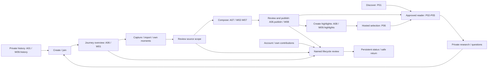

# Cross-surface journeys, shared screens and lifecycle workflows

> **Visual baseline, 6 November 2026:** [Fieldwork 1.0](../design/fieldwork-system.md) is selected through [DESIGN.md](../../DESIGN.md). Keep the functional, permission, connectivity and recovery contracts below. Apply Fieldwork to future compositions; remaining layout/container examples are interaction proposals, not approval of every screen.

Date: 5 November 2026. Status: consolidated design specification, not implementation or release evidence. Read this first when reviewing the complete screen set. It closes the boundaries between [mobile](mobile_workflow_specification.md), [creator web](creator_web_workflow_spec.md) and [public web](public_web_workflow.md). The [fresh design hub](../../DESIGN.md) owns future design choices and prototype planning; [requirements](../core/product_requirements.md), [selected decisions](accounts_journeys_access_decisions.md) and [architecture](../core/architecture.md) continue to own product policy, permissions and recovery.

## 1. Complete experience and screen ownership

There are three product surfaces and one shared account/lifecycle layer, not three separate products. They use one account identity, canonical journey, source-grant model and approved publication. Browser and native sessions are independently authenticated; moving between them never transfers a password or session credential.

| Person / job | Entry and ordered path | Completion / return |
| --- | --- | --- |
| Organiser starts a journey | Mobile A01 or web W09.history → E06 create → A06/W01 | One canonical journey, one private history reference; invite companions or capture/import. |
| Companion joins | Invite resolver E07 / A01.join → E01/E02 if needed → explicit Accept → A06/W01 | Same event; no gallery access, contribution or editorial powers implied by joining. |
| Participant contributes without editing | A04 personal moments or W09.contributions/W05 own-only mode → selected import → scope review | Owner controls selected sources; no draft/review-pool access is required. Return to own items. |
| Creator records offline | A02 → A03 local result → A04.queue → verified private cloud → explicit contribution | Local saving, backup, source scope and publication remain separate. Browser import has its own weaker file-retention guarantees. |
| Group composes | A07 focused tools or W02/W03/W04 → source inspection A04.moment/W05 → conflict A07.conflict/W07 when needed | Accepted draft revision; preserve other owners’ originals and unchanged approved narrative. |
| Publisher releases | A06.publish or W08 → exact candidate preview → final current-generation check → approved result | Read via P02; create highlights via A08/W09.highlights; listing submission is separate. |
| Friend experiences a share | External link → P06 or P02 → P03/P04 → P05 source → origin | Guest reading; explicit full-journey access from a highlight; no sign-in wall for public reading. |
| Prospective traveller researches | P01 → P02/P04 → R-note via E01 if needed → R-list | Private reference/note, never a completed trip. Start another journey through E06 with only the original reference. |
| Learner asks | P04.question → E01 if needed → explicit Submit → buffered answer/abstention → P05 → question | One authorized journey/version and account-scoped session; retained reading context, no auto-submit after login. |
| Source owner retains control | A04.moment/A09.contributions or W05/W09.contributions → named lifecycle review → E14/A06.operation | Denial, journal confirmation and cleanup are distinct; former owners never need the former workspace. |
| Administrator leaves/transfers | A06.people/W06 → transfer offer → recipient accepts → departure review | One administrator; no implied coauthor/publisher change; departure and source withdrawal remain separate. |
| Owner exports/deletes account | A09/W09 → permitted export/transfer if desired → E13 deletion → E14 outside auth | Others’ originals preserved; withdrawn owned reuse; minimal finite receipt after logout. |
| Visitor reports; operator acts | X-report → safe report receipt; restricted operator review → listing-only decision or scoped takedown | A report does not itself remove content. Listing removal and publication denial have different viewer effects. |

The diagram shows the main tasks; per-screen registers retain all alternate entries, permissions and Back paths. Public reading needs no membership. Research-to-create carries only a reference.

**Authority map:** A01–A09 own native compositions; W01–W08 own the shared-journey creator workspace; W09 owns private web history/account/source-management and personal presentation; P01–P08 own approved public discovery/reading. E01–E16 retain their existing account/access meaning. `L01`–`L16` below are named action contracts, not new top-level destinations or replacement canonical screen IDs.

### 1.1 Shared route and return contract

Private creator routes retain `/journeys/{journeyId}` and its `/sources`, `/story`, `/route`, `/learn`, `/people`, `/revisions`, `/publish` children. Proposed public routes use **`/stories/{publicationAlias}`** and `/stories/{publicationAlias}/sources/{approvedSourceId}`. This removes the collision between the previously proposed public `/journeys/:publicId` and private `/journeys/{J}`. Public aliases resolve to the same canonical journey; they do not create new journey identities. Final wire/route schema remains an implementation task.

Unlisted access uses a separate credential-aware resolver into the same approved reader, not a private workspace route or authorization-by-opaque-ID. Token storage, no-referrer, logging exclusion and rotation follow architecture §9.2. A preview remains an authorized candidate under W08/A06.preview, never an anonymous route to a draft. Public pages remain noindex under the current release baseline; noindex is not access control.

Preserve allowed journey/chapter/moment/view/filter/scroll context, origin and base version. Validate same-app return intents, hydrate auth before resolving them, and recheck current access on return. Do not put questions, notes, credentials, invite secrets, recipient emails or private source text in shared URLs. Sign-in never submits a question, joins a journey, saves a note, exports data or commits a sensitive action automatically.

Back/Cancel before submission returns to the real caller with inputs preserved or an explicit discard choice. Back after submission cannot undo the operation. An uncertain network outcome queries the same operation/command identity; it does not issue another destructive action. If the caller is no longer authorized, return to safe history/account/owner-source access, or P01 for guests. Cold links get a deterministic permitted parent rather than unconditional browser Back to another site.

Native ↔ web prototype continuation uses the named prepared fixture manifest and explicit “does not sync devices” copy. Production continuation re-fetches the same authorized canonical data in the destination’s own session. Neither path copies credentials, claims live sync from fixtures or copies an event into another owner’s history.

## 2. Shared web screens previously left as handoffs

These proposed W09 child IDs expand the existing canonical account/history screen. Retain E01–E16 functional responsibilities from the [account/journey handoff](accounts_journeys_access_design.md); do not implement competing auth or invitation systems. A narrow panel and full-page rendering can share an ID when their behavior and direct-link fallback match.

### W09.history — Your journeys

**Arrive:** global Your journeys, E01 default return, W01–W08 Back to journeys, completed leave/archive/status, safe unavailable exit. **Go to:** E06 create, E07 join, W01 permitted journey, E16 notices, W09.account, R-list saved research. **Back:** preserve history filters and scroll when returning from children; cold entry is a root.

**Elements/actions:** title, Create journey, Join with invite, role/status/year/category filters, scoped notices, unique journey cards and no-cover fallback. Count an event once despite several roles/shares. Show intended dates, not inferred completion. Former references are neutral, with no protected title/cover/place/roster. Distinguish loading, first-use empty, filtered-empty, stale/offline and refresh error; confirmed denial clears protected cached content. Authoritative history controls visibility, not a client-side filter over private payloads. Equivalent native: A01.

### E06 / E07 — Create and join from web

**Arrive:** W09.history, public X-new/R-list, valid invite link. **Go to:** E01/E02 for auth/verification; W01 only after confirmed create/explicit acceptance; Cancel to safe origin. **Elements/actions:** existing title/start/end/timezone/category form and validated invite-recipient review. Preserve source-reference-only intent for future journeys; do not copy media, dates, completed facts or membership. A public visitor signing in to create still fills the new event. Retry uses stable identity. Handle wrong recipient, expired/revoked invite, DST/invalid dates, offline and uncertain creation. Existing seven-day invite and explicit acceptance rules apply. Equivalent native: A01.create/A01.join.

### W09.account — Account hub and profile

**Arrive:** global account menu, W09.history, X-member own-profile management, safe status return. **Go to:** E10 profile/avatar, E11 sessions/security, W09.contributions, W09.export, E13 delete, R-list, W09.preferences, W09.public-profile, W09.highlights and W09.help. **Back:** restore invoker if permitted; otherwise history.

**Elements/actions:** private identity, labelled email, display-name/bio/avatar form and save state, sign-out and task links. Existing limits, sanitised avatar processing, initials fallback, profile-revision conflict and input retention apply. E11 identifies current/other sessions and supports explicit revocation/recovery; E04 refreshes identity only where policy requires it. Sign-out warns about unsent work, isolates account caches and never silently deletes/reassigns originals. Public fields require separate selection, not automatic exposure from profile edits. Equivalent native: A09/A09.profile/A09.security.

### W09.contributions — Your sources and contributions

**Arrive:** W09.account/history, W01 own-contribution action, former-owner notices, unavailable workspace’s separately authorized owner entry. **Go to:** owner source detail/import, source scope, exact-original request/approval, W09.export, L01/L02/L03, E14 and back to origin. An active participant can also use W05 own-only mode; a former member cannot use that mode to regain a workspace.

**Elements/actions:** owner-only library, upload/import, date/type/transfer filters, item inspector, selected-batch scope and per-source grants. Reuse W05’s selected-import/queue mechanics with an owner projection; no other-owner review pool, private roster or draft snippets. Import approved files privately before contribution; no upload on mere selection. Losing membership blocks scope expansion but preserves authorized owner restrictions/exports. Inaccessible destinations have neutral labels; owned source content is independently authorized. Missing browser handles require reselection, not a claim of mobile-grade durability. Equivalent native: A04/A09.contributions.

### W09.export — Permitted exports and downloads

**Arrive:** account, owned source/contributions, W01/W05 permitted export, E13 pre-deletion step. **Go to:** original-file permission panel for exact recipient/assets, L15 job/detail/download, E04 where required, source inspector or originating screen. **Back:** retains job identity and status; leaving does not restart generation.

**Elements/actions:** export type, exact scope, eligible/excluded items and reason, recipient/source grants and expiry where needed, independent-copy warning, Request export, refresh/status and authenticated Download. Profile JSON/managed-avatar export is not a full source/story archive. No payment gate on own data. Loading, nothing eligible, job failure, quota, stale policy, withdrawn source, expired grant and account loss have explicit states. Download controls recheck current rights; do not hand out permanent raw-bucket URLs. Equivalent native: A09.export/A04.export. Lifecycle: L03/L15.

### W09.highlights / W09.highlight-preview — Personal highlight creation

**Arrive:** W01/W08 approved result, public X-member for an eligible active member, account-owned share management. **Go to:** preview, permitted source inspection, P06 hosted result, P02 full approved journey, native/browser share where supported, L09 revoke, and back to origin. **Back:** preserve eligible selection and personal caption; invalidated items are removed with explanation.

**Elements/actions:** existing owned hosted-share list/status, select/revoke control, approved version, own attributed eligible default selection, explicit group-item choices/credits, cover, order, personal caption, plain-link fallback, visibility/forwarding disclosure and preview. Preview offers explicit Copy link, permitted card download and supported OS share; unavailable browser sharing falls back to copy/download. No auto-posting. P06 is the **read-only landing**, never the composer. Private draft/review rights do not qualify material for sharing. Empty selection, generation failure, withdrawn item, stale approval, lost membership and unpublished journey have useful recovery. Full-public-journey access and non-recall of external copies are shown before export. Equivalent native: A08/A08.preview; lifecycle L09.

### W09.public-profile — Optional public profile selection

**Arrive:** account/profile, own P07 via X-member. **Go to:** preview P07, permitted journey reader, L10 removal/disable and back to profile. **Elements/actions:** explicit field/avatar/credit choices, eligible public journey selections, separate private/public preview and Save. Private history, emails, unlisted journeys and a full member roster are excluded. Removing a selection does not leave/unpublish the journey; disabling profile does not delete the account. Failed save preserves choices; eligibility loss removes the card/count from public output. No public profile is required to contribute or receive attribution. Equivalent native: A09.profile; lifecycle L10.

### W09.preferences / W09.help — Preferences, limits and support

**Arrive:** account; public X-info or unavailable/status uses the public-safe help variant. **Go to:** account/origin, accessible help section, configured support channel; no hidden mutation on navigation. **Elements/actions:** System/Light/Dark, actual measured usage/configured limits when available, browser transfer preference if applicable, format/privacy/provider/retention guidance, app version and reviewed redacted diagnostics. Appearance controls and adapters will follow the new design decisions. Unknown measurements are unavailable, not zero. OS background restrictions, browser eviction and missing-file recovery are explained. No invented support address, legal certification, current travel advice or unlimited offer. Equivalent native: A09.appearance/A09.storage/A09.help.

### E12 / E13 / E14 — Lifecycle review, account deletion and status

**Arrive:** named L01–L16 invoker, direct allowed operation link, bounded post-deletion receipt. **Go to:** E04 reauth only if required, refreshed impact, Confirm named action, E14 result or safe origin; support on expired/uncertain status. **Back:** Cancel before submit; status after submit. Post-deletion status lives outside signed-in guards and must not redirect automatically into sign-in.

**Elements/actions:** action-specific resource/effect, permitted impact summary, retained data, required confirmations, current validity/revision, persistent status, Check status and authorized retry. Minimal receipt view is read-only and contains no protected account/journey identity. Do not collapse pending journal confirmation and byte cleanup. Concrete per-action rules follow in §4. Equivalent native: A06.lifecycle/A06.operation/A09.delete/A09.reauth.

### Restricted operator listing/report review

**Arrive:** authenticated operator work queue, listing submission or report receipt reference under scoped authority; never a public X-report receipt link that grants admin access. **Go to:** permitted current evidence, listing-only decision, separately scoped takedown/restriction status, queue and safe logout. A founder-operated runbook can supply this workflow; no new administration dashboard framework is selected.

**Elements/actions:** pending listing/report target, approved metadata/relevant authorized evidence, reason, current policy, review decision and audit/result. Approve a listing only while eligible; reject/remove a listing without claiming the story is unpublished. Rights takedown uses separate current authority and persistent restriction handling. Reports do not auto-grant access to private originals or enable reporters to remove content. Handle duplicate reports, target gone, lost authority, stale state and failed/pending decision. Operator identity, response policy and production channel need actual operational assignment before release. Lifecycle L14/L16.

## 3. One lifecycle state contract across every surface

### 3.1 Presentation and protocol

1. **Choose the exact action.** Exclude editorial placement, withdraw grant, delete source, leave, archive, unpublish and delete journey are different verbs and effects.
2. **Authorize and prepare impact.** Use current actor/action/resource/revision. Show only permitted consequences; an ordinary source owner gets safe affected-use summaries, not private draft text. The selected impact window is five minutes and becomes stale immediately on a bound-state change.
3. **Fresh identity if required.** Preserve intent through E04, then refresh impact/authority. Routine source withdrawal/narrowing and export-grant revocation must not be blocked by an unnecessary fresh-auth prompt. The server validates a ten-minute freshness window for capability changes, accepted administrative transfer, leave/removal/archive/deletion, original-export approval, credential/email changes and session-revocation controls as applicable. Broad byte deletion also requires fresh impact/confirmation. A fresh session does not bypass the five-minute impact window or revision checks. Reauth never confirms automatically.
4. **Explicit confirmation.** State what stops, what remains and which external copies cannot be recalled. Canonical deletion requires named-resource confirmation plus a second typed-title confirmation; no invented group vote/countersignature.
5. **Submit once.** Keep stable operation/event identity. An offline request is **Waiting to send**; an unknown response is **Checking result**. Neither proves server denial. Non-idempotent duplicate actions must not be triggered by Retry or Back/Forward.
6. **Apply server denial.** Restrictive commit atomically writes deny/policy generation/audit/retry job. Managed reads obey the deny immediately; cleanup/journal outage does not postpone it. Old jobs cannot reactivate superseded output.
7. **Confirm recovery separately.** Only the independent journal receipt establishes recovery-confirmed restriction. Until then show **Access denied; recovery confirmation pending**. Never invent receipt success from a timer.
8. **Track cleanup separately.** Confirmed restriction is not proof that bytes/PII and all backups vanished. Show the selected operational policy and actual state without promising remote erasure of downloaded files.
9. **Return safely.** Recompute allowed caller and notifications. Confirmed denial clears affected private payloads, titles, previews and positive access caches; generic unavailable does not explain protected existence. Preserve unaffected content only where dependency coverage proves it safe.

Pure local selection, unsaving a research note, profile presentation and report submission are not automatically journal-backed restrictions. Their exact domain adapters must apply the selected server rules; the UI must not manufacture a journal receipt for an operation that has none. Shared restriction status is reusable presentation, not a universal backend command.

### 3.2 Persistent status and recovery

| Visible state | Available next action | Required boundary |
| --- | --- | --- |
| Waiting to send | Reconnect/check, keep local intent, cancel unsent intent explicitly | Do not claim server denial or completed deletion. |
| Checking result | Query same operation identity | Do not repeat uncertain destructive side effects. |
| Access denied; confirmation pending | Check status; same-event retry only for currently authorized actor | Deny remains effective. Coordinator retries independently. |
| Restriction confirmed | Safe return; inspect separate cleanup status | Independent durable receipt, not inferred from UI navigation. |
| Cleanup pending / delayed / complete | Check actual status/support | Permission denial and journal confirmation remain separate facts. |
| Receipt unavailable/expired | Generic support/recovery guidance | No protected title/email/roster and no fallback bearer account session. |

The post-account-deletion receipt uses separate native SecureStore or per-operation path-scoped Secure/HttpOnly browser storage, not account Query/form state or URL secrets. It survives logout/account switching only within its selected finite window: 45-day hard validity, terminal status for seven days within that window. It is read-only. Production qualification must verify these selected limits. Losing the receipt does not authorize email/account enumeration or reopening deleted resources.

Restore/recovery replays independently recorded restrictions before reopening managed reads/exports. If journal history/tail is uncertain, stay closed. The consumer sees safe maintenance/status; the operator uses the [restriction recovery runbook](restriction_recovery_runbook.md). A UI prototype does not prove recovery.

### 3.3 Sign-out and account switching

A09/A09.security and W09.account/E11 show pending commands, unsent media and unbacked originals before sign-out. **Stay** cancels without changing the session. **Sign out and keep local work** stops account transports, cancels fetched queries, discards late responses and locks the account's local files/drafts/outbox from other accounts. It does not delete originals, complete uploads or silently assign work to the next account. Recover retained work only after the same account authenticates and current rights are checked. A removed account cannot regain a session; account deletion instead follows L12 and its cleanup policy.

This local-lock behavior is the proposed interaction contract; production must qualify storage isolation, secure key handling and actual persistence. Browser work can only claim recovery when persisted successfully; otherwise offer an explicit unsaved-work warning and Stay before logout. Device/app removal or browser eviction is not covered by a survival promise. Any later local-delete control requires a separate named impact/retention contract and must never delete the phone gallery. A bounded post-deletion receipt remains outside the account cache, read-only and independently expiring.

Ordinary session expiry/offline operation is different from explicit sign-out: an established native account can keep saving personal captures and drafts locally while remote work waits for same-account authentication. Confirmed permission denial clears protected shared projections, while separately owned unsent bytes remain isolated. Cold first-use anonymous capture is not selected.

## 4. Named lifecycle actions and screen connections

Each row includes the originating screens, required authority, review controls, result, destination and public effect. Every preview has Cancel to the exact still-authorized invoker; every submitted action has persistent status or an explicit completed local/account result. No operation is implied by opening a route.

| ID / action | Arrive from and authority | Review / controls | Result, next destination and public consequence |
| --- | --- | --- | --- |
| L01 Narrow/withdraw source reuse | A04.scope/moment, A09.contributions; W05 own item/W09.contributions. Source owner, including former member for restrictive action. | Exact source/journey grant, affected permitted uses, retained original, current audience; Confirm withdrawal/narrowing. | E14/A06.operation; source and dependent claims/media/geometry/shares/profiles/listings/search/answers denied under current policy, including old versions. Owner returns to own source; authorized editors get a repair notice. No silent deletion of owned bytes. |
| L02 Delete owned media | A04.moment/A09.contributions; W05 own item/W09.contributions. Owner only. | Distinguish local-copy cleanup from deletion of the owned source; cloud/contribution impact, last-copy warning, fresh auth where required, explicit confirmation. | Deny reuse and track cleanup via status. Other owners’ originals survive. Inaccessible source becomes safe unavailable; external downloads remain beyond recall. Never delete phone-gallery originals through cache cleanup. |
| L03 Revoke original-export permission | A04.export; W05/W09 exact-original permission panel. Grant owner or selected restrictive domain rule. | Exact recipient/assets/expiry, existing archives, metadata/external-copy notice; Revoke permission. | Status then grant detail; generation and every managed download/range denied under current grant state. Does not itself withdraw publication reuse. Recipient gets a safe unavailable export; downloaded bytes cannot be recalled. |
| L04 Leave journey | A06.people/lifecycle; W01/W06. Self member. | End own powers; source grants separate; administrator can offer transfer first or explicitly accept no-successor freeze. No forced withdraw checkbox. | History shows only permitted former reference; owner controls via Your contributions. No more protected editing/new member-only shares. Existing public access follows ordinary visibility; leaving alone does not unpublish or delete. |
| L05 Remove member / narrow powers | A06.people/powers; W06. Current administrator. | Named member/power, current impact, source-owner rights retained, scoped audience changes; Remove or Save reduced powers. | E14 where restrictive confirmation applies; clear removed authority and old outstanding offers; do not delete owned sources or assume public content is secret from that person. Remaining powers/source grants follow their independent rules. |
| L06 Transfer administration | A06.transfer; W06 transfer; E13 continuity entry. Current administrator offers to eligible existing active coauthor; recipient explicitly accepts. | Current/successor identity, offered admin power only, 72h expiry; Offer/Accept/Decline/Cancel. | Pending offer is not transfer. Acceptance leaves exactly one administrator without changing editorial/publisher powers. Return to People/E13 for a refreshed next action; new invitation cannot smuggle a member into an archived journey. |
| L07 Archive | A06.lifecycle; W01/W06. Current administrator. | Collaboration closure, retained permitted reading/export, no implied unpublish/delete; explicit Archive. | Status/archived overview. New contribution/edit/event correction/invite/acceptance/scope or capability expansion/new publication stops. Restriction and eligible existing-coauthor transfer remain. Exact-original approval for already contributed assets can remain under separate checks. No unarchive control in selected baseline. |
| L08 Unpublish / narrow visibility / rotate or revoke unlisted access | A06.publish/lifecycle; W08. Current designated publisher; scoped operator for authorized takedown only. | Show current/target audience, affected links/managed surfaces, stale generations, confirmation; issuance of replacement link separate from revocation. | Status then publication controls. Old authorized-link access is denied; new access resolves current policy. Catalog/profile/saved previews and answers reauthorize. Unpublish affects all managed publication views; public→unlisted removes public discovery but only the deliberately issued authorized link can read. Neither action alters private draft/source ownership. |
| L09 Revoke hosted personal share | A08.preview/member share management; W09.highlight-preview. Share creator with current management authority, or selected publisher/operator restriction path affecting the underlying publication. | Exact share and canonical journey distinction; revoke hosted link/card availability; external-copy warning. | Status/result then share list or safe origin. P06 becomes unavailable; canonical public story can remain readable. Source withdrawal/unpublish can suppress a share independently. Other people’s shares are not owner-editable by default. |
| L10 Remove public-profile selection / disable profile | A09.profile; W09.public-profile; X-member. Profile owner. | Exact selected fields/journeys; preview and explicit remove/disable. | Profile/save result; removed cards/counts disappear and disabled P07 is unavailable. Canonical journey and account remain; explicitly approved contributor attribution is not automatically erased or turned into a profile link. |
| L11 Unsave research / delete private note | A09.research; R-list/R-note. Reference/note owner. | Distinguish remove bookmark+note from editing/clearing a note; confirmation for losing a nonempty note; preserve on failure. | Return to retained research filters or reader; empty-state action → P01. Does not leave/delete/unpublish the source event or remove someone else’s saved reference. |
| L12 Delete account | A09.delete; W09.account → E13. Account owner, fresh identity and current impact. | Owned sources, issued/received export grants, offers, sessions, admin continuity, optional export and accepted-transfer/no-successor freeze; explicit confirmation after refreshed impact. | Revoke account access and withdraw owned-source reuse under selected D10; preserve others’ originals/canonical work; E14 outside auth tracks receipt/cleanup. No “keep my sources shared” option. New registration cannot resurrect old identity/grants. |
| L13 Delete canonical journey | A06.lifecycle; W01/W06. Sole current administrator; coauthor/publisher alone insufficient. | Named event/global reference effect, retained personal originals, fresh auth/current impact, resource confirmation plus typed title. | Status then safe history; all canonical references/listing/managed publication/shares unavailable. Do not delete other owners’ personal originals or require invented group countersignature. |
| L14 Submit/review/remove catalog listing | A06.publish/W08 submission; restricted operator queue for approval/removal; publisher withdraws own listing request where allowed. | Current public eligibility, approved metadata, request/reason and separate listing/publication states. | Pending/listed/rejected/removed status shown only to authorized creator/operator. P01 removes ineligible entry; direct P02 remains accessible if publication still public. Separate takedown follows L08. Recheck eligibility before any listing decision; no creator self-approval. |
| L15 Generate/download permitted export | A09.export; W09.export; original-grant detail. Owner or current explicitly entitled exporter. | Exact format/content/recipient/rights, source revisions and expiry; independent-copy and raw-metadata notice; Request export. | Bounded profile JSON can download directly without an archive job; heavy source/story exports use a durable bounded job/status, then authorized download. Revalidate at generation/activation/GET/HEAD/Range. Grant expiry, withdrawal, departure or stale job invalidates artifact; no direct bucket bypass. Retry same job identity; no fabricated archive on failure. |
| L16 Report content / request operator help | X-report from P01–P08, account support or safe unavailable/status; guests can report permitted target. | Opaque target, reason, description, optional reply contact, actual limits/retention and Submit/Cancel. | Safe receipt + origin; reporting is not takedown or a public comment. Restricted operator resolves through L14/L08 as applicable; failed submit retains text, receipt exposes no private evidence or admin link. |

### 4.1 Frozen and archived states are not interchangeable

No-successor freeze blocks role expansion, new publication and visibility widening under selected policy. It does **not by itself** close all editing, own capture or existing-grant contribution. Evaluate each operation against current membership, capability, grant and explicit freeze restrictions. Archive deliberately closes collaboration and also blocks event-detail correction. It invalidates pending invitations and expansion offers, blocks new acceptance and scope/capability expansion, and permits fresh accepted transfer only to an existing eligible coauthor. Owners may still approve exact-original export for already contributed sources under current grant/recipient rules; archive is not an export ban. Neither state prevents owner restrictions or authorized visibility narrowing. No ordinary “claim orphaned administration” or unarchive button is selected. Audited operator recovery cannot transfer source ownership or erase restrictions.

### 4.2 Redaction versus editorial repair

Owner source scope controls reuse; coauthor controls permitted draft edits; publisher controls activation and visibility restrictions. A publisher-only actor cannot edit a private original or grant another person’s rights. Privacy review routes geometry/text/media repairs to their authorized owner/editor and regenerates the exact safe projection. After withdrawal, a coauthor repairs affected narrative with independently permitted evidence, not by recreating the withdrawn fact in free text. Ordinary draft changes require republish; restrictive policy suppresses unsafe old output immediately.

### 4.3 Presentation-only actions and browser/native return

Excluding a placement from a draft is an editorial edit with revision/conflict handling, not L01 or L02. Cancelling an upload preserves the local original and is not source deletion. Removing a public-profile card is L10, not L08. Unsaving research is L11, not L04. Sharing an approved card does not grant raw-original access. Use these exact verbs on mobile, creator web and public support surfaces.

Guest P08 may result from a deleted/withdrawn/private/unknown resource without naming which protected fact caused it. Preserve an unaffected surrounding journey only where proven safe. A transient network failure gets Retry with retained safe context, not a false deletion message. A signed-in source owner can independently navigate to Your contributions, but P08 must not reveal ownership through an unauthenticated hint.

## 5. Shared components and complete-design disposition

| Component / state | Screens | Required design detail |
| --- | --- | --- |
| Impact review | L01–L08, L12–L13 as applicable | Named verb/resource, current scope, retained data, safe affected-use summary, validity, Cancel/Confirm, fresh-auth return. |
| Persistent operation status | E14/A06.operation | Waiting-to-send, uncertain, denied/pending receipt, confirmed, separate cleanup, authorized retry/read-only check, receipt expiry. |
| Transfer offer and acceptance | W06/A06.transfer, E13 | Eligible coauthor, single administrator, expiry, offered versus accepted, cancellation/race, no-successor explanation. |
| Export grant and job | W05/W09.export, A04.export/A09.export | Exact assets/recipient/source revision/expiry, approval/revocation, queued job, blocked download, independent-copy limits. |
| Personal presentation | W09.highlights/public-profile, A08/A09.profile | Approved eligibility, source credit, explicit selection, private/public distinction, revoke/remove controls. |
| Listing/report operator task | Restricted queue/runbook | Evidence access, reason, eligibility/version, listing-only versus takedown outcome, receipt/audit, safe creator notice. |
| Unavailable and stale context | P08/E15/all affected caller screens | Remove protected title/cover/coordinates/counts; safe Back; refresh/reauth only when useful; no unvalidated redirects. |

Every action above needs at least an interactive review/confirm/result/cancel and one consequential failure state in the complete prototype. Sequence implementation around the main capture-to-publication walkthrough, but do not mark a supporting lifecycle row “covered” solely because a menu item exists. Prepared outcomes must carry explicit sample labels; no actual account deletion, upload, mail, export, share posting or journal writes are triggered by prototype controls.

## 6. Combined review scenarios

1. Join from external invitation on web and native; verify explicit acceptance, same canonical history and no accidental gallery/source contribution. Cancel auth returns to safe origin without losing bounded intent.
2. Ordinary participant imports on web without installing native app or receiving coauthor powers; reaches own-source scope, export and withdrawal without another owner’s library/draft.
3. Five members compose one journey; source inspection returns to exact chapter/detail; admin-only sees no draft; publisher-only can review/activate but not edit.
4. Publish version 1, edit draft, then create native/web highlights from version 1. Public P06 remains read-only and can open the full eligible journey; no second listing/index.
5. Enter public `/stories/...` and private `/journeys/...` on cold navigation and refresh. Public reader never resolves the private workspace payload. Unknown aliases/selections follow safe fallbacks.
6. Save research, sign in, explicitly save the note, return, then create a new departure carrying only a reference. Unsave/clear note affects neither membership nor source publication.
7. Request exact originals; owner approves, recipient starts export, then grant expires/is revoked or recipient leaves. Job activation and subsequent managed/range download deny; previously downloaded bytes cannot be recalled.
8. Withdraw offline: waiting-to-send only. Server commits deny, journal is unavailable: managed outputs denied with confirmation pending. Retry/relaunch/Back never restores access or doubles the action.
9. Withdraw a source appearing in story, route bounds, practical detail, listing/profile preview, personal share, citation and stored answer. Test old versions/links, generation-in-flight and safe partial fallback.
10. Offer transfer, cancel/expire/race it, then accept with exactly one administrator. Separately test leave with no successor, archive, remove member and canonical deletion; each has different permitted outputs.
11. Archive allows existing authorized reading/export/restrictive controls, blocks new collaborative work, and permits only the selected existing-coauthor transfer. No-successor freeze is tested separately so it does not accidentally inherit the archive matrix.
12. Delete an account with a source and administrator responsibility; handle transfer or freeze, owner-reuse withdrawal and logout. Limited E14 status survives relaunch/account switch without loading protected account data; expired receipt goes to safe support.
13. Revoke only a hosted highlight, remove only a profile card, remove only a catalog listing, then unpublish. Verify that the first three do not silently delete the canonical public journey, while unpublish denies managed publication access.
14. Report available and unavailable content as a guest; retry failed submit; inspect safe receipt. Operator separately removes listing or applies an authorized takedown, with audit and current-policy checks. No report grants moderation or private-source authority.
15. Stale impact after reauth, double-submit, network timeout after commit and browser/native Back all preserve command identity and require refreshed current policy before any new mutation.

These supplement the [full-product acceptance scenario](../core/product_requirements.md#20-acceptance-scenarios-and-definition-of-done); they do not replace it. Verify actual native durability, server authorization, derivative/media payloads, restore replay and provider behavior in production integration. Prototype transitions demonstrate understanding and connectivity only.

## 7. Final document set and maintenance

Keep this shared specification plus the three platform specifications as the final workflow set. DESIGN.md connects the new design process; workflow review records functional specification checks. Avoid duplicating lifecycle policy separately in every screen: link here and the selected decisions, while retaining platform-specific entry, components and return behavior.

All proposed route/child-screen choices remain reviewable business/interaction decisions. Numerical retention/expiry values copied from selected decisions are targets to qualify, not independently verified promises. Public domain, support/moderation staffing, actual legal copy, media/language/device limits and operational credentials remain explicit release inputs. No extra design subscription, application framework or administration product is introduced.

Temporary context dumps, one-off document generators/checkers and redundant intermediate validation output can be removed after concise results are recorded in [workflow review](workflow_review.md). Preserve governing documents, historical accepted implementation/review evidence, source fixtures and relevant technical evidence. This cleanup does not remove installed skills, native output, host environment/signing files or unrelated `.kairn` backups.

## First connected static wireframes — 5 November 2026

Artifact: [flow-wireframes.pen](../../design/flow-wireframes.pen). Start at canvas frame **00 / OjON2**, then follow numbered frames and the adjacent review annotations. This is a **static flow wireframe**, not a clickable prototype. Pen's installed schema/execute API exposes no frame-navigation interaction primitive; a text `href` does not establish prototype transitions. The overview has drawn arrow connectors and each frame has explicit forward, Back/Cancel, entry, actor, state and accessibility notes outside its product UI.

Review status **S** below means static contract/connection review and structural canvas check completed, with representative rendered screens inspected. It does not mean user-approved interaction design, runtime/device acceptance or individually exercised accessibility. N = native shared Android/iOS review size 390 × 844; W = browser review size 1280 × 900. Aliases on a wide frame are functional equivalents, not an additional drawn native composition; compact/wide adaptations remain open. A state under an existing ID is not a new page requirement.

All content and outcomes are fictional/simulated. Inter, grayscale, rectangle controls, dimensions and spacing are disposable wireframe choices. They establish no visual system. Frame-level annotations carry state reuse and alternatives; they do not claim actual durable saving, upload, email delivery, publishing or deletion.

| Frame / Pen node | Screen IDs and task/state | Drawn size | Actor / source state | Notes node | Review |
| --- | --- | --- | --- | --- | --- |
| 28 / `fgskj` | A09.contributions / E15 — Your own contributions | N | Arun; former member / source owner | `A9Jds` | S |
| 29 / `pvUGq` | A04.export — Original-file permission | N | Arun; source owner | `wZKKh` | S |
| 32 / `KImvn` | A07 / X.web / E01 — Continue in creator web | W | Leela; native authenticated | `xGZTj` | S |
| 49 / `Hmjs4` | W08 / A06 — Publication approved | W | Dev; publisher · simulated success | `yLXMf` | S |
| 50 / `C3mig` | W08 — Discover listing status | W | Dev; publisher | `o5YLT` | S |
| 56 / `oZPC5` | A08 / W09.highlights — Choose your highlights | N | Arun; active participant; approved V1 | `iikbx` | S |
| 57 / `GUxwL` | A08.preview / W09.highlight-preview — Preview your highlights | N | Arun; active member | `T4d8ft` | S |
| 58 / `M6R5ee` | A08.preview / W09.highlight-preview — Share explicitly | N | Arun; hosted selection ready (simulated) | `lNIgy` | S |
| 59 / `iXtMm` | P06 — Arun’s highlights | W | Guest recipient; read-only | `qPqib` | S |
| 60 / `pixLN` | P05 / P06 / P08 — This content is unavailable | W | Guest; withdrawn source/share or denied journey | `fH2dK` | S |
| 64 / `ejLTk` | W09.highlights / W09.highlight-preview — Create personal highlights | W | Arun; browser authenticated active member | `P5bLr` | S |
| 65 / `kteiW` | A09.contributions / A04.scope — Restrict an existing contribution | N | Arun; former member, source owner | `p9EJs` | S |
| 66 / `GUF9G` | E12 / E14 / A06.lifecycle / A06.operation — Withdraw source reuse | N | Arun; source owner | `UBNn6` | S |

### Connected scenario and bounded review result

One event, **J-NIL — Rain and rest in the Nilgiris**, intended 12–15 October 2026 in Asia/Kolkata. Maya begins as creator/administrator/coauthor/publisher; Arun accepts a participant-only invitation and owns the sample moments. Leela (coauthor) and Dev (publisher only) have already accepted separately scoped offers. Switching the reviewer between those actors is a scenario transition, never an in-product role switch or a grant of powers. No public roster is implied.

The main path is 01–07 create, or 01/03/11 explicit join → 08 → 13–18 capture, or 23–26 selected import → 20/21/27 scope review → authorized coauthor 30/31 → 32 independently authenticated browser → 33–40 composition and conflict recovery → publisher 41–48 review/repair/exact candidate → 49 approved publication. Frame 50 separately submits the catalog listing; 51 is a later **operator-listed** scenario, not the result of pressing Submit. Guest 51–55 reads the approved record; active member 56–58 (web 64) creates and explicitly shares highlights; recipient 59 reads and opens the same accessible journey in 52.

Chapter **Waiting out the rain**, stage **Coonoor rest**, source **S-VOICE**, candidate **C2** and approved version **V1** have distinct identities. Rain photo and the short weather text are publication/share eligible. The voice note remains journey-review only; the rights repair excludes its placement and dependent taxi claim, not the owner's original. The candidate/public Learn view therefore omits the taxi amount. A participant-specific reported road return never becomes an exact measured path. Unknown times/location and the no-GPS rest stage remain useful content.

Bounded review covered each required path A–E from the task, including auth return intent without auto-acceptance, explicit batch approval, input retention, unknown-operation reconciliation, private/source/export boundaries, source-return context, publisher/coauthor separation, stale approval, optional maps and read-only recipients. Corrected findings: font unsupported by Pen; frame references leaking into action labels; synthetic stale-save action; former-member expansion route (now 28 → 65 → 66 → 28); ambiguous publisher-to-editor handoff (actor/capability annotation required). Pen's settled layout query returned **zero clipped nodes**, zero placeholder frames and **133 top-level frames: 66 screens, 66 annotation panels, one connected overview**. Representative account, capture, composition, contribution, candidate, recipient and owner-restriction renders were inspected. Source save/reopen and local whitespace checks are recorded with the design hub. No application tests were appropriate for this artifact/documentation-only change.

All screen transitions are annotations; static review cannot prove runtime focus, typography growth, persistence, source enforcement, delivery or map behavior. Failure variants that retain the same structure are annotated, not separate drawn destinations. OS picker/settings/share are explicit external boundaries, not replicas of operating-system screens. Native and browser sessions authenticate independently; the prepared fictional continuation does not sync devices.

### Remaining decisions and undrawn scope

Reversible proposals: phone 390 × 844 and wide web 1280 × 900; form/page rather than modal composition; explicit map loading with list-first Explore; retained candidate comparison; selected chapter/stage/moment return context. Final shell, responsive breakpoints, keyboard/safe-area behavior, text-growth layout, exact editor schema/limits, chapter-stage association commands, transcript-correction authority details, publication conflict/redaction projection rules, URL shape, Discover ordering and format/storage/transcription qualification remain open. No new domain policy or command is established by a wireframe control. Detailed owner transcript editing was undrawn at the initial checkpoint; R04/R20 below now cover the owner-only proposal. Reviewer inspection still grants no transcript-writing authority.

Still undrawn as dedicated destinations/compositions: native notices, metadata correction, full People/power/transfer tasks, revision history/restore, account hub/profile/security/recovery/reauthentication, saved research, storage/appearance/help, complete exports and account deletion; creator W06 management (native invite/status equivalents exist), full W05 browser import/transfer/original-grant panels, W07 historical restore, other W09 account/research/profile/export/preferences/help tasks; public P04.search and P04.question, P07, R-list/R-note, report/help/policy flows and restricted operator tooling. The initial flow used wide equivalents for native conflict and candidate modes; R09N and R12N/R13N/R15N now draw the focused repair-conflict and native candidate modes. General revision-history/restore remains undrawn. Compact public web, tablets, landscape, standalone browser account/create/join forms and exhaustive actor/state variants remain undrawn. Lifecycle actions beyond the narrow owner withdrawal scenario remain mapped in the specifications, not completed by this artifact.

**First-flow recommendation, now executed below:** refine the source-scope → publication blocker → authorized repair → refreshed candidate loop at native and compact-browser sizes, including owner transcript correction, publisher-only inspection, large text and keyboard/focus return. Keep visual styling provisional until the user selects a visual direction. This is not a resumption of any withdrawn prototype milestone.

## Scope-to-preview refinement — 5 November 2026

Continue in [flow-wireframes.pen](../../design/flow-wireframes.pen), overview **R00 / `OLIDE`**. The R labels are artifact/state references, **not new canonical screen IDs**. This refinement adds 21 paired native/compact-browser states (42 screens and 42 external annotation panels). Original first-flow frames remain intact and their relevant annotations point here. The detailed loop below supersedes their schematic treatment for this task only; unrelated canvas work is preserved.

All ordinary frames use a **390 × 844** native or browser content viewport. R19 uses 200% text and a **390 × 1316 full scroll-content capture** for that same 844px viewport. R20 is a scrolled editor fragment with a 300px keyboard-occlusion allowance; its actions end at y=388, above the y=544 occlusion boundary. Browser chrome/OS keyboard are not app-owned drawings. These are temporary review sizes, not selected breakpoints or typography.

Status **S** = static contract review, settled canvas bounds check, and representative screenshot inspection; no runtime/accessibility certification. Every screen has entry, action, caller-specific return, actor/current source state, failures and focus notes outside product UI. N/W are platform equivalents of the existing A/W/E responsibilities.

| Artifact / Pen node | Existing screen responsibility and state | Actor | Size | Notes node | Review |
| --- | --- | --- | --- | --- | --- |
| R06N / `ah1u9` | A06.publish — Publication is blocked | Dev · publisher only | 390 × 844 | `W5SkEp` | S |
| R06W / `b4WarO` | W08 — Publication is blocked | Dev · publisher only | 390 × 844 | `P6uAa` | S |
| R07N / `cYNA5` | A06.publish — Repair the rights blocker | Leela · coauthor, not publisher | 390 × 844 | `fYxoV` | S |
| R07W / `S3T8z` | W08 — Repair the rights blocker | Leela · coauthor, not publisher | 390 × 844 | `rDg4S` | S |
| R08N / `VchU3` | A07.chapter / A07.knowledge — Exclude the affected uses | Leela · coauthor | 390 × 844 | `KRado` | S |
| R08W / `Z3mZnS` | W02 / W04 — Exclude the affected uses | Leela · coauthor | 390 × 844 | `HUN8b` | S |
| R10N / `zygcj` | A06.publish — Preparing a fresh preview | Dev publisher / Leela reviewer | 390 × 844 | `zRrNV` | S |
| R10W / `fBGR0` | W08 — Preparing a fresh preview | Dev publisher / Leela reviewer | 390 × 844 | `i5WK2` | S |
| R16N / `rbl1Z` | A06.publish / A06.preview — This preview is out of date | Dev · publisher | 390 × 844 | `t0RKFI` | S |
| R16W / `FAHfZ` | W08 — This preview is out of date | Dev · publisher | 390 × 844 | `p3TH7M` | S |
| R18N / `RCfYi` | A06.unavailable / E15 — This task is unavailable | Current account lacks required access | 390 × 844 | `G82hi` | S |
| R18W / `oAsxq` | E15 — This task is unavailable | Current account lacks required access | 390 × 844 | `mkhGo` | S |
| R21N / `t1WWh` | A07 / X.web — Continue the repair | Leela · coauthor; separate device/browser sessions | 390 × 844 | `a97dsP` | S |
| R21W / `nogEX` | E01 / W02 — Independent browser sign-in and repair return | Leela; browser initially signed out | 390 × 844 | `B16ou` | S |

### Refined interaction contract and walkthrough

1. **Owner scope (R01–R03):** review each selected owned source independently. The sample mixed batch retains the rain photo's publication eligibility and the voice note's review-only grant; “Keep these scopes” is honest because no change was selected. Changed-selection variants name Before/After and require confirmation. Selecting a narrower grant enters the existing impact/status flow (66), not a silent ordinary save. Staged-import scope returns to batch approval without upload or grant activation. Audience changes preserve the proposed choice and require renewed review; current-role assignments do not imply original export.
2. **Owner transcript (R04–R05):** Arun corrects “Sixteen hundred each” to “Sixteen hundred for all four of us” against audio at 00:08–00:14. Original text/audio/provenance remain. Scope and publication are unchanged. Known failure retains the correction; uncertain result checks the same operation. R14 is the later acknowledged-correction scenario, not evidence that merely opening R05 saved it. Source language, processing support and broad correction command details still need qualification.
3. **Capability-specific blocker (R06/R07/R14):** Dev can inspect and approve, but cannot repair draft or grant Arun's rights. Leela can inspect permitted evidence and enter editorial exclusion, but cannot approve publication. These are separate authenticated actor scenarios, never a user-facing role switch. No new “request permission” messaging command is introduced. Direct owner access does not expose protected draft dependencies.
4. **Repair and return (R08–R10):** remove the voice placement and its dependent taxi claim; retain original recording and other permitted material. Saves respect each actual entity revision. This proposed aggregated consequence view does not establish an atomic multi-entity command: partial acceptance remains visible and preview stays blocked until all required repairs are accepted. R09 retains the candidate and Maya's unrelated paragraph; reapply rechecks the current revision, never force-overwrites. Return restores the Rights issue and rebuilds a safe candidate; accepted repair is not yet a ready preview.
5. **Exact refreshed preview (R11–R17):** Story, Explore and Learn all inspect C2, with selected chapter/rest stage preserved. Review-only voice material and the dependent taxi amount are absent, including the question-source manifest. No-GPS rest and reported participant branch remain explicit. Map loading is optional; failure retains the complete stage list. Publisher-only final action names Public/Unlisted accurately and rechecks current candidate, grants, privacy and capability. Coauthor projection omits approval. Listing is still separate. Draft/rights race invalidates the preview (R16); lost authority removes protected information (R18). A source-return path restores exact origin and rechecks freshness.
6. **Native/browser handoff (R21N/W):** native unsaved-work gate offers Save before continuing, explicit Continue with shared draft, and Stay in native editor. Save must be confirmed before the successful variant offers Open creator web. Continuing without saving retains the native candidate and warns that the browser starts from the latest accepted shared revision. Browser sign-in/verification is independent and returns to authorized R08W without submitting exclusions. Account change, expiry, cancelled auth and denied access cannot silently restore authority or lose native work. The fixture does not synchronize devices.

### Bounded review and remaining decisions

Reviewed these paths against requirements COL-01–03/COL-06–07, PUB-01–03/PUB-07–08, ASK-02, creator W05/W08, mobile A04.scope/A04.moment/A06.publish and shared lifecycle §§1.1/4.2. Fixed findings in place: single-source versus mixed-batch context; retained option after audience race; browser continuation incorrectly displaying native wording; unsaved handoff incorrectly assuming a confirmed save. Kept transcript-correction controls owner-only and publication controls publisher-only. First-flow related notes link to the detailed R frames.

Canvas verification: **218 top-level frames = 108 screen/state frames + 108 external annotation panels + 2 overviews**. Settled bounds report zero clipped nodes, zero overlapping top-level frames, zero unfinished placeholders. Representative owner scope, publisher blocker, coauthor repair, fresh review, independent browser sign-in, keyboard and 200% text renders were inspected. Source saved and closed/reopened in VS Code, then checked using a fresh registered Pen MCP client. Local references and whitespace checked. No application, browser runtime, screen-reader, native durability or publication-service test was run or claimed; application implementation remains later.

Remaining interaction decisions: final navigation shell/viewport adaptation; exact owner-transcript correction command/schema and processing support; aggregation of multi-entity repair saves; how original-versus-corrected evidence is exposed in a finalized inspector; actual persistence/eviction behavior; implemented focus/keyboard behavior. Current controls are reversible interaction proposals under existing authority, not selected policy changes or a visual system. Compact public reading, general historical restore, remaining account/lifecycle tasks and the broader inventory previously listed are still outside this refinement.

**Next bounded task:** walk through R01–R21 with owner, coauthor and publisher scenarios, settling scope wording and the exclusion/return interaction before choosing visual foundations or implementing an interactive prototype. This static refinement does not establish clickable navigation; connectors and explicit transition annotations remain the review mechanism.

## Fieldwork component system — 6 November 2026

Fieldwork 1.0 is selected. The [system](../design/fieldwork-system.md), [catalogue](../../design/fieldwork-system/catalog.json), [registry](../../design/fieldwork-system/manifest.json) and [qualification record](../design/fieldwork-verification.md) accompany [fieldwork.pen](../../design/fieldwork.pen): 45 boards FW00–FW44, 50 used components, eight optional specimens and 22 Kairn patterns. These are reusable states and compositions, not new screen IDs or destinations.

The existing R01–R21 wireframes retain complete scope/repair/preview contracts. Preserve local save, private backup, contribution, source scope, original export and publication as independent facts. Static component coverage is not runtime durability, authorization or accessibility acceptance.
